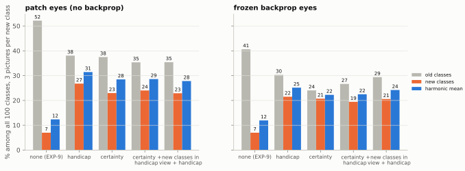
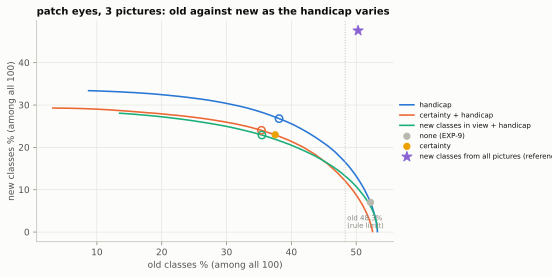
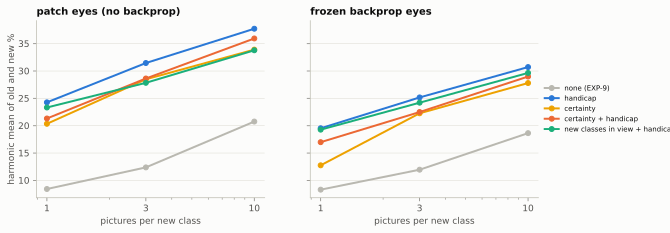
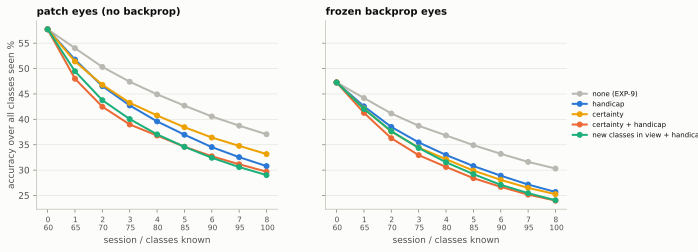
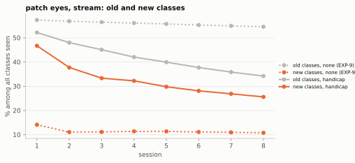

# EXP-10 · NEW CLASSES AMONG OLD ONES

**Experiment ID:** EXP-10 · **Part A written:** 2026-11-17, before any code was run · **Hardware:** free Kaggle GPU (the method must still fit the RTX 3050 laptop, 4 GB) · **Status:** COMPLETE. Run and Part B added 2026-11-17. Result: "does not work" by the written rule: the best balance (harmonic mean 31.5) was reached only by letting old classes fall from 52% to 38% (section 12)

This journal has two parts. **Part A** (this part) explains the experiment before it starts.
**Part B** will be added to the end of this same PDF when the experiment finishes. Part A
will not be edited after results exist, except for the status word in the line above.

## 1. Why this experiment

### What happened before

The project thinks of a learning system as two parts: the **eyes**, which turn a picture into
a list of numbers describing it, and the **memory**, which stores what was learned about
each class and gives the answer.

- **EXP-1** was a plan only. It was never run.
- **EXP-2 to EXP-6** used eyes trained by backpropagation. The best system that keeps no old
  pictures (grow and lock) reached 39.6% on the 80-class photo test.
- **EXP-7 and EXP-8** built eyes with no training at all (1,600 fixed picture patches) and a
  memory of class averages (**cards**) plus one **shared table**. They reach 55.2% on 80
  classes, 6 points under a fully retrained network (61.1%), forgetting nothing, in about
  24 seconds. But a new class learned from 3 pictures scored only 17.0%.
- **EXP-9** fixed that. From the cards and the shared table it computes a **learned view**:
  the few directions along which the known classes differ most. New pictures are described
  through it, and each new card borrows a little from its 2 nearest known cards. Readings, 5
  seeds (from `EXP-9-FEW-PICTURES/results/summary.json`):

| 20 new classes, among themselves | 1 picture | 3 pictures | 10 pictures |
|---|---|---|---|
| Patch eyes, plain cards (EXP-8) | 12.1% | 17.0% | 22.9% |
| **Patch eyes, learned view + borrowing (EXP-9)** | **23.3%** | **33.5%** | **44.2%** |
| Grow and lock (EXP-8) | 19.4% | 29.8% | 41.1% |
| Retrain everything (EXP-8, keeps all pictures) | 25.4% | 38.5% | 51.5% |

### What stayed open in EXP-9

Those scores are for new classes **competing only with each other**. EXP-9 also ran one check
where the 20 new classes (3 pictures each) join the 80 known classes (500 pictures each) and
every picture must be named among all 100:

| Patch eyes, all 100 classes together | Known classes | New classes |
|---|---|---|
| Learned view + borrowing (EXP-9's way) | 52.2% (53.3% before the new ones joined) | **7.1%** |
| EXP-8's shared table | 54.2% | 0.05% |

So the new classes are **drowned out**: when a picture of a new class is shown, a class
learned from 500 pictures usually wins. A real system always meets a new class in the company
of everything it already knows, so the few-picture result of EXP-9 cannot yet be used.

### What the papers say

A literature pass for this experiment (literature log, section 9; all read as passages, not
full papers) found that this is a known problem. In one paper (Gidaris and Komodakis,
arXiv:1804.09458) a classifier scores 72.8% on new classes alone and 70.7% on old classes
alone, but 51.9% when both compete. Two closed-form remedies came up:

- **Calibrated stacking** (Chao et al., arXiv:1605.04253): subtract one fixed amount from
  the scores of all old classes, with the amount chosen by pretending some old classes are new.
- **Fair comparison by certainty**: a card made from 3 pictures sits farther from its own
  pictures than a card made from 500, simply because it is a rougher average. Distances can
  be corrected for that. The exact form used here was derived by the reading subagent, not
  taken from a paper.

The usual single score when old and new classes compete is the **harmonic mean** of the two
accuracies (Xian et al., arXiv:1707.00600). It is high only when both are high.

### So EXP-10 asks

**Can a few single calculations let classes learned from a few pictures hold their place
among classes learned from hundreds, without spoiling the old ones? And does the whole
system still work when new classes keep arriving, a few at a time, with a few pictures each?**

# Part A: the plan (written before the run)

## 2. The idea in plain words

**Cats and digits example.** A child has seen hundreds of cats and dogs, and then 3 pictures
of a fox. Shown a new fox picture, the child compares it with its memory of cats, of dogs and
of the fox. The cat and dog memories are smooth and well-rounded; the fox memory is three
snapshots. The fox picture will often look "a bit like a dog" and "a bit like the fox
snapshots", and the dog wins because the dog memory is so solid. Two fixes:

1. **A handicap.** Tell the child: "you know dogs so well that you are biased towards them;
   only say dog when it is clearly a dog." That is one fixed amount taken off every old
   class's score.
2. **Judge by certainty.** Tell the child: "your fox memory is rough, so a real fox will look
   less like it than a real dog looks like your dog memory. Allow for that." That is a
   correction that depends on how many pictures each class was learned from.

A third idea is to **let the new classes shape the view**: recompute the "which details
matter" directions with the new classes included, so the view also separates the fox.

## 3. What is run

### The system

Exactly EXP-9's: patch eyes (1,600 fixed patches, no backprop), memory of running tables
(class sums, one shared table), learned view at EXP-9's chosen smoothing (0.1, all
directions), borrowing from the 2 nearest known cards with a weight of 1 picture. Frozen
backprop eyes are run alongside as a comparison (smoothing 1, as EXP-9 chose for them).

### Part 1: 20 new classes join 80 known classes

The same 80 known classes, 20 surprise classes, 5 seeds and the same pictures as EXP-9.
Each new class is learned from 1, 3 or 10 pictures, drawn 20 times at random. Every test
picture of all 100 classes (10,000) is then named among all 100.

| | Correction | What it does | Setting |
|---|---|---|---|
| C0 | none (EXP-9 as is) | compare by angle in the learned view | none |
| C1 | **handicap** | as C0, then subtract a fixed amount from every old class's score | the amount, tried from −0.2 to 0.5 in steps of 0.01 |
| C2 | **judge by certainty** | compare by distance in the learned view, measured in units of how much pictures of one class normally vary there (from the shared table); a class's distance is divided by (1 + 1/n), where n is the number of pictures it was learned from (plus 1 for borrowing) | none |
| C3 | certainty + handicap | C2, then subtract a fixed amount from every old class's score | the amount, from −0.5 to 1.0 times the number of directions, in steps of 0.02 |
| C4 | **new classes shape the view** + handicap | add the new classes' pictures to the tables, recompute the view, then C1 | the amount, as C1 |
| Ref | all pictures (reference, not a method) | new classes learned from all their 500 pictures, C0 | none |

### How settings are chosen: the same rehearsal as EXP-9

The memory after stage 6 knows 60 classes. The 20 classes of stages 7 and 8 play the new
classes, learned from the same number of pictures, and every rehearsal picture is named
among all 80. For each correction, the amount with the highest harmonic mean in the
rehearsal is fixed, separately for 1, 3 and 10 pictures (a real system knows how many
pictures each class came from). The **selected correction** is the one with the highest
rehearsal harmonic mean at 3 pictures. No surprise class is used to choose anything; the
rehearsal's tables never saw its pretend-new classes.

### Part 2: a stream of new classes

This follows the shape of the standard few-shot class-incremental benchmark (Tao et al.,
arXiv:2004.10956, read as abstract): many classes first, then small sessions of new classes.

- **Start:** the 60 classes of stages 1 to 6, all their pictures.
- **Then 8 sessions.** In each, 5 new classes arrive with **5 pictures each**. The 40 new
  classes are those of stages 7 and 8 plus the 20 surprise classes, in a random order per seed.
- **After each session:** every test picture of every class seen so far is named among all of
  them. Reported: accuracy on all of them, on the 60 starting classes, on the new classes,
  and the harmonic mean.
- **Settings for the stream** come from their own rehearsal: the memory after stage 4 (40
  classes), with the 20 classes of stages 5 and 6 as pretend-new, 5 pictures each, all named
  among 60. These classes are not part of the stream's new classes.
- Run for C0, for the correction selected in Part 1, and for C4 (in the stream C4 recomputes
  the view after every session).

The published benchmark uses its own fixed class split, its own lists of the 5 pictures, and
a network trained on the starting classes. Ours uses our class order, random pictures and
untrained eyes. **No published number is used as a target**, and none should be compared
directly.

**Settings fixed now.**

| Setting | Value |
|---|---|
| Single score | harmonic mean H = 2 × old × new / (old + new), with old and new each the accuracy among all classes |
| Old and new test pictures | all test pictures of those classes (both halves; nothing is chosen on them) |
| Pictures per new class | Part 1: 1, 3, 10 (20 draws each); Part 2: 5 |
| Seeds | 5 |

## 4. What is measured

| | Measurement | Why it matters |
|---|---|---|
| S1 | Part 1: old, new and harmonic mean for each correction, at 1, 3 and 10 pictures | The main question |
| S2 | The 20-new-classes-only score for each correction | Checks that a correction does not spoil what EXP-9 achieved |
| S3 | The full curve of old against new accuracy as the handicap varies (C1) | Shows the trade-off, not only one chosen point |
| S4 | Part 2: accuracy on all classes seen, after each of the 8 sessions; old, new, harmonic mean | The realistic case, and how fast the score falls |
| S5 | Rehearsal score against real score for each correction | Whether the rehearsal still picks well when old and new compete |
| S6 | Time, GPU energy, peak GPU memory | Cost and laptop fit |

## 5. How the result will be judged (written before the run)

All scores are means of 5 seeds, patch eyes, 100 classes, 3 pictures per new class, unless
said otherwise. "Old" means the 80 known classes' pictures named among all 100. The EXP-9
starting point is old 52.2%, new 7.1%, harmonic mean 12.4.

**Step 0: is the EXP-9 check rebuilt?** C0: new within 1.5 points of 7.1%, old within 1.5
of 52.2%.

**Step 1: the main verdict.** The selected correction:

| Reading | Verdict |
|---|---|
| harmonic mean 30 or more, and old 48.3% or more (at most 5 points below 53.3%) | **works** |
| harmonic mean 20 or more, and old 48.3% or more | **helps, but not enough** |
| anything else | **does not work** |

**Step 2: which correction does the work?** The harmonic mean of C1, C2, C3 and C4 at their
rehearsal settings. A correction counts if it adds 3 or more to C0's harmonic mean.

**Step 3: does letting new classes shape the view help?** C4 against C1: 2 or more of
harmonic mean counts as **yes**.

**Step 4: the stream.** After session 8 (100 classes): the selected correction against C0, on
accuracy over all classes seen. A gain of 3 points or more counts as **helps the stream**.
Reported alongside: the 60 starting classes' accuracy at the start and at the end (how much
they lose to rivals), and the new classes' accuracy at the end.

**Step 5: can the rehearsal be trusted?** If the selected correction's real harmonic mean is
within 1.5 of the best correction's real harmonic mean: **yes**.

**What I expect, written down now.**

- C1 (handicap): new about 18%, old about 48.5%, harmonic mean about **26**.
- C2 (certainty, no setting): new about 12%, old about 51%, harmonic mean about 19.
- C3 (both): harmonic mean about 27, and it will be selected.
- C4 (new classes shape the view): no better than C1 (the papers give weak evidence).
- So the verdict would be **"helps, but not enough"**.
- The 20-new-only score stays near 33.5% for C1 (a handicap on old classes cannot change the
  order among new classes) and falls a little for C2 and C3.
- Stream: about 57% on the 60 starting classes at the start; about 38% over all 100 after
  session 8 with C0 and about 42% with the selected correction (helps the stream).
- The rehearsal will pick well.

My main prediction was wrong in EXP-9 (I expected "helps, but not enough" and it worked). If
any of this is wrong, it stays in the journal as written.

## 6. What carries over beyond pictures

| Part | Depends on pictures? |
|---|---|
| Patch eyes | yes |
| The handicap, the certainty correction, letting new classes shape the view | **no**. They work on any lists of numbers with class labels and a count of examples per class |
| The stream (many classes first, then a few at a time with a few examples) | no. A language system learning new words or facts meets the same situation |
| The harmonic mean of old and new | no |

## 7. What could go wrong

- **The handicap is one number for all old classes.** Some old classes may be strong rivals
  of the new ones and others not. One number may be too blunt.
- **The certainty correction assumes every class varies the same way** (one shared table).
  A new class that varies more than average will still lose.
- **Comparing by distance was worse than by angle in EXP-9** (by 2 to 3 points among new
  classes). C2 and C3 need distance; they may lose some of EXP-9's gain.
- **Letting 3-picture classes shape the view** may bend the directions the old classes rely
  on. Old accuracy is measured to catch this.
- **The rehearsal for Part 1 names pictures among 80 classes, the test among 100**; the
  stream's rehearsal uses 60. A handicap that fits one size may not fit another. Step 5 checks
  Part 1.
- **The stream reuses the stages 7 and 8 classes**, which Part 1's rehearsal used. This is why
  the stream has its own rehearsal on stages 5 and 6.
- **5 seeds, one dataset, images only. The surprise classes are fixed.**

## 8. Time and disk

| | Expected |
|---|---|
| Run time | about 35 minutes on a free Kaggle GPU, of which about 20 is the slow dataset download seen in EXP-9. The weekly free allowance is about 30 hours, of which about 22.5 are used |
| Disk in this folder | about 0.15 GB for this experiment's own Python environment (figures and PDF; asked for before it is made), plus under 0.05 GB of results and figures |
| Downloads to the laptop | the small Python environment only. A short code check on the laptop borrows EXP-2's environment and CIFAR-100 without changing them |
| GPU memory | under 3 GB, as in EXP-9 (2.9 GB). The peak will be reported |

## 9. Words used in this journal

| Word | Meaning here |
|---|---|
| Class | One kind of thing to recognise |
| Eyes (features) | The part that turns a picture into a list of numbers |
| Memory | The part that stores what was learned about each class and gives the answer |
| Card | The average description of one class |
| Shared table (covariance) | A table of which numbers of a description rise and fall together inside a class, kept as a running sum |
| Learned view | The few directions along which known classes differ most, computed in one step from the cards and the shared table (EXP-9) |
| Borrowing | Mixing the cards of the 2 nearest known classes into a new class's card (EXP-9) |
| Old / known classes | Classes learned from all their pictures (about 500 each) |
| New classes | Classes learned from 1 to 10 pictures each |
| Handicap (calibrated stacking) | One fixed amount subtracted from every old class's score before the answer is picked |
| Judge by certainty | Allow for the fact that a card made from few pictures is a rougher average, by dividing that class's distance by (1 + 1/n) |
| Harmonic mean | One score from two: 2 × a × b / (a + b). It is high only if both are high (old 50% and new 10% gives 16.7, not 30) |
| Rehearsal | Choosing settings by pretending the most recent known classes are new. Uses no test class |
| Stream / session | New classes arriving in small groups over time; each group is one session |
| Backpropagation | The usual way to train a network: measure the error and push corrections back through all layers, many times |
| Seed | One repeat with a different random shuffle |

# Part B: the readings (added after the run, 2026-11-17)

Part A above was not changed after the run, except the one status line at the top of page 1.

## 10. What was actually run

The plan in section 3 was run once, on a free Kaggle GPU (Tesla T4), as a private job named
`exp10-new-among-old`. It took **70 minutes**, of which **53.5 minutes were Kaggle downloading
the photo dataset** (visible in `results/kaggle_run.log`); the experiment itself took about
16 minutes for all 5 seeds. The result files were downloaded into `results/`: `runs.jsonl`
(780 lines), `meta.json` and `kaggle_run.log`. There were no errors. `src/figures.py` turned
`runs.jsonl` into `results/summary.json` and the figures. **Every number below comes from
`results/summary.json`** unless another file is named: means of 5 seeds; harmonic means are
computed per seed and then averaged.

**Things that differ from Part A, or that the code had to fix:**

| Item | What was done |
|---|---|
| Small code checks before the run | A tiny trial (1 pass, a tenth of the data, 1 seed) was run on the laptop, borrowing EXP-2's Python environment and CIFAR-100 (read only). A second trial with full-size patch eyes, to measure GPU memory, was stopped by Claude Code because the laptop ran low on ordinary memory; it gave no reading. The owner chose to go to Kaggle without it |
| Choosing handicaps | Every handicap value was run and logged; the choosing was done afterwards from the rehearsal rows only, exactly by the rule in section 3 |
| C4 in Part 1 | the view is recomputed for each of the 20 draws (each draw gives different new cards) |
| C4 in the stream | the tables keep the new classes from session to session, so the view is recomputed once per session |
| Borrowing | in C2 and C3 the 2 nearest known cards are found by distance, in C0, C1 and C4 by angle; always among the old classes only |
| Python environment | this folder's own `.venv` (146 MB), made after the owner approved it. Part A's PDF was rendered with EXP-9's environment before that |

Nothing in sections 1 to 9 was changed.

## 11. The readings

### 11.1 Step 0: is the EXP-9 check rebuilt? Yes

C0, 3 pictures: old 52.2% (EXP-9: 52.2%), new 7.0% (EXP-9: 7.1%; EXP-9 used 5 of the 20 draws).

### 11.2 Part 1: 20 new classes join 80 old ones

*Figure 1. 3 pictures per new class, every picture named among all 100 classes. Each
correction at the handicap chosen in the rehearsal.*

| Patch eyes, 3 pictures | Handicap chosen | Old classes | New classes | Harmonic mean | New classes among themselves |
|---|---|---|---|---|---|
| C0 none (EXP-9) | – | 52.2 | 7.0 | 12.4 | 33.5 |
| **C1 handicap** (selected) | 0.18 | **38.1** | **26.8** | **31.5** | 33.5 |
| C2 judge by certainty (no setting) | – | 37.5 | 23.0 | 28.5 | 29.3 |
| C3 certainty + handicap | 0.02 × 79 | 35.4 | 24.0 | 28.6 | 29.3 |
| C4 new classes in the view + handicap | 0.28 | 35.5 | 22.9 | 27.8 | 28.6 |
| *Reference: new classes from all their pictures* | – | *50.3* | *47.6* | *48.9* | – |

Frozen backprop eyes show the same order, lower: C0 harmonic mean 12.0, C1 25.2 (old 30.3,
new 21.5), C2 22.3, C3 22.5, C4 24.2; reference 35.5.

### 11.3 The trade-off

*Figure 2. Patch eyes, 3 pictures. Each line is one correction as its handicap varies:
moving left along a line, the old classes lose and the new classes gain. Circles: the
handicap chosen in the rehearsal. Dotted line: the old-class limit of the rule (48.3%). Star:
the new classes learned from all their pictures.*

Along the handicap line (C1, from `results/runs.jsonl`): handicap 0.01 gives old 51.9 and
new 8.0; 0.04 gives 50.7 and 11.4; 0.07 gives 49.0 and 15.2; 0.10 gives 46.7 and 19.0; 0.16
gives 40.5 and 25.2. Near the rule's limit, every point of new-class accuracy costs about half
a point of old-class accuracy. **The best that stays above the limit is new 16.5%, old 48.3%,
harmonic mean 24.6** (handicap 0.08). That point is read off the test itself and is a
diagnosis, not a result.

All the lines lie far below the star. With all their pictures the new classes would reach
47.6% among all 100 while the old ones keep 50.3%. So the memory and the view can hold 100
classes; what fails is the card made from 3 pictures.

### 11.4 Number of pictures

*Figure 3. Harmonic mean of old and new against pictures per new class.*

| Patch eyes, harmonic mean | 1 picture | 3 pictures | 10 pictures |
|---|---|---|---|
| C0 none | 8.4 | 12.4 | 20.8 |
| C1 handicap | 24.3 | 31.5 | 37.7 |
| C2 certainty | 20.4 | 28.5 | 33.9 |

At 10 pictures the handicap gives old 41.9% and new 34.3%.

### 11.5 Part 2: the stream

*Figure 4. 60 classes, then 8 sessions of 5 new classes with 5 pictures each. Accuracy over
all test pictures of all classes seen so far. Handicaps chosen in the stream's own rehearsal.*

| Patch eyes, after session 8 (100 classes) | All classes | Old 60 | New 40 | Harmonic mean |
|---|---|---|---|---|
| Start (60 classes, session 0) | 57.7 | 57.7 | – | – |
| C0 none | **37.1** | 54.6 | 10.8 | 18.0 |
| C1 handicap (0.17) | 30.8 | 34.2 | 25.6 | **29.3** |
| C2 certainty | 33.2 | 41.5 | 20.6 | 27.5 |
| C3 certainty + handicap | 29.7 | 34.0 | 23.2 | 27.6 |
| C4 new classes in the view + handicap | 29.0 | 33.8 | 21.9 | 26.5 |

*Figure 5. Patch eyes, the stream: old and new classes, without a correction (dotted) and
with the handicap (solid).*

Without a correction, the 60 starting classes lose only 3 points over 8 sessions (57.7 to
54.6): the new classes barely take any of their answers, because they are barely ever chosen
(about 11%). With the handicap, the new classes are found far more often (25.6%), but the old
classes lose 23 points. Because there are more old test pictures than new ones, the plain
accuracy over all classes is **higher without the correction**. Frozen backprop eyes behave
the same way (all classes 30.3 without, 25.7 with the handicap; harmonic mean 16.7 against 24.5).

### 11.6 The rehearsal

The rehearsal chose the handicap (C1) and C1 was also the best correction on the real test.
The handicap it chose (0.18) is within 0.01 of the best handicap on the test (0.19, harmonic
mean 31.5). The rehearsal predicted the harmonic mean 3 points too high (34.8 against 31.5).

### 11.7 Cost

| Per seed, Kaggle T4 | Patch eyes | Frozen backprop eyes |
|---|---|---|
| Describing pictures | 23 s | 6 s |
| Filling the tables | 13 s | 0.3 s |
| Part 1, all corrections, all handicaps, 20 draws | 51 s | 5 s |
| Rehearsals | 60 s | 5 s |
| Stream, all corrections | 6 s | 0.9 s |
| **Peak GPU memory** | **2.6 GB** | 1.0 GB |

The time is for every correction at every handicap value; one chosen correction is a small
part of it.

## 12. The verdict, by the rule written in section 5

| Step | Reading | Result |
|---|---|---|
| 0. Rebuild | old 52.2, new 7.0 against 52.2, 7.1 | passed |
| **1. Main verdict** | selected C1: harmonic mean **31.5** (30 needed), but old classes **38.1%** (48.3% needed) | **does not work** |
| 2. Which correction does the work? | harmonic mean gains over C0: C1 +19.1, C2 +16.1, C3 +16.3, C4 +15.5 (3 needed) | all count; the handicap is best |
| 3. Do new classes shaping the view help? | C4 27.8 against C1 31.5: −3.6 (2 needed) | **no** |
| 4. The stream | all classes after session 8: C1 30.8 against C0 37.1: −6.3 (+3 needed) | **does not help the stream** |
| 5. Can the rehearsal be trusted? | selected C1 is also best on the test | **yes** |

**A flaw in my rule, recorded here and not fixed after the fact.** Part A chose the handicap
by the highest harmonic mean, but judged the result with a limit on old classes. The two did
not agree: the highest harmonic mean sits at a handicap that pushes old classes far below the
limit. A choice made under the limit (in the rehearsal: highest harmonic mean while old stays
within 5 points of no handicap) would have picked a handicap of 0.08. On the test that gives
old 48.3%, new 16.5%, harmonic mean 24.6, which would read "helps, but not enough". That
choosing rule was written after seeing the results, so it is reported here as a diagnosis.
The verdict stays "does not work".

## 13. Was the expectation in section 5 right?

| What I wrote before the run | What happened | |
|---|---|---|
| C1: new about 18%, old about 48.5%, harmonic mean about 26 | new 26.8%, old 38.1%, harmonic mean 31.5 | the rehearsal chose a much stronger handicap than I expected |
| C2: harmonic mean about 19 | 28.5 | **too low**; the setting-free correction does almost as well as the tuned one |
| C3 best and selected, about 27 | 28.6, not selected | wrong |
| C4 no better than C1 | 3.6 worse | right |
| Verdict "helps, but not enough" | "does not work" (old classes fell too far) | wrong |
| New-among-themselves unchanged for C1, lower for C2 and C3 | 33.5 unchanged; 29.3 | right |
| Stream: about 57% at the start | 57.7% | right |
| Stream: about 38% after session 8 without correction, about 42% with | 37.1% and 30.8% | first right; second wrong in direction |
| The rehearsal picks well | it did | right |

## 14. What it means for the project

**1. Moving answers around does not create knowledge.** Every correction tried here works by
shifting answers from old classes to new ones. Near the rule's limit, each point gained by the
new classes costs about half a point of the old ones. The best balance reached (harmonic mean
31.5) needs the old classes to give up 14 points. That is a trade, not a fix.

**2. The limit is the card made from a few pictures, not the memory.** When the new classes
were learned from all their pictures, the same memory and view named them correctly 47.6% of
the time among all 100, with the old classes at 50.3%. From 3 pictures the best balance is far
from that point at every handicap (figure 2). The eyes and the memory can hold 100 classes;
three pictures do not pin down where a new class sits.

**3. Forgetting stays solved; rivalry is the problem.** In the stream without a correction,
the 60 starting classes lose only 3 points over 8 sessions. Nothing is overwritten. What goes
wrong is that new classes are almost never chosen. When they are pushed forward, they take the
old classes' answers. This is competition between classes, not erasure.

**4. The setting-free certainty correction is nearly as good as the tuned handicap** (28.5
against 31.5), needs nothing chosen, and keeps a little more of the old classes in the stream
(41.5 against 34.2). If a correction is used later, it is the more principled choice.

**5. Letting new classes reshape the view hurts** (−3.6). A view built from 3 pictures of a
class moves the directions the other classes need.

**6. Plain accuracy over all classes rewards ignoring new classes.** In the stream it is
highest with no correction, because old test pictures outnumber new ones. A system judged
that way would never learn to use new classes. The harmonic mean, or old and new reported
separately, is needed for any further work.

**7. Against the three goals.** No forgetting: still achieved. Cheap: still achieved (about
2.5 minutes per seed for everything, 2.6 GB of GPU memory). A new class from a handful of
pictures: achieved among new classes (EXP-9, 33.5%), **not achieved among old classes**.

## 15. What is still unverified

- **A choosing rule that respects the old-class limit** was not tested in advance; its reading
  (harmonic mean 24.6) is from the test.
- **A handicap per class**, depending on how close each old class is to the new ones, was not
  tried. One number for all old classes may be too blunt.
- **Making more out of each new picture** (mirrored or shifted copies when building a new
  card) was not tried. It could move the cards towards the star in figure 2.
- **The stream used 5 pictures and one draw per seed**; other draws may differ by a point or two.
- **The published few-shot class-incremental benchmark** was imitated in shape only; no number
  was compared.
- 5 seeds, one dataset, images only. GPU energy only.

## 16. What carries over beyond pictures

| Part | Depends on pictures? |
|---|---|
| The finding that shifting scores trades old against new | no |
| The certainty correction (divide by 1 + 1/n) | no |
| The finding that plain accuracy rewards ignoring new classes | no. It applies to any system judged on a mixture of old and new |
| Making more out of each new picture (proposed next) | yes, for mirrored or shifted copies. The idea of making more of each example has language versions (rephrasing), which are not part of this plan |

## 17. What the next experiment should be, and why

**Proposed EXP-11: better cards from a few pictures, through better eyes.**

Why: EXP-10 shows the balance between old and new classes is limited by how well 3 pictures
pin down a new class, not by the memory. The same memory with all the pictures sits at a
harmonic mean of 48.9; from 3 pictures the best is 31.5, and only by sacrificing old classes.
Everything left now goes through the eyes and through what each picture contributes:

- the 6-point gap to the retrained network on 80 classes (EXP-8: 55.2% against 61.1%);
- the 5-point gap on 20 new classes from 3 pictures (EXP-9: 33.5% against 38.5%);
- the gap between cards from 3 pictures and from all pictures (EXP-10).

What it should contain, all without backpropagation:

1. **More out of each picture**: describe each picture and its mirror image, and use both, when
   learning and when answering (the literature log, section 7, lists this as a cheap gain).
2. **The cheap upgrades to the patch eyes** from the literature log, section 7: positive and
   negative parts of each detector, finer regions than 4 quarters, more detectors. Peak GPU
   memory must stay under 4 GB.
3. **All three tests at once**: 80 classes (as EXP-8), 20 new classes from 3 pictures among
   themselves (as EXP-9), and 100 classes together with the handicap and with the certainty
   correction (as EXP-10), using a choosing rule that keeps old classes within 5 points
   (written down in Part A this time).
4. Keep the image-specific parts (mirroring, regions) apart from the rest in the journal, as the
   project rules ask.

Also worth a short Kaggle fix first: the dataset download took 53.5 of 70 minutes. Uploading
CIFAR-100 once as a private Kaggle dataset, with the owner's approval, would remove that wait.

This is a proposal. It needs its own Part A before any code is run.
