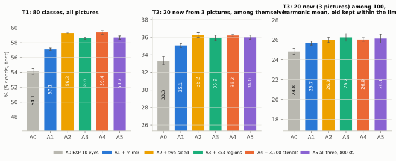
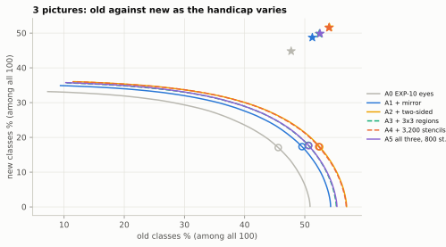
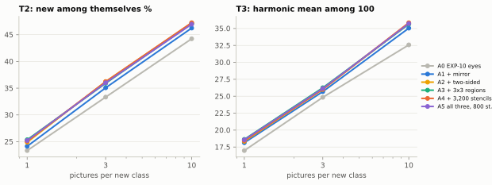
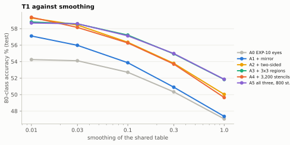
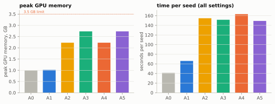

# EXP-11 · SHARPER EYES FOR BETTER CARDS

**Experiment ID:** EXP-11 · **Part A written:** 2026-11-19, before any code was run · **Hardware:** free Kaggle GPU (the method must still fit the RTX 3050 laptop, 4 GB) · **Status:** COMPLETE (run 2026-11-19 on Kaggle). Verdict: **helps, but not enough**. Part B added at the end

This journal has two parts. **Part A** (this part) explains the experiment before it starts.
**Part B** will be added to the end of this same PDF when the experiment finishes. Part A
will not be edited after results exist, except for the status line above.

## 1. Why this experiment

### What happened before

The project thinks of a learning system as two parts: the **eyes**, which turn a picture into
a list of numbers describing it, and the **memory**, which stores what was learned about
each class and gives the answer.

- **EXP-1** was a plan only. It was never run.
- **EXP-2 to EXP-6** used eyes trained by backpropagation. The best system that keeps no old
  pictures (grow and lock) reached 39.6% on the 80-class photo test.
- **EXP-7 and EXP-8** built eyes with no training at all (1,600 fixed picture patches) and a
  memory of class averages (**cards**) plus one **shared table**. On 80 classes they reach
  **55.2%**, 6 points under the best network retrained on all the pictures (**61.1%**), and
  forget nothing.
- **EXP-9** computed a **learned view** from the cards and the shared table (the directions
  along which known classes differ most) and let new cards **borrow** from their 2 nearest
  known cards. A new class learned from **3 pictures** then scores **33.5%** among 20 new
  classes (retrained network: 38.5%).
- **EXP-10** put those new classes among the 80 old ones. Without a correction they are
  drowned out (new 7.0%, old 52.2%, harmonic mean 12.4). Every correction tried (a handicap
  on old classes, a certainty correction) only moved answers from old classes to new ones.
  Readings, 5 seeds, from `EXP-10-NEW-AMONG-OLD/results/summary.json`:

| Patch eyes, 100 classes, 3 pictures per new class | Old classes | New classes | Harmonic mean |
|---|---|---|---|
| No correction | 52.2 | 7.0 | 12.4 |
| Handicap at the rehearsal's choice (old classes fell too far) | 38.1 | 26.8 | 31.5 |
| Handicap at the strongest value that keeps old within 5 points (read off the test, a diagnosis only) | 48.3 | 16.5 | 24.6 |
| **New classes learned from all their 500 pictures** (reference) | **50.3** | **47.6** | **48.9** |

### What stayed open

The last row is the key. The same memory and view hold 100 classes well when every class is
learned from all its pictures. From 3 pictures, the new classes are too badly placed, and no
shift of scores fixes that. EXP-10's verdict was "does not work", and its section 17 says
what is left goes through the **eyes**, and through **how much each picture gives**:

- the gap on 80 classes (55.2% against 61.1%);
- the gap on 20 new classes from 3 pictures (33.5% against 38.5%);
- the gap between cards from 3 pictures and cards from all pictures (harmonic mean 24.6 within
  the old-class limit, against 48.9).

EXP-10 also found a flaw in its own rule: it chose the handicap by the best harmonic mean
but judged it with a limit on how far old classes may fall. This time the limit is part of
the choosing rule, written down below.

### What the papers say

The literature log, section 7 (all read as passages), lists cheap ways to make this kind of
eyes stronger, with no backpropagation:

| Upgrade | Source and what it reports |
|---|---|
| **Mirrored copies** of each picture | Prabhu et al., RanDumb, arXiv:2402.08823: CIFAR-100, 26.9% without, 28.6% with mirrored copies when filling the tables |
| **Positive and negative parts** of each detector's answer | Coates and Ng, ICML 2011: splitting the answer "always improved" |
| **Finer regions** than 4 quarters | Jia, Huang, Darrell (CVPR 2012 workshop version): with 200 detectors, 70.2% with quarters, 72.2% with a 4 × 4 grid (CIFAR-10) |
| **More detectors** | Thiry et al., arXiv:2101.07528: 79% with 512, 85.6% with 10,000 (CIFAR-10, a different pipeline) |

None of these numbers was measured with our memory, our class order or our few-picture tests.

### So EXP-11 asks

**Do sharper eyes, still with no backpropagation, make better cards: on 80 classes, on new
classes from 3 pictures, and on new classes among old ones? And do they fit the 4 GB laptop?**

# Part A: the plan (written before the run)

## 2. The idea in plain words

**Cats and digits example.** The eyes look at a picture through 1,600 small stencils (6 × 6
pixel patterns cut from real photos), slid over every place in the picture. For each stencil
they write down how strongly it matched in each quarter of the picture. That list is the
description.

The four upgrades change only how the description is written:

1. **Mirror.** A cat looking left is still a cat looking right. Every picture is also
   described flipped left to right. When learning, both copies go into the tables (the memory
   sees twice as many examples). When answering, and when making a new card, the picture's
   description is the average of itself and its mirror image.
2. **Two-sided answers.** Today a stencil only reports "this matches". It can also report "this
   is the exact opposite" (a dark edge where the stencil has a light one), as a separate number.
3. **Finer regions.** Instead of 4 quarters, the picture is cut into a 3 × 3 grid of 9 regions,
   so the description records more precisely where things are (ears at the top, paws at the
   bottom).
4. **More stencils.** 3,200 instead of 1,600.

Each upgrade makes the description longer, and the shared table grows with the square of the
length. A table for a 14,400-number description takes 1.6 GB in full precision. So the
longest description allowed here is **14,400 numbers**, and the tables are written more
compactly (section 3).

## 3. What is run

### The six versions of the eyes

| | Eyes | Stencils | Sides | Regions | Mirror | Description length |
|---|---|---|---|---|---|---|
| A0 | **EXP-10's eyes, unchanged** | 1,600 | one | 4 | no | 6,400 |
| A1 | + mirror | 1,600 | one | 4 | yes | 6,400 |
| A2 | + mirror + two-sided | 1,600 | two | 4 | yes | 12,800 |
| A3 | + mirror + finer regions | 1,600 | one | 9 | yes | 14,400 |
| A4 | + mirror + more stencils | 3,200 | one | 4 | yes | 12,800 |
| A5 | + mirror + all three, fewer stencils | 800 | two | 9 | yes | 14,400 |

All stencils are cut from stage 1's pictures only, as before, and the same stencils are
shared by all versions (A5 uses the first 800 of A0's 1,600; A4 adds 1,600 more). Each
stencil's answer is "how well it matches, minus 0.1, or zero" as in EXP-7; for two-sided
eyes the opposite match gets the same rule. Matches are added up per region, then square-rooted.

### The memory: EXP-10's, with two changes for size

The memory is the one from EXP-9 and EXP-10: running tables (class sums and one shared table,
filled stage by stage, no old pictures kept), the learned view (all directions), and
borrowing from the 2 nearest known cards with a weight of 1 picture. Two changes are needed
to fit the longer descriptions in 4 GB:

- **The shared table is kept in single precision** (half the memory), as sums around a fixed
  reference point (stage 1's average description), so that the small differences that matter
  are not lost in rounding. It is turned into full precision only while the view is computed.
- **The view is computed in place**, inside one full-precision working table, instead of
  making several copies.

A0 checks these changes: it must reproduce EXP-10's numbers (section 5, step 0).

The **smoothing** of the shared table is tried at 0.01, 0.03, 0.1, 0.3 and 1 (times the
average of the table's diagonal), because longer descriptions may need more of it. EXP-8's
choice for A0 was 0.01, EXP-9's was 0.1.

### The three tests, all in one run

The same 80 known classes in 8 stages of 10, the same 20 surprise classes and 5 seeds as
EXP-8 to EXP-10. All test pictures of a class are used.

| | Test | Same as | How a picture is named |
|---|---|---|---|
| T1 | **80 classes**, learned from all their pictures | EXP-8 (55.2%) | nearest card by distance through the shared table (the EXP-8 memory) |
| T2 | **20 new classes from 3 pictures, among themselves** | EXP-9 (33.5%) | learned view, by angle, with borrowing (EXP-9's way) |
| T3 | **the 20 new classes (3 pictures) among all 100** | EXP-10 | as T2, plus a correction: C1 handicap, or C3 certainty plus handicap |

T2 and T3 are also run with 1 and 10 pictures (20 random draws each), as in EXP-10. Also run:
C0 (no correction) and C2 (certainty, no setting), for reference, and the **reference with
all pictures** (the new classes learned from all their 500 pictures, no correction).
EXP-10's correction C4 (new classes reshape the view) is dropped, since it lost 3.6 points
there; so is EXP-10's stream and the frozen backprop eyes, which are not part of this question.

### How settings and the selected version are chosen: the rehearsal

As in EXP-9 and EXP-10: the memory after stage 6 knows 60 classes, and the 20 classes of
stages 7 and 8 play the new classes, learned from the same number of pictures. No surprise
class is used to choose anything. For each version of the eyes, from the rehearsal only:

- **T1 smoothing:** the one with the best 60-class accuracy.
- **T2 smoothing:** the one with the best accuracy of the pretend-new classes among themselves.
- **T3 setting:** among all smoothings, both corrections (C1, C3) and every handicap value,
  keep only those where the old classes stay within 5 points of no correction (C0 at the same
  smoothing) in the rehearsal; of those, take the highest harmonic mean.
- **The selected version** of the eyes is the one with the highest T3 harmonic mean in the
  rehearsal at 3 pictures, among the versions whose peak GPU memory is 3.5 GB or less.

All values of every setting are run and logged; the choosing is done afterwards from the
rehearsal rows, by these rules, in `src/figures.py`.

| Setting | Value |
|---|---|
| Harmonic mean | H = 2 × old × new / (old + new), old and new each the accuracy among all 100 |
| Handicap grids | as EXP-10: C1 from −0.2 to 0.5 in steps of 0.01; C3 from −0.5 to 1.0 times the number of directions, steps of 0.02 |
| Pictures per new class | 1, 3, 10 (20 draws each) |
| Seeds | 5 |

## 4. What is measured

| | Measurement | Why it matters |
|---|---|---|
| M1 | T1: 80-class accuracy, each version, each smoothing | Does sharper eyes close the 6-point gap to retraining? |
| M2 | T2: new among themselves at 1, 3, 10 pictures | Does it close the 5-point gap from 3 pictures? |
| M3 | T3: old, new and harmonic mean with each correction; and the full old-against-new curve | The EXP-10 problem |
| M4 | The reference with all pictures, each version | Is the gap between 3 pictures and all pictures getting smaller, or are both rising together? |
| M5 | Rehearsal against test, for the choice of version and settings | Can the choosing be trusted? |
| M6 | Time, GPU energy, peak GPU memory, peak ordinary memory | Cost, and whether it fits the laptop |

## 5. How the result will be judged (written before the run)

All scores are means of 5 seeds, on the test, at the settings chosen in the rehearsal.
**"Gain" means the selected version minus A0, both measured in this run with the same rules.**

**Step 0: are the earlier numbers rebuilt?** A0 at smoothing 0.1, no correction, 3 pictures:
old within 0.5 of 52.2% and new within 0.5 of 7.0% (EXP-10); new among themselves within 0.5
of 33.5% (EXP-9). A0's T1 at smoothing 0.01 within 1 point of 55.2% (EXP-8 used only half of
the test pictures, so a small difference is expected). If step 0 fails, the compact tables
changed the system, and every comparison with earlier experiments is marked unreliable.

**Step 1: the main verdict.** The selected version must reach:

| | Condition |
|---|---|
| (a) | T1 gain of 2.0 points or more |
| (b) | T2 gain of 2.0 points or more (3 pictures) |
| (c) | T3 harmonic-mean gain of 3.0 or more (3 pictures), with the test's old-class accuracy no more than 6 points under the same version's no-correction old-class accuracy (the rule allows 5 in the rehearsal; 1 point of slack for the move from rehearsal to test) |
| (d) | peak GPU memory 3.5 GB or less |

| Reading | Verdict |
|---|---|
| (a), (b), (c) and (d) all hold | **works** |
| (d) holds, and one or two of (a), (b), (c) | **helps, but not enough** |
| anything else | **does not work** |

**Step 2: which upgrade does the work?** On each test: A1 − A0 (mirror), A2 − A1
(two-sided), A3 − A1 (finer regions), A4 − A1 (more stencils), A5 − A1 (all three within the
same length). An upgrade counts on a test if it adds 1.0 point or more.

**Step 3: does the gap to "all pictures" shrink?** The ratio of the T3 harmonic mean (3
pictures) to the reference's harmonic mean (all pictures), for the selected version against
A0. A rise of 0.05 or more counts as **the gap shrinks**; otherwise the eyes lift both
together and the few-picture problem stays.

**Step 4: can the rehearsal be trusted?** If the selected version's test harmonic mean is
within 1.0 of the best version's test harmonic mean: **yes**.

**What I expect, written down now.**

- Step 0 passes.
- Mirror (A1) adds about 1 point on T1 and 1.5 on T2. Each of the other upgrades adds 1 to 1.5
  on T1 and under 1 on T2. A5 (all three) is the best version and is selected.
- Selected against A0: T1 +3 (to about 58%), T2 +2 (about 35.5%), T3 harmonic mean +2.
- So the verdict would be **"helps, but not enough"**: sharper eyes help on all pictures more
  than on few, and the gap to "all pictures" does not shrink (step 3: no).
- Peak GPU memory about 3 GB for the longest descriptions.
- The rehearsal picks well.

My main prediction was wrong in EXP-9 and in EXP-10. If any of this is wrong, it stays in
the journal as written.

## 6. What carries over beyond pictures

| Part | Depends on pictures? |
|---|---|
| Mirror, finer regions, two-sided stencils, more stencils | **yes**. These are all image-specific |
| The idea behind mirroring: give the memory more than one version of each example | no, but the language version (rephrasing) is not part of this plan |
| The compact tables (single precision around a fixed reference, view computed in place) | **no**. They halve the memory cost of the shared table for any list of numbers |
| The choosing rule with an old-class limit | no |

## 7. What could go wrong

- **Longer descriptions need a bigger table, learned from the same pictures.** With 14,400
  numbers and 80,000 examples (40,000 pictures and their mirrors), the table is less certain.
  Smoothing is the guard; the rehearsal chooses it.
- **Mirror copies are not new pictures.** They count twice in the tables but carry less than
  twice the information. The certainty correction (C3) counts real pictures only.
- **The compact tables may round away something.** Step 0 checks it.
- **Finer regions hurt when the object moves:** a cat in the top-left region in one picture
  and the centre in another looks less alike. More smoothing, or fewer stencils, may be needed.
- **A5 has half the stencils of the others.** If it loses, it may be the fewer stencils, not
  the combination.
- **The rehearsal picks smoothing on 60 classes and the test uses 80 or 100.**
- **5 seeds, one dataset, images only. The surprise classes are fixed.**

## 8. Time and disk

| | Expected |
|---|---|
| Run time | about 2 hours on a free Kaggle GPU: the shared table of the longest descriptions takes about 11 seconds to turn into a view on the laptop's GPU (measured once in a test of that step), done 15 times per version and seed. The dataset is read from the private Kaggle copy made on 2026-11-17, so no download wait. About 24 of the roughly 30 free weekly hours are used |
| Disk in this folder | about 0.15 GB for this experiment's own Python environment (figures and PDF), under 0.05 GB of results and figures |
| Downloads to the laptop | the small Python environment only (approved by the owner). A short code check on the laptop borrows EXP-2's environment and CIFAR-100 without changing them |
| GPU memory | about 3 GB for the longest descriptions (1.6 GB working table + 0.8 GB compact table + pictures). The peak is measured for every version |

## 9. Words used in this journal

| Word | Meaning here |
|---|---|
| Class | One kind of thing to recognise |
| Eyes (features) | The part that turns a picture into a list of numbers (the description) |
| Stencil (detector) | A small 6 × 6 pattern cut from a real photo; the eyes record how well it matches each place in a picture |
| Region | A part of the picture over which the matches of one stencil are added up (4 quarters, or a 3 × 3 grid) |
| Two-sided | Each stencil also reports how well its opposite (light and dark swapped) matches, as a separate number |
| Mirror | The picture flipped left to right |
| Memory | The part that stores what was learned about each class and gives the answer |
| Card | The average description of one class |
| Shared table (covariance) | A table of which numbers of a description rise and fall together inside a class, kept as a running sum |
| Single / full precision | Numbers kept with about 7 or about 16 correct digits; single takes half the memory |
| Smoothing | How strongly the shared table is evened out before use. More smoothing trusts the table less |
| Learned view | The directions along which the known classes differ most, computed in one step from the cards and the shared table (EXP-9) |
| Borrowing | Mixing the cards of the 2 nearest known classes into a new class's card (EXP-9) |
| Handicap | One fixed amount subtracted from every old class's score before the answer is picked (EXP-10) |
| Certainty correction | Dividing a class's distance by (1 + 1/n), n the number of pictures it was learned from (EXP-10) |
| Harmonic mean | One score from two: 2 × a × b / (a + b). It is high only if both are high |
| Rehearsal | Choosing settings by pretending the most recent known classes are new. Uses no test class |
| Backpropagation | The usual way to train a network: measure the error and push corrections back through all layers, many times |
| Seed | One repeat with a different random shuffle |

# Part B: the readings (added after the run, 2026-11-19)

Part A above was not changed after the run, except the one status line at the top of page 1.

## 10. What was actually run

The plan in section 3 was run once, on a free Kaggle GPU (Tesla T4), as a private job named
`exp11-sharper-eyes`. It took **61 minutes** for all six versions and 5 seeds. The photos were
read from the private Kaggle copy of CIFAR-100 and were ready in **0.2 minutes** (in EXP-10 the
download took 53.5 of 70 minutes). The result files were downloaded into `results/`:
`runs.jsonl` (4,080 lines), `meta.json` and `kaggle_run.log`. There were no errors.
`src/figures.py` turned `runs.jsonl` into `results/summary.json` and the figures, with the
choosing rules of section 3. **Every number below comes from `results/summary.json`** unless
another file is named: means of 5 seeds on the test, with the spread between seeds (standard
deviation) after ± where it matters.

**Things that differ from Part A, or that need saying:**

| Item | What was done |
|---|---|
| Code check on the laptop | Before the run, a small trial (1 seed, a tenth of the stencils) ran every version on the laptop. A second check built the largest description (A3, 14,400 numbers) at full size on the laptop's RTX 3050 through the stage-6 rehearsal: peak **2.74 GB** of GPU memory in use (3.31 GB including what PyTorch holds in reserve). The trial's numbers were thrown away |
| Run time | 61 minutes, not the 2 hours expected: the views took less time on the T4 than my laptop measurement suggested. About 1 Kaggle hour used |
| Memory reading in the rule | Step 1(d) reads the peak GPU memory **in use**. PyTorch also holds some memory in reserve; both are reported in section 11.8 |
| Ordinary (CPU) memory | measured on Kaggle (about 1.5 GB for every version). Not measured on the laptop, where Windows does not offer that reading |
| Python environment | this folder's own `.venv` (146 MB), for the figures and the PDF only |

Nothing in sections 1 to 9 was changed.

## 11. The readings

### 11.1 Step 0: are the earlier numbers rebuilt? Yes

| A0 (EXP-10's eyes), compact tables | This run | Earlier | Allowed difference |
|---|---|---|---|
| Old classes, smoothing 0.1, no correction, 3 pictures | 52.2 ± 0.2 | 52.2 (EXP-10) | 0.5 |
| New classes, same setting | 7.0 ± 0.3 | 7.0 (EXP-10) | 0.5 |
| New among themselves, same setting | 33.5 ± 0.5 | 33.5 (EXP-9) | 0.5 |
| T1, 80 classes, smoothing 0.01 | 54.3 ± 0.5 | 55.2 (EXP-8, half of the test pictures) | 1.0 |

The compact tables changed nothing measurable. T1 sits 0.95 under EXP-8's number, just inside
the allowed point; EXP-8 used only half of the test pictures, so the two are not the same exam.

### 11.2 The three tests, every version

*Figure 1. Each version of the eyes on the three tests. T1: 80 classes from all their pictures.
T2: 20 new classes from 3 pictures, named among themselves. T3: the same 20 new classes among
all 100, harmonic mean, at the setting chosen in the rehearsal under the old-class limit.*

| Version | Length | T1: 80 classes | T2: 20 new, 3 pictures | T3 old | T3 new | **T3 harmonic mean** |
|---|---|---|---|---|---|---|
| A0 EXP-10's eyes | 6,400 | 54.1 | 33.3 | 45.6 | 17.1 | 24.8 |
| A1 + mirror | 6,400 | 57.1 | 35.1 | 49.5 | 17.3 | 25.7 |
| **A2 + mirror + two-sided** (selected) | 12,800 | **59.3** | **36.2** | **52.5** | **17.3** | **26.0** |
| A3 + mirror + 9 regions | 14,400 | 58.6 | 35.9 | 50.6 | 17.7 | 26.2 |
| A4 + mirror + 3,200 stencils | 12,800 | 59.4 | 36.2 | 52.3 | 17.3 | 26.0 |
| A5 + mirror + all three, 800 stencils | 14,400 | 58.7 | 36.0 | 50.6 | 17.6 | 26.1 |

The rehearsal chose correction C1 (the handicap) at a handicap of 0.08 for every version. The
smoothing chosen differs by version (A2: 0.01 for T1, 0.1 for T2 and T3).

In plain words: the sharper eyes name the 80 known classes much better (**54.1% to 59.3%**) and
the new classes among themselves better (**33.3% to 36.2%**). When the new classes have to
compete with the old ones, the new classes stay at about **17%** in every version. What rises
is the old classes' score at the same handicap (45.6% to 52.5%). The harmonic mean moves only
from 24.8 to 26.0.

For comparison: EXP-8's retrained network with the same memory scored 58.8% and its ceiling
61.1%, both on half of the test pictures. So A2's 59.3% is about level with the retrained
network, with no backpropagation, but this is not a comparison on the same pictures. EXP-9's
retrained network scored 38.5% on T2, still 2.3 points above A2.

### 11.3 Which upgrade does the work? (step 2)

| Upgrade | T1 | T2 | T3 harmonic mean | Counts (1.0 or more) on |
|---|---|---|---|---|
| Mirror (A1 − A0) | **+3.0** | **+1.7** | +0.8 | T1, T2 |
| Two-sided (A2 − A1) | +2.2 | +1.2 | +0.3 | T1, T2 |
| 9 regions (A3 − A1) | +1.5 | +0.9 | +0.6 | T1 |
| 3,200 stencils (A4 − A1) | +2.3 | +1.1 | +0.4 | T1, T2 |
| All three in 14,400 numbers (A5 − A1) | +1.6 | +0.9 | +0.5 | T1 |

Mirroring is the biggest single gain and costs nothing in description length. Two-sided answers
and doubling the stencils give the same gain at the same length (12,800); combining all three
in a fixed length (A5) is worse than either. **No upgrade counts on T3.**

### 11.4 Old against new

*Figure 2. 3 pictures per new class, every picture named among all 100. Each line is one version
of the eyes as the handicap moves from small to large; the circle is the setting chosen in the
rehearsal; the star is the same version with the new classes learned from all their pictures.
A2 and A4 (dashed) lie almost on top of each other, and so do A5 and A3 (dashed).*

The sharper eyes move the whole curve outwards: at every handicap, both old and new are a
little higher. But the stars move outwards just as much. The certainty correction C2 (no
setting) shows the same: with A2 it reaches a harmonic mean of 31.2 (old 43.3, new 24.4),
against 27.7 with A0 (old 35.2, new 22.9). That is a bigger gain (+3.5), but at old-class
scores far under the limit, so it is not the setting the rule allows.

### 11.5 1, 3 and 10 pictures

*Figure 3. T2 (new among themselves) and T3 (harmonic mean among 100) against the number of
pictures per new class.*

| Pictures per new class | T2, A0 | T2, A2 | T3 harmonic mean, A0 | T3 harmonic mean, A2 |
|---|---|---|---|---|
| 1 | 23.3 | 24.9 | 17.0 | 18.3 |
| 3 | 33.3 | 36.2 | 24.8 | 26.0 |
| 10 | 44.2 | 47.2 | 32.6 | 35.8 |

The gain from the sharper eyes grows with the number of pictures: +1.6 points on T2 at 1
picture, +3.0 at 10. Better eyes help most when there is more to describe.

### 11.6 Does the gap to "all pictures" shrink? (step 3) No, it grows

| Version | T3 harmonic mean, 3 pictures | Reference: all pictures | Ratio |
|---|---|---|---|
| A0 | 24.8 | 46.2 | 0.537 |
| A2 (selected) | 26.0 | 52.9 | 0.492 |

The sharper eyes lift the reference by 6.6 points and the few-picture result by 1.2. The ratio
falls by 0.045. A rise of 0.05 was needed to count as "the gap shrinks".

### 11.7 Smoothing

*Figure 4. T1 (80 classes) against the smoothing of the shared table, every version.*

The longer descriptions did **not** need more smoothing for T1: 0.01, the smallest value tried,
is best or within 0.3 of best for every version. Part A's worry (section 7) that longer
descriptions would make the table too uncertain did not show up here. Because 0.01 is at the
edge of the values tried, an even smaller value might be better still.

### 11.8 Cost

*Figure 5. Peak GPU memory and time per seed for each version, on the Kaggle T4.*

| Version | Length | Peak GPU memory in use | Including reserve | Time per seed | GPU energy per seed |
|---|---|---|---|---|---|
| A0 | 6,400 | 1.0 GB | 1.4 GB | 41 s | 0.24 Wh |
| A1 | 6,400 | 1.0 GB | 1.4 GB | 66 s | 0.42 Wh |
| **A2** | 12,800 | **2.2 GB** | **3.1 GB** | **155 s** | **1.39 Wh** |
| A3 | 14,400 | 2.7 GB | 3.4 GB | 152 s | 1.25 Wh |
| A4 | 12,800 | 2.2 GB | 3.1 GB | 163 s | 1.52 Wh |
| A5 | 14,400 | 2.7 GB | 3.6 GB | 149 s | 1.22 Wh |

Time per seed covers everything: describing all pictures, filling the tables, computing views
at 5 smoothings for the rehearsal and the test, and scoring every setting. Every version is
under the 3.5 GB limit for memory in use. The two 14,400-number versions hold 3.4 to 3.6 GB
including reserve, which is close to the laptop's 4 GB; the selected A2 holds 3.1 GB.

### 11.9 Rehearsal against test

| Version | T3 harmonic mean, rehearsal | T3 harmonic mean, test |
|---|---|---|
| A0 | 29.9 | 24.8 |
| A1 | 30.7 | 25.7 |
| **A2** (selected) | **31.4** | 26.0 |
| A3 | 30.7 | **26.2** (best on test) |
| A4 | 31.1 | 26.0 |
| A5 | 30.8 | 26.1 |

A2 was chosen; A3 is best on the test by 0.25. Versions A2 to A5 are all within 0.3 of each
other on the test.

## 12. The verdict, by the rule written in section 5

| Step | Reading | Result |
|---|---|---|
| 0. Rebuild | old 52.2, new 7.0, new among themselves 33.5, T1 54.3 | passed |
| 1(a) T1 gain | A2 59.3 − A0 54.1 = **+5.2** (2.0 needed) | holds |
| 1(b) T2 gain | 36.2 − 33.3 = **+2.9** (2.0 needed) | holds |
| 1(c) T3 harmonic-mean gain | 26.0 − 24.8 = **+1.2** (3.0 needed); old 52.5 against 55.9 without correction, within 6 | **fails** |
| 1(d) peak GPU memory | 2.2 GB (3.5 GB allowed) | holds |
| **1. Main verdict** | (d) plus two of (a)–(c) | **helps, but not enough** |
| 2. Which upgrade does the work? | mirror, two-sided and more stencils count on T1 and T2; 9 regions and the combination on T1 only | none counts on T3 |
| 3. Does the gap to "all pictures" shrink? | ratio 0.537 to 0.492 | **no**, it grows |
| 4. Can the rehearsal be trusted? | A2 26.0 against best A3 26.2 | **yes** |

## 13. Was the expectation in section 5 right?

| What I wrote before the run | What happened | |
|---|---|---|
| Step 0 passes | passed (T1 by 0.05 of the allowed point) | right |
| Mirror: about +1 on T1, +1.5 on T2 | +3.0 and +1.7 | T1 **too low**; T2 right |
| Other upgrades: +1 to +1.5 on T1, under 1 on T2 | two-sided +2.2 and +1.2, stencils +2.3 and +1.1, regions +1.5 and +0.9 | too low for two of the three |
| A5 (all three) is best and selected | A2 selected; A5 fourth in the rehearsal | wrong |
| T1 +3, to about 58% | +5.2, to 59.3% | too low |
| T2 +2, to about 35.5% | +2.9, to 36.2% | too low |
| T3 harmonic mean +2 | +1.2 | too high |
| Verdict "helps, but not enough" | "helps, but not enough" | right |
| The gap to "all pictures" does not shrink | it grows | right |
| About 3 GB of GPU memory for the longest | 2.7 GB in use, 3.4–3.6 GB including reserve | right |
| The rehearsal picks well | it did | right |
| About 2 hours on Kaggle | 61 minutes | too high |

My verdict was right this time, but the eyes did better than I expected on everything except
the one test that matters most here.

## 14. What it means for the project

**1. Eyes with no backpropagation are now about level with a retrained network on the known
classes.** 59.3% on 80 classes, against 58.8% for EXP-8's retrained network with the same memory
(not the same test pictures, so "about level"), and 2 points under the 61.1% ceiling. This takes
one pass, about 2.5 minutes per seed, 2.2 GB of GPU memory and no forgetting. Mirroring alone
gave 3 points of that.

**2. Better eyes do not fix new classes among old ones.** Among themselves the new classes
improved (33.3% to 36.2%), and with all their pictures they reach 51.7% among all 100. From 3
pictures, among all 100, they stay at 17% whatever the eyes, at the handicap the old-class limit
allows. The extra quality went to the old classes, which have 500 pictures each to use it.
**Sharper eyes widen the advantage of classes that have many pictures.**

**3. The problem is now the decision "old or new?", not the card.** Two readings, put together
by hand (arithmetic, not measured): the old classes named among themselves by angle score 60.7%
(A2), and the new classes among themselves 36.2%. If every picture were first sent to the right
group (old or new) by a perfect switch, the harmonic mean would be about **45**. The method
gets 26. Most of the loss happens when an old card and a new card compete for the same picture,
not inside either group. A handicap is one number for all classes and cannot make that decision
well.

**4. Against the three goals.** No forgetting: still achieved. Cheap: achieved (2.5 minutes per
seed, 2.2 GB, 1.4 Wh of GPU energy per seed). A new class from a handful of pictures: achieved
among new classes (36.2%), **not achieved among old classes** (17% at the old-class limit).

## 15. What is still unverified

- **The comparison with the retrained network on T1** used different test pictures (EXP-8: half
  of them). Running EXP-8's retrained network on the full test would settle "about level".
- **Smoothing below 0.01** was not tried; T1 may rise a little more.
- **The "perfect switch" figure (about 45)** is arithmetic on two readings, not a measurement.
  The old-group reading is by angle at a different smoothing from the new-group reading.
- **The laptop run of the selected version end to end** was not done. A3 at full size was
  measured on the laptop only up to the stage-6 rehearsal (2.74 GB in use). The versions of
  14,400 numbers hold up to 3.6 GB including reserve on the T4, which is close to 4 GB.
- **Mirror copies when building the new card** were used as an average (the picture and its
  mirror). Using the two copies as two separate pictures was not tried.
- 5 seeds, one dataset (CIFAR-100), images only. GPU energy only.

## 16. What carries over beyond pictures

| Part | Depends on pictures? |
|---|---|
| Mirror, two-sided stencils, finer regions, more stencils | **yes**. All four are image-specific |
| The compact tables (single precision around a fixed reference, view computed in place) | **no**. They held 14,400 numbers per example in 2.7 GB with no measurable loss (step 0) |
| The finding that better descriptions help classes with many examples more than new ones | **no**. It is about how much data each class has, not about pictures |
| The finding that the "old or new?" decision is where most of the loss is | **no** |
| The choosing rule with an old-class limit | **no** |

## 17. What the next experiment should be, and why

**Proposed EXP-12: is it something I know? A switch between old and new classes.**

Why: EXP-11 shows that better eyes improve old classes, and new classes among themselves, but
leave new classes stuck at 17% when they compete with old ones. A perfect "old or new?" switch
in front of the two groups would lift the harmonic mean from 26 to about 45 (section 14,
arithmetic). The handicap is a crude switch: one number, the same for every class. The brain
has a separate signal for this ("I have seen this before" against "this is new"), and the same
question exists in language (is this word or topic one I know?).

What it should contain, all closed-form, on A2's eyes (mirror and two-sided, 12,800 numbers):

1. **Measure the switch first.** Run the perfect switch (using the true answer, as a ceiling) to
   confirm the "about 45" in this journal with real readings.
2. **Closed-form familiarity scores**, computed from what the memory already stores: for
   example, how far a picture is from the nearest old card compared with how far that class's
   own pictures usually are (the shared table gives this), or how much of the picture lies
   outside the directions the old classes use. Measure how well each separates old test
   pictures from new ones.
3. **Switch, then name**: send each picture to the old or new group by the familiarity score,
   then name it within the group. Judge it against the handicap with the same old-class limit.
4. **A short paper check first** (a Sonnet subagent), on known ways to tell known classes from
   unknown ones with class averages and a shared table, before Part A is written.

This is a proposal. It needs its own Part A before any code is run.
