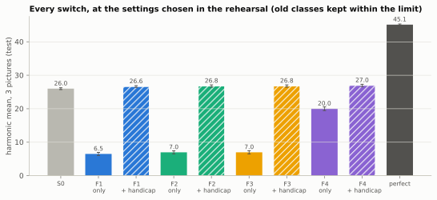
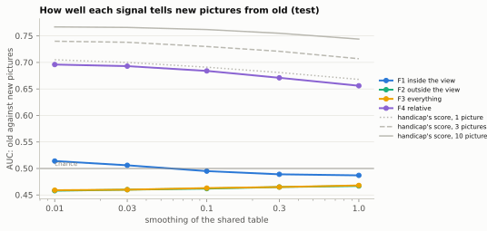
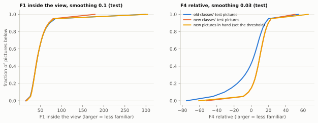
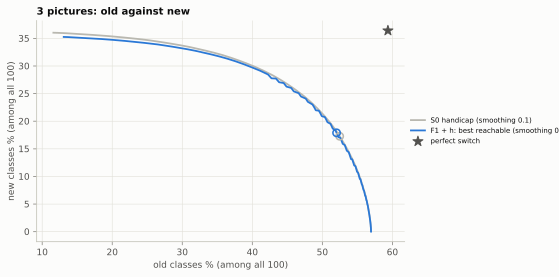
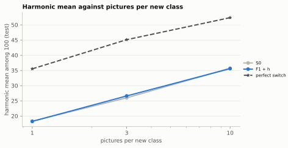

# EXP-12 · OLD OR NEW? A SWITCH IN FRONT OF THE MEMORY

**Experiment ID:** EXP-12 · **Part A written:** 2026-11-19, before any code was run · **Hardware:** free Kaggle GPU (the method must still fit the RTX 3050 laptop, 4 GB) · **Status:** COMPLETE (run 2026-11-19 on Kaggle). Verdict: **does not work**. Part B added at the end

This journal has two parts. **Part A** (this part) explains the experiment before it starts.
**Part B** will be added to the end of this same PDF when the experiment finishes. Part A
will not be edited after results exist, except for the status line above.

## 1. Why this experiment

### What happened before

The project thinks of a learning system as two parts: the **eyes**, which turn a picture into
a list of numbers describing it, and the **memory**, which stores what was learned about each
class and gives the answer.

- **EXP-1** was a plan only. It was never run.
- **EXP-2 to EXP-6** used eyes trained by backpropagation. The best system that keeps no old
  pictures reached 39.6% on the 80-class photo test.
- **EXP-7 and EXP-8** built eyes with no training (fixed picture patches) and a memory of class
  averages (**cards**) plus one **shared table**: 55.2% on 80 classes, no forgetting.
- **EXP-9** added a **learned view** (the directions along which known classes differ most)
  and **borrowing** from the 2 nearest known cards: a new class from 3 pictures scores 33.5%
  among 20 new classes.
- **EXP-10** put the new classes among the 80 old ones. They are drowned out (new 7.0%). A
  **handicap** (one amount subtracted from every old class's score) only trades old answers for
  new ones.
- **EXP-11** made the eyes sharper with no backpropagation (each picture also seen mirrored;
  each stencil also reports its opposite). Readings from
  `EXP-11-SHARPER-EYES/results/summary.json`, 5 seeds, test:

| EXP-11 | EXP-10's eyes | Sharper eyes (A2) |
|---|---|---|
| 80 known classes, all pictures | 54.1 | **59.3** |
| 20 new classes from 3 pictures, among themselves | 33.3 | **36.2** |
| Same 20 new among all 100, handicap within the old-class limit: old / new | 45.6 / 17.1 | 52.5 / 17.3 |
| Harmonic mean of old and new (the main score) | 24.8 | **26.0** |
| New classes learned from all their pictures (reference): harmonic mean | 46.2 | 52.9 |

Verdict "helps, but not enough". The sharper eyes help the old classes and the new classes
**among themselves**, but when the two groups compete, the new classes stay at 17%.

### What stayed open

EXP-11, section 14, put two of its readings together (arithmetic, not a measurement): the old
classes named only among old classes score 60.7%, the new classes named only among new ones
36.2%. **If a perfect switch first said "this picture is from an old class" or "from a new
class", and the memory then named it within that group, the harmonic mean would be about 45
instead of 26.** Most of what is lost is lost in that one decision, old or new, not inside
either group.

The handicap is a crude switch: it says "new" when the best new card's score is close enough
to the best old card's score. Three pictures make a new card noisy, so that comparison is noisy
too.

**One more idea checked before writing this plan, on EXP-11's own logged results.** EXP-10's
certainty correction (distance divided by 1 + 1/n) left out a second term of the textbook
probability formula. With that term put back, the rule needs no setting, and it turns out to be
one fixed point that EXP-11 already logged (correction C3 at a handicap of about −0.22 for 3
pictures). Read from `EXP-11-SHARPER-EYES/results/runs.jsonl`, A2 eyes, smoothing 0.1, test:
old 55.6%, new **4.3%**, harmonic mean **8.0** (1 picture: 2.9; 10 pictures: 24.7). The textbook
rule almost never says "new". It is not tried again here.

### What the papers say

One Sonnet subagent, 2026-11-19 (literature log, section 10). The papers were read through
summaries of the papers' web pages made by a reading tool, so the numbers are as relayed.

| Paper | Tag | What it reports |
|---|---|---|
| Socher et al., "Zero-Shot Learning Through Cross-Modal Transfer", NIPS 2013, arXiv:1301.3666 | passages (relayed) | A **switch first**: a picture is called new if it is unlikely under every known class; then it is named within the group. The threshold is swept, not chosen by a rule |
| Atzmon and Chechik, COSMO, CVPR 2019, arXiv:1812.09903 | passages (relayed) | A **trained** switch between known and new groups beats the handicap ("calibrated stacking") by 2 to 9 harmonic-mean points on three datasets. It is trained on known classes that pretend to be new (our rehearsal does the same pretending) |
| Ren et al., "A Simple Fix to Mahalanobis Distance for Improving Near-OOD Detection", 2021, arXiv:2106.09022 | passages (relayed) | **Relative distance**: distance to the nearest known class minus distance to one "background" spread fitted to all known pictures. CIFAR-100 against CIFAR-10, telling known from unknown: 74.9 plain, 81.0 relative (area under the curve, 50 = chance) |
| Kamoi and Kobayashi, arXiv:2003.00402 | passages (relayed) | The power of such distances for spotting the unknown comes from the **directions that matter least for naming** the known classes |
| Wang et al., ViM, CVPR 2022, arXiv:2203.10807 | abstract + passages (relayed) | Spotting the unknown by **what is left outside** the main directions of the known pictures |
| Lee et al., NeurIPS 2018, arXiv:1807.03888 | abstract | Distance through one shared table to the nearest class average, used to spot the unknown |

None of these numbers was measured with our eyes, memory or classes.

### So EXP-12 asks

**Can a switch computed in one step from what the memory already stores tell pictures of known
classes from pictures of new ones well enough to lift the new classes among the old ones, while
the old classes stay within the limit?**

# Part A: the plan (written before the run)

## 2. The idea in plain words

**Cats and digits example.** The memory knows 80 animals and objects, each from 500 pictures.
It is shown 3 pictures of a fox. Then a fox picture arrives. Today the memory compares it with
all 100 cards at once, and the well-known "dog" card usually wins against the shaky 3-picture
"fox" card.

A switch splits the question in two:

1. **"Have I seen anything like this before?"** If the picture looks like none of the 80 known
   classes, it is probably one of the new ones.
2. Then name it **only within that group**: among the 80 old cards, or among the 20 new cards.

The first question needs no fox card at all. It asks only how well the picture fits what is
already known, and the memory knows that very well (500 pictures per class). So the shaky new
card no longer decides which group the picture goes to.

**How "seen before" is measured.** The memory has class cards and one shared table of how
descriptions vary inside a class. From them, four familiarity signals can be computed in one
step each:

| | Signal | In plain words |
|---|---|---|
| F1 | **Inside the view** | Distance to the nearest old card along the directions the old classes use to tell each other apart |
| F2 | **Outside the view** | How much of the picture lies in directions the old classes never use. A fox may have a pattern no old class has |
| F3 | **Everything** | F1 + F2: the distance to the nearest old card through the whole shared table (Lee et al.) |
| F4 | **Relative** | F1 minus the distance to the "average of everything known" (Ren et al.). A picture that is far from every card only because it is an unusual picture overall gets no extra credit |

A note found while planning: if the background spread of F4 is built from the same tables, the
part outside the view cancels exactly, so F4 uses only directions inside the view. F2 and F3
need one extra calculation per picture through the full table.

## 3. What is run

**Eyes and memory: EXP-11's selected version (A2), unchanged.** 1,600 stencils, two-sided, 4
quarters, mirrored (12,800 numbers per picture); compact tables, learned view with all
directions, borrowing from the 2 nearest known cards. The same 80 known classes in 8 stages of
10, the same 20 surprise classes, the same 5 seeds, the same random draws of new-class pictures
as EXP-11. Smoothing of the shared table: 0.01, 0.03, 0.1, 0.3, 1.

**Naming within a group** is by angle in the learned view, as in EXP-9 to EXP-11: among the old
cards only, or among the new cards only.

**The switches.** A picture goes to the new group when the switch says "new":

| Switch | Says "new" when | Setting(s) |
|---|---|---|
| **S0 handicap** (EXP-11's C1, the baseline) | best new score > best old score − h | handicap h |
| **S-F only** (one per signal F1–F4) | the picture is at least as unfamiliar as the q-th fraction of the new pictures the memory was shown | q |
| **S-F and handicap** (one per signal) | both of the above | h and q |
| **Perfect switch** (a ceiling, not a method) | the picture is really from a new class | none |

**Why the threshold is set by the new pictures in hand.** The familiarity of a picture has no
natural unit. The memory does have the 1, 3 or 10 pictures of each new class it was shown (20
to 200 pictures in all). Their familiarity values show how unfamiliar a new-class picture
looks. "q = 0.2" means: call a picture new if it is less familiar than the least familiar 20%
of the new pictures in hand. This needs no old pictures and no test labels, and it means the
same thing in the rehearsal and in the test.

**Grids.** h from −0.2 to 0.5 in steps of 0.01 (as EXP-10 and EXP-11), plus "no handicap test"
(S-F only). q from 0 to 1 in steps of 0.02, plus "no familiarity test" (S0). Every combination
is run and logged. Pictures per new class: 1, 3 and 10, with 20 random draws each.

**Choosing settings: the rehearsal**, as in EXP-9 to EXP-11. The memory after stage 6 knows 60
classes; the 20 classes of stages 7 and 8 play the new ones. No surprise class is used to choose
anything. For each switch and each number of pictures, among all smoothings and settings, keep
those where the old classes stay within 5 points of no correction (S0 at h = 0, same smoothing)
in the rehearsal; of those, take the highest harmonic mean. **The selected switch** is the one,
among the eight familiarity switches (four signals, alone or with the handicap), with the
highest rehearsal harmonic mean at 3 pictures. The choosing is done afterwards, from the
rehearsal rows only, in `src/figures.py`.

Dropped from EXP-11, because they are not part of this question: the other five versions of the
eyes, the certainty corrections C2 and C3, the 80-class test T1 and the reference with all
pictures.

## 4. What is measured

| | Measurement | Why it matters |
|---|---|---|
| M1 | The **perfect switch**: old and new within their groups, harmonic mean | Is "about 45" real? It is the most any switch can reach with these cards |
| M2 | For each signal: how well it separates old pictures from new ones, as the **area under the curve** (AUC: the chance that a random new picture looks less familiar than a random old one; 0.5 = chance, 1 = perfect). Also for the handicap's score | Which signal knows best what is new, before any threshold is chosen |
| M3 | Old, new and harmonic mean with each switch at the settings chosen in the rehearsal, 1, 3 and 10 pictures | The main result |
| M4 | The full old-against-new curve of each switch | Whether a switch moves the whole curve, or only a point on it |
| M5 | Rehearsal against test | Can the choosing be trusted? |
| M6 | Time, GPU energy, peak GPU memory | Cost, and whether it fits the laptop |

## 5. How the result will be judged (written before the run)

All scores are means of 5 seeds, on the test, at the settings chosen in the rehearsal.
**"Gain" means the selected switch minus S0, both chosen by the same rule in this run.**

**Step 0: is EXP-11 rebuilt?** S0 at smoothing 0.1, h = 0.08, 3 pictures: old within 0.5 of
52.5, new within 0.5 of 17.3 (EXP-11, A2). If it fails, comparisons with EXP-11 are marked
unreliable.

**Step 1: the main verdict.** The selected switch must reach:

| | Condition |
|---|---|
| (a) | harmonic-mean gain of 3.0 or more at 3 pictures, with the test's old-class accuracy no more than 6 points under no correction (5 in the rehearsal, 1 of slack) |
| (b) | harmonic-mean gain of 1.5 or more at 1 picture and at 10 pictures |
| (c) | peak GPU memory 3.5 GB or less |

| Reading | Verdict |
|---|---|
| (a), (b) and (c) all hold | **works** |
| (c) holds, and the gain at 3 pictures is 1.0 or more, but (a) or (b) fails | **helps, but not enough** |
| anything else | **does not work** |

**Step 2: is the ceiling real?** The perfect switch's harmonic mean at 3 pictures, against the
"about 45" of EXP-11. Within 3 points: confirmed.

**Step 3: where is the signal?** Does the outside-the-view signal (F2) separate old from new
better than the inside-the-view signal (F1)? It counts if its AUC is higher by 0.02 or more.
Does the relative signal (F4) beat the plain one (F1) by 0.02 or more?

**Step 4: how much of the gap is closed?** (selected − S0) / (perfect − S0), at 3 pictures.

**Step 5: can the rehearsal be trusted?** If the selected switch's test harmonic mean is within
1.0 of the best switch's on the test: **yes**.

**What I expect, written down now.**

- Step 0 passes exactly (same seeds, same draws, same code path).
- The perfect switch at 3 pictures: about 44.
- AUC on the test at 3 pictures: the handicap's score about 0.80 (it uses the new cards);
  F4 about 0.72; F1 about 0.68; F3 about 0.66; F2 about 0.62. So step 3: **no** for the
  outside-the-view signal, **yes** for relative.
- Selected switch: F4 with the handicap. Gain about +1.5 at 3 pictures (to about 27.5), under
  1.5 at 1 picture. So the verdict would be **"helps, but not enough"**, and step 4 closes under
  a fifth of the gap.
- Peak GPU memory about 2.3 GB. The rehearsal picks well.

The reason for the low expectation: the new classes here are ordinary photos (other animals,
objects and scenes), close to the old ones. Telling "near" unknowns from known classes is the
hard case in the papers above. My main prediction was wrong in EXP-9 and EXP-10 and right in
EXP-11. If it is wrong again, it stays in the journal as written.

## 6. What carries over beyond pictures

| Part | Depends on pictures? |
|---|---|
| The eyes (patch stencils, mirror, two-sided) | **yes** |
| The switch: "have I seen anything like this?" computed from class averages and one shared table | **no**. It works on any list of numbers: a sentence's description from a language model could be judged the same way |
| Setting the switch from the few new examples in hand (q) | **no** |
| The finding that the outside-the-view part cancels in the relative signal | **no**. It is a property of the tables, not of pictures |

## 7. What could go wrong

- **Near unknowns.** A fox looks like a wolf. Familiarity may barely separate them; the papers
  report this case as the hard one.
- **The few new pictures set the threshold.** With 1 picture per class there are only 20 values
  to read a fraction from, so q is coarse.
- **The outside-the-view signal depends on smoothing.** With little smoothing, small random
  directions dominate the distance. The rehearsal chooses the smoothing, but it may not
  transfer from 60 to 80 known classes.
- **Old test pictures are less familiar than old training pictures**, because the tables were
  fitted on the training pictures. The threshold is set by new pictures, so this only matters
  if old test pictures look as unfamiliar as new ones.
- **The rehearsal has 60 old classes and 25% new pictures; the test has 80 and 20%.**
- **5 seeds, one dataset, images only. The surprise classes are fixed.**

## 8. Time and disk

| | Expected |
|---|---|
| Run time | about 45 minutes on a free Kaggle GPU (EXP-11's A2 took 2.6 minutes per seed; the full-table calculation for F2 and F3 adds about 2 minutes per seed). About 25 of the roughly 30 free weekly hours are used, so about 1 is needed |
| Disk in this folder | 0.15 GB for this experiment's own Python environment (copied from EXP-11's, so nothing is downloaded), under 0.1 GB of results and figures |
| Downloads | none. A short code check on the laptop borrows EXP-2's environment and CIFAR-100 without changing them |
| GPU memory | about 2.3 GB (as EXP-11's A2) |
| Ordinary memory | about 1 GB more than EXP-11: the descriptions of the test pictures are kept while the views are computed |

## 9. Words used in this journal

| Word | Meaning here |
|---|---|
| Class | One kind of thing to recognise |
| Eyes (features) | The part that turns a picture into a list of numbers (the description) |
| Memory | The part that stores what was learned about each class and gives the answer |
| Card | The average description of one class |
| Shared table (covariance) | A table of which numbers of a description rise and fall together inside a class |
| Smoothing | How strongly the shared table is evened out before use |
| Learned view | The directions along which the known classes differ most, computed in one step from the cards and the shared table (EXP-9) |
| Borrowing | Mixing the cards of the 2 nearest known classes into a new class's card (EXP-9) |
| Handicap | One amount subtracted from every old class's score before the answer is picked (EXP-10) |
| Switch | A rule that first decides "old class" or "new class", before the picture is named within that group |
| Familiarity signal | A number saying how well a picture fits what the memory already knows |
| Inside / outside the view | The part of a description along the learned view's directions, and the part left over |
| AUC (area under the curve) | The chance that a random new picture looks less familiar than a random old one. 0.5 is guessing, 1 is perfect |
| Harmonic mean | One score from two: 2 × a × b / (a + b). It is high only if both are high |
| Rehearsal | Choosing settings by pretending the most recent known classes are new. Uses no test class |
| Backpropagation | The usual way to train a network: push corrections back through all layers, many times |
| Seed | One repeat with a different random shuffle |

# Part B: the readings (added after the run, 2026-11-19)

Part A above was not changed after the run, except the one status line at the top of page 1.

## 10. What was actually run

The plan in section 3 was run once, on a free Kaggle GPU (Tesla T4), as a private job named
`exp12-old-or-new`. It took **18 minutes** for 5 seeds (the photos were ready in 0.2 minutes,
read from the private Kaggle copy of CIFAR-100). The result files were downloaded into
`results/`: `runs.jsonl` (1,005 lines), `meta.json` and `kaggle_run.log`. There were no errors.
`src/figures.py` turned `runs.jsonl` into `results/summary.json` and the figures, with the
choosing rules of section 3. **Every number below comes from `results/summary.json`** unless
another file is named: means of 5 seeds on the test.

**Things that differ from Part A, or that need saying:**

| Item | What was done |
|---|---|
| Code checks on the laptop | A small trial (1 seed, a tenth of the stencils and pictures) ran the whole code. On the same small trial, EXP-11's code and this code gave **identical** handicap numbers at every smoothing and number of pictures compared. A second check ran the full-size eyes on the laptop's RTX 3050 through the stage-6 rehearsal: peak **2.39 GB** of GPU memory in use (2.8 GB including reserve). The trials' numbers were thrown away |
| Smoothing for step 2 and step 3 | Part A did not say at which smoothing the perfect switch and the AUCs are read. Done here: the perfect switch at the smoothing with the best rehearsal harmonic mean; each signal's AUC at the smoothing its own "F only" switch chose in the rehearsal. Figure 2 shows every smoothing, and the conclusions are the same at all of them |
| Run time | 18 minutes, not the 45 expected. About 0.3 Kaggle hours used |
| Python environment | copied from EXP-11's folder (146 MB), so nothing was downloaded |

Nothing in sections 1 to 9 was changed.

## 11. The readings

### 11.1 Step 0: is EXP-11 rebuilt? Yes, exactly

S0 at smoothing 0.1, handicap 0.08, 3 pictures: old **52.47%**, new **17.28%** (EXP-11, A2:
52.47 and 17.28).

### 11.2 Every switch

*Figure 1. Harmonic mean at 3 pictures on the test, for every switch at the settings chosen in
the rehearsal, with the old classes kept within the limit. Hatched: familiarity combined with
the handicap. Last bar: the perfect switch (a ceiling, not a method).*

| Switch, 3 pictures | Smoothing | q | Handicap | Old | New | **Harmonic mean** |
|---|---|---|---|---|---|---|
| **S0 handicap** (EXP-11's way) | 0.1 | – | 0.08 | 52.5 | 17.3 | **26.0** |
| F1 inside the view, alone | 0.01 | 0.90 | – | 52.9 | 3.5 | 6.5 |
| F2 outside the view, alone | 1 | 0.88 | – | 41.0 | 3.8 | 7.0 |
| F3 everything, alone | 1 | 0.88 | – | 41.0 | 3.8 | 7.0 |
| F4 relative, alone | 0.1 | 0.60 | – | 51.1 | 12.4 | 20.0 |
| **F1 + handicap** (selected) | 0.1 | 0.02 | 0.09 | 52.0 | 17.9 | **26.6** |
| F2 + handicap | 0.03 | 0.00 | 0.09 | 54.4 | 17.8 | 26.8 |
| F3 + handicap | 0.03 | 0.00 | 0.09 | 54.4 | 17.8 | 26.8 |
| F4 + handicap | 0.03 | 0.02 | 0.09 | 54.5 | 17.9 | 27.0 |
| *Perfect switch* | 0.03 | – | – | *59.4* | *36.4* | ***45.1*** |

In plain words: **the perfect switch is real**, at 45.1, as EXP-11's arithmetic said. **None of
the real switches comes close.** Alone, the familiarity signals are far worse than the handicap.
Combined with it, they add about half a point, and section 11.4 shows that this half point does
not come from the familiarity signals.

### 11.3 Can the signals tell old pictures from new ones?

*Figure 2. How well each signal separates old classes' test pictures from new classes' test
pictures (AUC: 0.5 = guessing, 1 = perfect), at every smoothing. Grey: the handicap's own score
(best new card minus best old card), which uses the new cards.*

| Signal | AUC (test) |
|---|---|
| F1 inside the view | 0.51 (smoothing 0.01; 0.49 to 0.51 at the others) |
| F2 outside the view | **0.47**: below guessing |
| F3 everything | 0.47 |
| F4 relative | **0.68** (smoothing 0.1; 0.66 to 0.70 at the others) |
| The handicap's score, 1 / 3 / 10 pictures | 0.69 / **0.73** / 0.76 (smoothing 0.1) |

**Distance to the nearest known card says nothing about whether a picture is new.** F1, F2 and
F3 are at or below guessing at every smoothing. A fox picture is as close to the "dog" card as
a dog picture is. Outside the view, the new pictures even look slightly *more* familiar than the
old test pictures.

**The relative signal (F4) does separate them partly** (0.68), as Ren et al. reported for near
unknowns. But it is still weaker than the handicap's own score (0.73 at 3 pictures), which uses
the new cards.

*Figure 5. How the familiarity values are spread, for old classes' test pictures (blue), new
classes' test pictures (red), and the new pictures the memory was shown (amber, which set the
threshold). Left: F1. Right: F4. Each curve is the fraction of pictures below a given value.*

In F1 the three curves lie on top of each other. In F4 about a third of the old pictures are
clearly more familiar than any new one (the blue tail on the left); the rest overlap. The amber
and red curves match in both, so **setting the threshold from the pictures in hand worked as
planned**. The weak point is the signal, not the threshold.

### 11.4 Where the half point comes from

At the chosen settings, the switches with the handicap use q = 0 or 0.02, so the familiarity
test is almost switched off. Read directly from `results/runs.jsonl` (test, 3 pictures, mean of
5 seeds):

| F4 + handicap, smoothing 0.03, handicap 0.09 | q: none | 0 | 0.02 | 0.1 | 0.2 | 0.5 |
|---|---|---|---|---|---|---|
| Harmonic mean | **27.3** | 27.2 | 27.0 | 25.7 | 23.7 | 16.2 |

**Every familiarity test lowers the score; the more it is used, the lower it goes.** The half
point over S0 comes from the handicap: the combined switches end up at 0.09 instead of 0.08. S0
alone at a handicap of 0.09 would reach 27.4 on the test, but in the rehearsal its old classes
fall 0.2 points past the 5-point limit, so the rule did not allow it. A familiarity test at q
of about 0 throws away a handful of new answers, and that keeps the old classes just inside the
limit. The gain is a side effect of where the limit falls, not of the familiarity signal.

As a diagnosis only, choosing on the test instead of the rehearsal (still within the limit),
the best harmonic mean at 3 pictures is 28.6 for S0, and 28.3, 28.1 and 28.5 with F1, F2 and F4
added. Nothing beats the handicap alone.

### 11.5 Old against new

*Figure 3. 3 pictures, every picture named among all 100. Grey: S0 as the handicap varies.
Blue: the best that the selected switch (F1 + handicap) can reach, over all its settings.
Circles: the settings chosen in the rehearsal. Star: the perfect switch.*

The two curves lie on top of each other; the familiarity signal does not move the curve. The
perfect switch sits far outside both.

### 11.6 1, 3 and 10 pictures

*Figure 4. Harmonic mean against pictures per new class: S0, the selected switch, and the
perfect switch.*

| Pictures per new class | S0 | Selected (F1 + handicap) | Gain | Perfect switch |
|---|---|---|---|---|
| 1 | 18.4 | 18.3 | −0.1 | 35.5 |
| 3 | 26.0 | 26.6 | +0.6 | 45.1 |
| 10 | 35.8 | 35.6 | −0.1 | 52.4 |

The gap to the perfect switch is 17 to 19 points at every number of pictures.

### 11.7 Cost

| | Reading |
|---|---|
| Peak GPU memory in use | **2.4 GB** (2.9 GB including reserve) on the T4; 2.39 GB on the laptop through the rehearsal |
| Ordinary memory | 2.5 GB at its peak (EXP-11: 1.5 GB), because the test pictures' descriptions are kept while the views are computed |
| Time per seed | 213 s: describing 53 s, tables 6 s, views and the full-table calculation for F2 and F3 150 s, scoring 3 s |
| GPU energy per seed | 2.1 Wh |

## 12. The verdict, by the rule written in section 5

| Step | Reading | Result |
|---|---|---|
| 0. Rebuild | old 52.47, new 17.28 (EXP-11: 52.47, 17.28) | passed, exactly |
| 1(a) gain at 3 pictures | F1 + handicap 26.6 − S0 26.0 = **+0.6** (3.0 needed); old 52.0 against 55.9 without correction, within 6 | **fails** |
| 1(b) gain at 1 and 10 pictures | −0.1 and −0.1 (1.5 needed) | **fails** |
| 1(c) peak GPU memory | 2.4 GB (3.5 GB allowed) | holds |
| **1. Main verdict** | (c) holds, but the gain at 3 pictures is under 1.0 | **does not work** |
| 2. Is the ceiling real? | perfect switch 45.1 against "about 45" | **confirmed** |
| 3. Where is the signal? | outside the view minus inside: −0.05 (+0.02 needed); relative minus inside: **+0.17** | outside: **no**; relative: **yes** |
| 4. How much of the gap is closed? | (26.6 − 26.0) / (45.1 − 26.0) | **3%** |
| 5. Can the rehearsal be trusted? | selected 26.6 against best on the test (F4 + handicap) 27.0 | **yes** |

## 13. Was the expectation in section 5 right?

| What I wrote before the run | What happened | |
|---|---|---|
| Step 0 passes exactly | exactly | right |
| Perfect switch about 44 | 45.1 | right |
| AUC: handicap's score about 0.80 | 0.73 | too high |
| AUC: F4 about 0.72 | 0.68 | close |
| AUC: F1 about 0.68, F3 about 0.66, F2 about 0.62 | 0.51, 0.47, 0.47 | **wrong**: all at or below guessing |
| Outside the view does not beat inside; relative does | as written | right |
| Selected switch: F4 with the handicap | F1 with the handicap (F4 + handicap was best on the test) | wrong |
| Gain about +1.5 at 3 pictures, under 1.5 at 1 picture | +0.6; −0.1 | too high; right |
| Verdict "helps, but not enough" | "does not work" | **wrong** |
| Under a fifth of the gap closed | 3% | right |
| About 2.3 GB of GPU memory; the rehearsal picks well | 2.4 GB; yes | right |
| About 45 minutes; about 1 GB more ordinary memory | 18 minutes; 1.05 GB more | too high; right |

## 14. What it means for the project

**1. The "old or new?" decision cannot be made from old knowledge alone, with these eyes.** The
memory knows its 80 classes very well, yet "how far is this picture from everything I know?"
does not tell a fox from a dog. A photo of a new animal is built from the same kinds of patches
(fur, edges, eyes, grass) as the known ones, so it is no farther from the known cards than a
known animal's own photo is.

**2. Only the relative signal carries information,** because it removes how unusual a picture is
overall. Even so, it is weaker than the score the handicap already uses, and adding it to the
handicap does not help. Whatever F4 knows, the handicap's score already knows.

**3. What separates the groups is how well the picture fits the new cards.** The only signal that
beats guessing clearly is the handicap's score (best new card minus best old card), and it gets
better with more pictures per new class (0.69, 0.73, 0.76). So the decision depends on the new
card again. **Three experiments (EXP-10, EXP-11, EXP-12) now point the same way: the limit is how
little a new card from a few pictures says, not how the answer is picked.** EXP-11 improved the
eyes, and the old classes took the benefit. EXP-12 tried to avoid the new card in the decision,
and found nothing else to decide with.

**4. The perfect switch is a real target.** With a perfect old-or-new decision, the same cards
give 45.1 at 3 pictures and 52.4 at 10 pictures, close to the 52.9 of new classes learned from
all their pictures (EXP-11). Naming within each group is not the problem.

**5. A useful negative finding.** Familiarity through one shared table does not detect near
unknowns in this setting. The textbook rule (EXP-12, page 1) and the "distance to everything I
know" rule both fail for the same reason: the shared table describes how pictures vary, not what
makes a class new.

**6. Against the three goals.** No forgetting: still achieved. Cheap: achieved (3.5 minutes per
seed, 2.4 GB of GPU memory, 2.1 Wh). A new class from a handful of pictures among old ones: **not
achieved**. The best balance stays at a harmonic mean of about 26 to 27 at 3 pictures.

## 15. What is still unverified

- **Why the outside-the-view signal is below guessing** (new pictures look slightly more familiar
  there). Not looked into.
- **A switch fitted on the score pattern** (several of the top old and new scores together,
  instead of one difference), as the trained switch in COSMO does. Not tried.
- **Familiarity from eyes trained by backpropagation**, or from larger pretrained eyes. These
  signals may work with eyes that know more about objects; not tested here.
- **Per-class thresholds** (each old class's own spread). Not tried.
- **The rule's edge effect** (section 11.4) means a handicap of 0.09 for S0 was just outside the
  limit in the rehearsal. The verdict does not depend on it: no switch beats S0 on the test either.
- 5 seeds, one dataset (CIFAR-100), images only. The surprise classes are fixed.

## 16. What carries over beyond pictures

| Part | Depends on pictures? |
|---|---|
| The finding that distance to known class averages does not detect near unknowns | **no**. It is about class averages and one shared table, which a language model's memory could also use |
| The relative signal works partly where plain distance fails (0.68 against 0.51) | **no** |
| Setting a threshold from the few new examples in hand | **no**. It worked as planned (figure 5) |
| The perfect-switch ceiling as a measuring tool | **no** |
| The eyes | **yes** |

## 17. What the next experiment should be, and why

**Proposed EXP-13: how many pictures does a new class need, and can more be made of each one?**

Why: EXP-10, EXP-11 and EXP-12 all show the limit is the new card from few pictures, not the
answering rule. Shifting scores (EXP-10), sharper eyes (EXP-11) and a familiarity switch (EXP-12)
each fail for the same reason. Two things are not known yet:

1. **How many pictures are enough?** At 3 pictures the harmonic mean is 26; with all 500 it is
   52.9 (EXP-11). The curve in between (3, 10, 30, 100, 500 pictures, with no correction and with
   the handicap) shows how much better a card must get, and whether the handicap is still needed
   once cards are good. This costs almost nothing to measure.
2. **Can each picture count for more?** EXP-11 found the mirror worth 3 points on known classes.
   Shifted and slightly cropped copies of each new picture (still no backpropagation) could make a
   3-picture card behave like a card from more pictures. Measure where 3 pictures × 8 copies lands
   on the curve from point 1.

The second part is image-specific (copies of a picture). Its language version would be rephrasing
a sentence, which is not part of this plan. Point 1 is not image-specific.

**An alternative, if the owner prefers to stay with the switch:** fit a switch on the pattern of
the top old and new scores, in one step from the rehearsal (a straight-line rule between "old" and
"new" computed from averages and one shared table, the same kind of calculation as the memory
itself), as COSMO does with training. That is not image-specific, but EXP-12 suggests the scores
hold little beyond what the handicap already uses.

This is a proposal. It needs its own Part A before any code is run.
