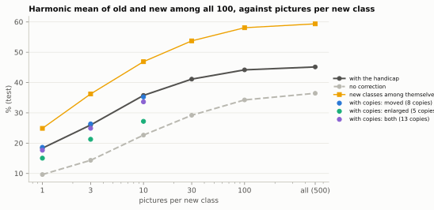
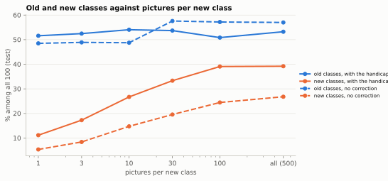
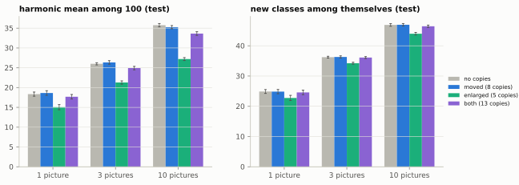
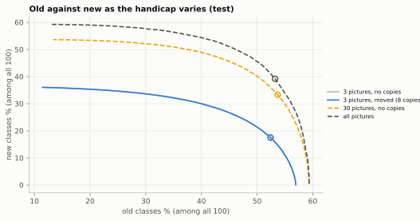

# EXP-13 · HOW MANY PICTURES DOES A NEW CLASS NEED?

**Experiment ID:** EXP-13 · **Part A written:** 2026-11-19, before any code was run · **Hardware:** free Kaggle GPU (the method must still fit the RTX 3050 laptop, 4 GB) · **Status:** COMPLETE (run 2026-11-19 on Kaggle). Verdict: **does not work**. Part B added at the end

This journal has two parts. **Part A** (this part) explains the experiment before it starts.
**Part B** will be added to the end of this same PDF when the experiment finishes. Part A
will not be edited after results exist, except for the status line above.

## 1. Why this experiment

### What happened before

The project thinks of a learning system as two parts: the **eyes**, which turn a picture into
a list of numbers describing it, and the **memory**, which stores what was learned about each
class and gives the answer.

- **EXP-1** was a plan only. It was never run.
- **EXP-2 to EXP-6** used eyes trained by backpropagation (best without old pictures: 39.6%
  on 80 classes).
- **EXP-7 and EXP-8**: eyes with no training (fixed picture patches) and a memory of class
  averages (**cards**) plus one **shared table**: 55.2% on 80 classes, no forgetting.
- **EXP-9**: a **learned view** and **borrowing** from the 2 nearest known cards: a new class
  from 3 pictures scores 33.5% among 20 new classes.
- **EXP-10**: among all 100 classes the new ones are drowned out; a **handicap** on old classes
  only trades old answers for new ones.
- **EXP-11**: sharper eyes (mirror, two-sided stencils): 59.3% on 80 classes, 36.2% for new
  classes among themselves, but among all 100 the harmonic mean of old and new rises only from
  24.8 to 26.0.
- **EXP-12**: a switch that first decides "old class or new class?" from how familiar a picture
  looks. Readings from `EXP-12-OLD-OR-NEW/results/summary.json`, test, 5 seeds:

| EXP-12, 3 pictures per new class | Old | New | Harmonic mean |
|---|---|---|---|
| Handicap (EXP-11's way) | 52.5 | 17.3 | 26.0 |
| Best familiarity switch (selected by the rule) | 52.0 | 17.9 | 26.6 |
| **Perfect switch** (true group given; a ceiling) | **59.4** | **36.4** | **45.1** |

Distance to the known cards told new pictures from old ones no better than guessing (0.47 to
0.51 on a scale where 0.5 is guessing and 1 is perfect). Only the handicap's own score, which
compares the picture with the **new cards**, separates the groups (0.69, 0.73, 0.76 at 1, 3, 10
pictures). Verdict "does not work".

### What stayed open

EXP-10, EXP-11 and EXP-12 all point to the same limit: **a card made from 3 pictures says too
little.** Shifting scores (EXP-10), sharper eyes (EXP-11) and a familiarity switch (EXP-12) each
failed for that reason. Two things are not known:

1. **How many pictures are enough?** At 3 pictures the harmonic mean is 26.0; EXP-11's reference
   with all 500 pictures (new classes also added to the tables and the view) was 52.9. Nobody has
   measured the curve in between with this memory, nor whether the handicap is still needed once
   cards are good.
2. **Can each picture count for more?** EXP-11 found the mirror image worth 3 points on known
   classes. Shifted and enlarged copies of each new picture might make a 3-picture card behave
   like a card from more pictures.

### What the papers say

One Sonnet subagent, 2026-11-19 (literature log, section 11).

| Paper | Tag | What it reports |
|---|---|---|
| Yang, Liu, Xu, "Free Lunch for Few-shot Learning: Distribution Calibration", ICLR 2021, arXiv:2101.06395 | passages | A new class's average is mixed with the averages of its 2 nearest known classes, **as our borrowing already does**, and its spread is taken from them. A square-root transform of the features helps as much as the mixing at 1 picture (miniImageNet 5-way: 56.4 without either, 64.3 with the transform only, 63.7 with the mixing only, 68.6 with both). Our eyes already take a square root of every number (since EXP-7) |
| Bai et al., "Can One-Shot Test-Time Data Augmentation Help with Generalization?", arXiv:2602.00114 | model-written summary of the page only; unverified | Copies of a single picture (moved, noised, then cleaned by a **trained** model) gave +4.8 to +8.2 points for a class-average classifier at 1 picture (miniImageNet). The trained cleaning step makes it a different method |

No paper was found that tests plain shifted or enlarged copies averaged into a class average on
fixed eyes, or that reports a curve from 1 to 500 pictures for new classes among old ones.

### So EXP-13 asks

**How quickly do new classes catch up with old ones as they get more pictures? And can copies
of each new picture (moved, enlarged), made with no training at all, make 3 pictures count like
more?**

# Part A: the plan (written before the run)

## 2. The idea in plain words

**Cats and digits example.** The memory knows 80 classes from 500 pictures each. A fox arrives
with 3 pictures. Its card (the average of the 3 descriptions) is shaky: one picture shows a
fox's head close up, another a whole fox far away. The "dog" card, from 500 pictures, is steady.

**Part 1, the curve.** Give the fox 1, 3, 10, 30, 100 pictures, and then all 500, and see how
the score among all 100 classes grows, with and without the handicap. This says how good a card
must be before new and old classes compete fairly.

**Part 2, copies.** A person who has seen one photo of a fox can still recognise a fox a little
to the left, or a little closer. The eyes cannot: their description changes when the picture
moves. So each of the fox's pictures is also described:

- **moved**: 8 copies shifted by 3 pixels (left, right, up, down and the diagonals);
- **enlarged**: 5 copies in which a 28 × 28 part (each corner and the centre) is enlarged back to
  the full 32 × 32, like stepping closer.

The fox's card then uses, for each picture, the average of its description and its copies'
descriptions. Only the new pictures are copied; the old classes, the tables and the test
pictures stay as they were. Nothing is trained.

## 3. What is run

**Eyes and memory: EXP-11's version A2 and EXP-12's memory, unchanged.** 1,600 stencils,
two-sided, 4 quarters, mirrored (12,800 numbers per picture); compact tables; learned view of
the old classes with all directions; new cards by angle with borrowing from the 2 nearest known
cards (weight 1 picture). The same 80 known classes in 8 stages of 10, the same 20 surprise
classes, the same 5 seeds. The draws of 1, 3 and 10 pictures are the same as in EXP-11 and
EXP-12. Smoothing: 0.01, 0.03, 0.1, 0.3, 1.

**Naming:** every test picture among all 100 classes by angle in the learned view, with the
handicap h subtracted from old classes' scores (EXP-11's C1; h = 0 means no correction). h from
−0.2 to 0.5 in steps of 0.01, every value logged.

| Part | Pictures per new class | Draws | Copies |
|---|---|---|---|
| 1, the curve | 1, 3, 10, 30, 100, all (500) | 20, 20, 20, 20, 10, 1 | none |
| 2, copies | 1, 3, 10 | 20 each | none / moved (8) / enlarged (5) / both (13) |

The new classes are never added to the tables or to the view (they were in EXP-11's reference),
so "all 500 pictures" here measures only the card, not a rebuilt memory.

**Choosing settings: the rehearsal**, as in EXP-9 to EXP-12. The memory after stage 6 knows 60
classes; the 20 classes of stages 7 and 8 play the new ones. For each copy setting and each
number of pictures, among all smoothings and handicaps, keep those where the old classes stay
within 5 points of no correction (h = 0, same smoothing) in the rehearsal; of those, take the
highest harmonic mean. The same rule gives the "no correction" readings (h = 0, smoothing with
the best rehearsal harmonic mean). **The selected copy setting** is the one, among moved,
enlarged and both, with the highest rehearsal harmonic mean at 3 pictures. All choosing is done
afterwards, from the rehearsal rows only, in `src/figures.py`.

## 4. What is measured

| | Measurement | Why it matters |
|---|---|---|
| M1 | The curve: old, new, harmonic mean and new-among-themselves against pictures per new class, with the handicap and without | How good a card must be; whether the handicap is still needed with good cards |
| M2 | Copies at 1, 3, 10 pictures: harmonic mean and new-among-themselves | Does each picture count for more? |
| M3 | **Picture-equivalent**: where 3 pictures with copies land on the curve of part 1 (read between the measured points, on a log scale) | Copies in the same unit as real pictures |
| M4 | Rehearsal against test | Can the choosing be trusted? |
| M5 | Time, GPU energy, peak GPU memory | Cost, and whether it fits the laptop |

## 5. How the result will be judged (written before the run)

All scores are means of 5 seeds, on the test, at the settings chosen in the rehearsal.
**"Gain" means the selected copy setting minus no copies, both chosen by the same rule in this
run, at the same number of pictures.**

**Step 0: is EXP-12 rebuilt?** No copies, smoothing 0.1, h = 0.08, 3 pictures: old within 0.5 of
52.47, new within 0.5 of 17.28 (EXP-11 and EXP-12).

**Step 1: the main verdict on copies.** The selected copy setting must reach:

| | Condition |
|---|---|
| (a) | harmonic-mean gain of 3.0 or more at 3 pictures, with the test's old-class accuracy no more than 6 points under no correction (5 in the rehearsal, 1 of slack) |
| (b) | harmonic-mean gain of 1.5 or more at 1 picture and at 10 pictures |
| (c) | new-among-themselves gain of 2.0 or more at 3 pictures (the cards themselves are better) |
| (d) | peak GPU memory 3.5 GB or less |

| Reading | Verdict |
|---|---|
| (a) to (d) all hold | **works** |
| (d) holds, and the harmonic-mean gain at 3 pictures is 1.0 or more, but (a), (b) or (c) fails | **helps, but not enough** |
| anything else | **does not work** |

**Step 2: the picture-equivalent.** 3 pictures with the selected copies count as how many
pictures, on the handicap curve of part 1? **1.5 times or more (4.5 pictures or more) counts as
"each picture counts for more".**

**Step 3: how many pictures are needed?** The smallest number of pictures on the handicap curve
at which the harmonic mean reaches 90% of its value with all pictures (read between the measured
points). A description, not a pass or fail.

**Step 4: is the handicap still needed with good cards?** With all pictures, the harmonic mean
with the handicap minus without. Under 1.0: **not needed**.

**Step 5: can the rehearsal be trusted?** If the selected copy setting's test harmonic mean at 3
pictures is within 1.0 of the best copy setting's on the test: **yes**.

**What I expect, written down now.**

- Step 0 passes exactly.
- The curve with the handicap, harmonic mean at 1 / 3 / 10 / 30 / 100 / all pictures: about
  18 / 26 / 36 / 43 / 47 / 50. Without correction: about 9 / 13 / 21 / 32 / 42 / 49. So step 3:
  about 60 pictures are needed for 90%, and step 4: the handicap is **not needed** with all
  pictures (under 1.0).
- Copies at 3 pictures: moved +1 on new-among-themselves, enlarged +0.5, both +1; harmonic mean
  +0.5 to +1. Selected: both. Picture-equivalent about 3.5 (step 2: no).
- So the verdict would be **"does not work"**: copies help a little but far from enough.
- Peak GPU memory about 2.3 GB. The rehearsal picks well.

I expect little from the copies because the eyes add up each stencil's matches over each quarter
of the picture, which already ignores small moves inside a quarter. My main prediction was wrong
in EXP-9, EXP-10 and EXP-12 and right in EXP-11. If it is wrong again, it stays in the journal.

## 6. What carries over beyond pictures

| Part | Depends on pictures? |
|---|---|
| The curve of score against examples per new class, and the measure "picture-equivalent" | **no**. The same curve can be measured for new words or topics in a language memory |
| Whether the handicap is still needed when new classes have as many examples as old ones | **no** |
| Moved and enlarged copies | **yes**. The language version would be rephrasing a sentence, which is not part of this plan |

## 7. What could go wrong

- **Copies are not new pictures.** A moved fox is the same fox: copies can steady the card
  against position but cannot show a different fox. The gain may be small for that reason.
- **Copies change what the card looks like.** An average of moved copies is blurrier than any
  single picture, and the test pictures are not blurred. This could even lower the score.
- **Enlarging** uses a smooth resize, which softens fine detail the stencils respond to.
- **The view does not include the new classes.** With all 500 pictures, the new classes may be
  held back by a view built without them, so "all" here can be lower than EXP-11's 52.9.
- **100 pictures and all pictures** use fewer draws (10 and 1), so those points are a little
  less certain.
- **5 seeds, one dataset, images only. The surprise classes are fixed.**

## 8. Time and disk

| | Expected |
|---|---|
| Run time | about 25 minutes on a free Kaggle GPU (EXP-12 took 18; describing the copies adds about 2 minutes per seed). About 25 of the roughly 30 free weekly hours are used, so about 0.5 is needed |
| Disk in this folder | 0.15 GB for this experiment's own Python environment (copied from EXP-12's, so nothing is downloaded), under 0.05 GB of results and figures |
| Downloads | none. A short code check on the laptop borrows EXP-2's environment and CIFAR-100 without changing them |
| GPU memory | about 2.3 GB (as EXP-11's A2) |

## 9. Words used in this journal

| Word | Meaning here |
|---|---|
| Class | One kind of thing to recognise |
| Eyes (features) | The part that turns a picture into a list of numbers (the description) |
| Memory | The part that stores what was learned about each class and gives the answer |
| Card | The average description of one class |
| Shared table (covariance) | A table of which numbers of a description rise and fall together inside a class |
| Smoothing | How strongly the shared table is evened out before use |
| Learned view | The directions along which the known classes differ most, computed in one step from the cards and the shared table (EXP-9) |
| Borrowing | Mixing the cards of the 2 nearest known classes into a new class's card (EXP-9) |
| Handicap | One amount subtracted from every old class's score before the answer is picked (EXP-10) |
| Copy | The same picture moved by a few pixels, or a part of it enlarged |
| Picture-equivalent | How many real pictures would give the same score as the pictures with copies |
| Harmonic mean | One score from two: 2 × a × b / (a + b). It is high only if both are high |
| Rehearsal | Choosing settings by pretending the most recent known classes are new. Uses no test class |
| Backpropagation | The usual way to train a network: push corrections back through all layers, many times |
| Seed | One repeat with a different random shuffle |

# Part B: the readings (added after the run, 2026-11-19)

Part A above was not changed after the run, except the one status line at the top of page 1.

## 10. What was actually run

The plan in section 3 was run once, on a free Kaggle GPU (Tesla T4), as a private job named
`exp13-how-many-pictures`. It took **16 minutes** for 5 seeds (photos read from the private
Kaggle copy of CIFAR-100). The result files were downloaded into `results/`: `runs.jsonl`,
`meta.json` and `kaggle_run.log`. There were no errors. `src/figures.py` turned `runs.jsonl` into
`results/summary.json` and the figures, with the choosing rules of section 3. **Every number below
comes from `results/summary.json`** unless another file is named: means of 5 seeds on the test.

**Things that differ from Part A, or that need saying:**

| Item | What was done |
|---|---|
| Code checks on the laptop | A small trial (1 seed, a tenth of the stencils and pictures) ran the whole code; its no-copies numbers were identical to EXP-12's small trial. The full-size eyes ran on the laptop's RTX 3050 through the stage-6 rehearsal: peak **2.22 GB** of GPU memory in use (2.7 GB including reserve). The trials' numbers were thrown away |
| Run time | 16 minutes, not 25. About 0.3 Kaggle hours used |
| Python environment | copied from EXP-12's folder (146 MB), so nothing was downloaded |

Nothing in sections 1 to 9 was changed.

## 11. The readings

### 11.1 Step 0: is EXP-12 rebuilt? Yes, exactly

No copies, smoothing 0.1, handicap 0.08, 3 pictures: old **52.47%**, new **17.28%** (EXP-12: the
same).

### 11.2 The curve: more pictures per new class

*Figure 1. Harmonic mean of old and new among all 100 classes, against pictures per new class,
with the handicap (black) and without correction (grey, dashed). Orange: the new classes named
among themselves only. Coloured dots: 1, 3 and 10 pictures with copies.*

| Pictures per new class | 1 | 3 | 10 | 30 | 100 | all (500) |
|---|---|---|---|---|---|---|
| **Harmonic mean, with the handicap** | 18.4 | 26.0 | 35.8 | 41.1 | 44.2 | **45.1** |
| Old / new, with the handicap | 51.6 / 11.2 | 52.5 / 17.3 | 54.0 / 26.7 | 53.7 / 33.3 | 50.9 / 39.1 | 53.2 / 39.2 |
| Harmonic mean, no correction | 9.7 | 14.3 | 22.7 | 29.2 | 34.3 | **36.5** |
| Old / new, no correction | 48.5 / 5.4 | 48.9 / 8.4 | 48.8 / 14.8 | 57.6 / 19.6 | 57.2 / 24.5 | 57.0 / 26.8 |
| New classes among themselves | 24.9 | 36.2 | 46.9 | 53.8 | 58.1 | 59.4 |

*Figure 4. Old (blue) and new (red) classes separately, with the handicap (solid) and without
(dashed). Without correction, the rule picks the smoothing with the best rehearsal score, which
is 1 up to 10 pictures and 0.03 from 30 on; that is why the old classes jump at 30.*

In plain words:

- **More pictures help a lot, then stop helping.** From 3 to 30 pictures the harmonic mean rises
  from 26 to 41. From 100 pictures on it is flat at about 45.
- **Even with all 500 pictures, as many as the old classes have, the new classes lose.** They
  score 59.4% among themselves, but only 26.8% among all 100 without correction, and 39.2% with
  the handicap. The old classes, with the same number of pictures, score 57.0%.
- **So a card from few pictures is not the only limit.** In EXP-11, the reference with all
  pictures also added the new classes to the memory's tables and to the learned view, and reached
  a harmonic mean of **52.9 with no correction** (old 54.1, new 51.7;
  `EXP-11-SHARPER-EYES/results/summary.json`, A2). Here the new classes are left out of the view,
  and the same cards reach only **36.5** without correction and 45.1 with the handicap. The view
  is built from the old classes: its directions are the ones that tell **old** classes apart. New
  classes are squeezed into those directions and overlap with the old classes.

### 11.3 Copies

*Figure 2. Harmonic mean among 100 (left) and the new classes among themselves (right), at 1, 3
and 10 pictures, with each kind of copy.*

| Harmonic mean among 100 (new among themselves) | 1 picture | 3 pictures | 10 pictures |
|---|---|---|---|
| No copies | 18.4 (24.9) | 26.0 (36.2) | 35.8 (46.9) |
| **Moved, 8 copies** (selected) | 18.6 (24.9) | 26.4 (36.3) | 35.3 (47.0) |
| Enlarged, 5 copies | 15.1 (22.8) | 21.3 (34.2) | 27.2 (44.0) |
| Both, 13 copies | 17.7 (24.6) | 24.9 (36.1) | 33.6 (46.5) |

**Moved copies change almost nothing** (+0.3, +0.4, −0.5). **Enlarged copies hurt**, by up to 8.6
points at 10 pictures. As Part A expected, the eyes add up each stencil's matches over each
quarter of the picture, so a 3-pixel move barely changes the description. An enlarged copy does
change it, but in the wrong way: the test pictures are not enlarged, so the card drifts away from
what a real fox picture looks like.

### 11.4 Old against new

*Figure 3. Old against new among all 100 as the handicap varies: 3 pictures with no copies (grey,
hidden under the blue line because the two are almost identical), 3 pictures with moved copies
(blue), 30 pictures (orange) and all pictures (black). Circles: the settings chosen in the
rehearsal.*

More pictures move the whole curve outwards; copies do not move it. With all pictures, the curve
still bends sharply. Without a handicap (the right-hand end of each curve), the new classes are
still far down.

### 11.5 Cost

| | Reading |
|---|---|
| Peak GPU memory in use | **2.2 GB** (3.0 GB including reserve) on the T4; 2.22 GB (2.7 GB) on the laptop through the rehearsal |
| Ordinary memory | 1.4 GB at its peak |
| Time per seed (T4) | 194 s: describing 59 s, copies 89 s, tables 6 s, views 39 s, scoring under 1 s |
| GPU energy per seed | 1.9 Wh |

## 12. The verdict, by the rule written in section 5

| Step | Reading | Result |
|---|---|---|
| 0. Rebuild | old 52.47, new 17.28 (EXP-12: the same) | passed, exactly |
| 1(a) gain at 3 pictures | moved copies 26.35 − no copies 26.00 = **+0.35** (3.0 needed) | **fails** |
| 1(b) gain at 1 and 10 pictures | +0.28 and −0.50 (1.5 needed) | **fails** |
| 1(c) new-among-themselves gain at 3 pictures | +0.07 (2.0 needed) | **fails** |
| 1(d) peak GPU memory | 2.2 GB (3.5 GB allowed) | holds |
| **1. Main verdict on copies** | the gain at 3 pictures is under 1.0 | **does not work** |
| 2. Picture-equivalent | 3 pictures with moved copies count as **3.1** pictures (4.5 needed) | **no** |
| 3. How many pictures are needed? | 90% of the all-pictures score (40.6) is reached at about **27 pictures** | — |
| 4. Is the handicap still needed with good cards? | all pictures: 45.1 with the handicap, 36.5 without: **+8.7** | **yes, still needed** |
| 5. Can the rehearsal be trusted? | the selected copies (moved) are also the best on the test | **yes** |

## 13. Was the expectation in section 5 right?

| What I wrote before the run | What happened | |
|---|---|---|
| Step 0 passes exactly | exactly | right |
| With the handicap: 18 / 26 / 36 / 43 / 47 / 50 | 18.4 / 26.0 / 35.8 / 41.1 / 44.2 / 45.1 | right up to 10 pictures; too high from 30 on |
| No correction: 9 / 13 / 21 / 32 / 42 / 49 | 9.7 / 14.3 / 22.7 / 29.2 / 34.3 / 36.5 | right up to 10; **much too high** with many pictures |
| About 60 pictures for 90% | about 27 (because the curve flattens lower) | wrong |
| The handicap is not needed with all pictures | still worth +8.7 | **wrong** |
| Moved copies +1 on new-among-themselves, enlarged +0.5, both +1; selected: both | +0.1, −2.0, −0.1; selected: moved | wrong in detail; enlarged copies hurt |
| Picture-equivalent about 3.5 | 3.1 | close |
| Verdict "does not work" | "does not work" | right |
| About 2.3 GB; the rehearsal picks well | 2.2 GB; yes | right |

The wrong part is the one that matters: I expected that new classes with as many pictures as the
old ones would compete as equals. They do not, as long as the view leaves them out.

## 14. What it means for the project

**1. There are two limits, not one.** Up to about 30 pictures, the limit is the card: more
pictures lift the harmonic mean from 26 (3 pictures) to 41 (30). Beyond that, **the limit is the
view.** With all 500 pictures, new classes that are left out of the view score 26.8% among 100
without correction. The same classes inside the view (EXP-11's reference) score 51.7%.

**2. The view is the memory's "way of looking", and it is fitted to what it already knows.** It
keeps the directions that separate the old classes. A fox that is new to the view is seen only
through "dog-or-cat-or-wolf" directions, so it looks like one of them. In brain terms, the memory
has learned what to pay attention to, and a new kind of thing is forced into the old categories.

**3. Adding a class to the view at the right time looks like the missing step.** EXP-10 found that
adding new classes to the view from 3 pictures **hurts** (−3.6): a 3-picture class shapes the view
badly. EXP-11's reference shows that adding them with all their pictures **helps** a great deal
(36.5 → 52.9 with no correction, comparing EXP-13 and EXP-11 at all pictures). Somewhere in
between there is a point where a new class has enough pictures to join the view. That is like
consolidation in the brain: a new memory is first held separately and only later woven into the
general structure.

**4. Copies of a picture do not make it count for more** with these eyes: moved copies change
nothing, enlarged copies hurt. More real pictures help; transformed copies of the same picture do
not.

**5. Against the three goals.** No forgetting: still achieved. Cheap: achieved (2.2 GB, about 3
minutes per seed, 1.9 Wh). A new class from a handful of pictures among old ones: **not achieved**. A new
class needs about 30 pictures before it competes reasonably, and even then it is held back by a
view that does not include it.

## 15. What is still unverified

- **The comparison of "in the view" and "not in the view" with all pictures** uses two experiments
  (EXP-11's reference and EXP-13). Both use A2's eyes, the same seeds and the same classes, but
  EXP-11's reference also added the new classes' pictures to the shared table. Which of the two
  (table or view) matters was not separated.
- **At how many pictures adding a class to the view starts to help** was not measured (EXP-10:
  hurts at 3; EXP-11: helps at 500).
- **Other kinds of copies** (small rotations, colour changes, copies used as separate pictures
  rather than averaged) were not tried.
- **Points at 100 and all pictures** use 10 draws and 1 draw.
- 5 seeds, one dataset (CIFAR-100), images only. The surprise classes are fixed.

## 16. What carries over beyond pictures

| Part | Depends on pictures? |
|---|---|
| The curve of score against examples per new class, flattening at about 30 | **no** |
| The finding that a memory's learned view, fitted to old classes, holds back new classes even with many examples | **no**. It applies to any memory that compresses its descriptions to directions chosen from what it already knows |
| The need for a step that adds a class to the view once it has enough examples | **no** |
| Moved and enlarged copies (do not help) | **yes** |

## 17. What the next experiment should be, and why

**Proposed EXP-14: when should a new class join the view?**

Why: EXP-13 shows that, past about 30 pictures, the limit is a view built only from the old
classes. EXP-10 showed that adding new classes to the view from 3 pictures hurts; EXP-11 showed
that adding them with all their pictures helps (no-correction harmonic mean 52.9 against 36.5).
The crossover between the two is unknown, and it decides how a growing memory should work.

What it should contain, all closed-form, on A2's eyes:

1. **The crossover.** For 3, 10, 30, 100 and 500 pictures per new class: the new classes kept out
   of the view (as EXP-13), added to the view only, and added to both the shared table and the
   view. Old, new and harmonic mean, with and without the handicap.
2. **A stream with consolidation.** New classes arrive with a few pictures and receive more over
   time; a class joins the view once it has at least N pictures, N chosen in the rehearsal. Compared
   with never joining and with always joining. This is the brain-like step: hold a new memory
   apart, then fold it into the general structure once it is reliable.
3. Keep the old-class limit and the rehearsal rule as in EXP-11 to EXP-13.

Nothing in it is image-specific: a language memory with a learned view would face the same
question of when a new word or topic is allowed to reshape the view.

This is a proposal. It needs its own Part A before any code is run.
