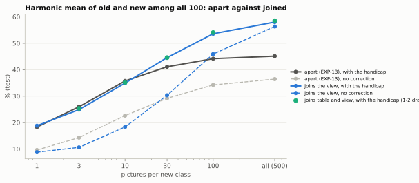
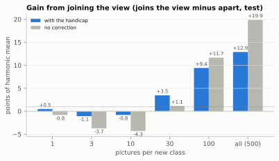
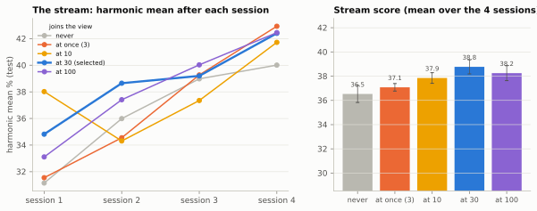
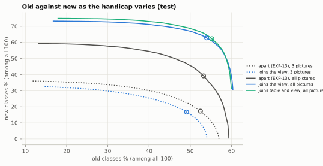

# EXP-14 · WHEN SHOULD A NEW CLASS JOIN THE VIEW?

**Experiment ID:** EXP-14 · **Part A written:** 2026-11-19, before any code was run · **Hardware:** free Kaggle GPU (the method must still fit the RTX 3050 laptop, 4 GB) · **Status:** COMPLETE (run 2026-11-19 on Kaggle). Verdict: **helps, but not enough**. Part B added at the end

This journal has two parts. **Part A** (this part) explains the experiment before it starts.
**Part B** will be added to the end of this same PDF when the experiment finishes. Part A
will not be edited after results exist, except for the status line above.

## 1. Why this experiment

### What happened before

The project thinks of a learning system as two parts: the **eyes**, which turn a picture into
a list of numbers describing it, and the **memory**, which stores what was learned about each
class and gives the answer.

- **EXP-1** was a plan only. It was never run.
- **EXP-2 to EXP-6** used eyes trained by backpropagation (best without old pictures: 39.6%
  on 80 classes).
- **EXP-7 and EXP-8**: eyes with no training (fixed picture patches) and a memory of class
  averages (**cards**) plus one **shared table**: 55.2% on 80 classes, no forgetting.
- **EXP-9**: a **learned view** (the directions along which the known classes differ most) and
  **borrowing** from the 2 nearest known cards: a new class from 3 pictures scores 33.5% among
  20 new classes.
- **EXP-10**: among all 100 classes the new ones are drowned out. A **handicap** on old classes
  only trades old answers for new ones. Putting the new classes into the tables and the view
  when they have 3 pictures **made things worse** (harmonic mean −3.6, `EXP-10-NEW-AMONG-OLD`).
- **EXP-11**: sharper eyes: 59.3% on 80 classes. A reference with the new classes' **all 500
  pictures put into the tables and the view** reached a harmonic mean of **52.9** with no
  correction (old 54.1, new 51.7).
- **EXP-12**: a switch "old class or new class?" from familiarity did not work.
- **EXP-13** measured how the score among all 100 classes grows with the pictures per new class,
  with the new classes **kept out of the tables and the view**. Readings from
  `EXP-13-HOW-MANY-PICTURES/results/summary.json`, test, 5 seeds:

| Pictures per new class | 1 | 3 | 10 | 30 | 100 | all (500) |
|---|---|---|---|---|---|---|
| Harmonic mean, with the handicap | 18.4 | 26.0 | 35.8 | 41.1 | 44.2 | 45.1 |
| Harmonic mean, no correction | 9.7 | 14.3 | 22.7 | 29.2 | 34.3 | **36.5** |
| New classes among themselves | 24.9 | 36.2 | 46.9 | 53.8 | 58.1 | 59.4 |

Moved or enlarged copies of a picture did not help (verdict "does not work").

### What stayed open

EXP-13 found **two limits**. Up to about 30 pictures, the limit is the card. Beyond that, the limit
is the **view**: with all 500 pictures, new classes kept out of the view reach a harmonic mean of
36.5 with no correction, against 52.9 when they are inside it (EXP-11). The view keeps the directions
that tell the **old** classes apart; a fox that is not part of it is seen only through
"dog-or-cat-or-wolf" directions.

So a new class should join the view at some point. EXP-10 says 3 pictures is too early; EXP-11 says
500 is fine. **Where the crossover lies, and whether the shared table matters as well as the view,
is unknown.** EXP-13's section 15 lists both as unverified.

### What the papers say

One Sonnet subagent, 2026-11-19 (literature log, section 12). Five papers were opened; none
measures after how many examples a new class should join a shared view.

| Paper | Tag | What it reports |
|---|---|---|
| McClelland, McNaughton, Lampinen, "Integration of new information in memory: new insights from a complementary learning systems perspective", Phil. Trans. R. Soc. B 375:20190637 (2020) | passages | Brain theory with small simulations. A fast store holds a new item at once; a slow "cortex" absorbs it later. The abstract says "the projection onto the known dimensions can be learned rapidly", but "learning the new dimension requires gradual interleaved learning". **This is the same split as our "card now, join the view later"** |
| Zhou et al., "Forward Compatible Few-Shot Class-Incremental Learning" (FACT), arXiv:2203.06953 | passages | Keeps the shared features fixed when new classes arrive; new classes get only an average. CIFAR-100, last session: 49.1%. The text says gains from more pictures per class become "trivial for K > 20" (figure only, no numbers read) |
| Akyürek et al., "Subspace Regularizers for Few-Shot Class Incremental Learning", ICLR 2022, arXiv:2110.07059 | passages | New classes are kept close to the directions of the old classes, which are not changed. miniImageNet, 5 pictures per class, last session: 46.8 against 26.5 for changing the representation |
| Chumachenko et al., "Incremental Fast Subclass Discriminant Analysis", arXiv:2002.04348 | passages (method; tables did not extract) | A closed-form update of a discriminant view as data arrive, "equal or close" to rebuilding it. About how to update, not when |
| Khawand et al., "Continual Learning with Deep Streaming Regularized Discriminant Analysis", arXiv:2309.08353 | passages (text; table did not extract) | Each class's own table is blended with the shared table (best blend 0.55 by search); a class's own table alone fails when it has little data |

The few-shot methods all keep new classes **out** of the shared directions when they have 1 to 5
pictures; none tests letting them in later. The brain theory says new directions should be added
slowly. No paper gives the crossover.

### So EXP-14 asks

**After how many pictures should a new class join the memory's learned view? And does a memory
that holds new classes apart first and lets them join once they have enough pictures (like
consolidation in the brain) beat one that never lets them join, or one that lets them join at
once?**

# Part A: the plan (written before the run)

## 2. The idea in plain words

**Cats and digits example.** The memory knows 80 classes from 500 pictures each. Its learned view
is like a set of questions it asks about every picture: "pointy ears or round?", "fur or
feathers?", "four legs on the ground or wings?". These questions were chosen because they tell the
80 known classes apart. A fox arrives. The memory makes a fox card, but it still asks only its old
questions, and a fox answers them much like a dog. The memory never asks "bushy tail and orange
coat?", because no known class needed that question.

**Joining the view** means adding the fox's question: one new direction, the one in which the fox's
card differs from everything the memory already distinguishes. It is computed in one step from the
fox's card and the existing shared table; nothing is trained. With 3 fox pictures, that direction is
partly about those 3 particular photos (a fox in snow, a fox at night), so the new question may be
a bad one. With 100 pictures it is about foxes.

**Three ways to treat a new class**, each from the same pictures:

| Name | What happens to the new class | Cost |
|---|---|---|
| **Apart** | a card only; the view is the old classes' view (EXP-13) | none |
| **View** | its card also adds new directions to the view; the shared table stays as it was | a few small calculations per class |
| **Table and view** | its pictures are also added to the shared table, and the view is rebuilt | rebuilding the view (about 4 seconds) |

**Part 1, the crossover.** Give each of the 20 new classes 1, 3, 10, 30, 100 or all 500 pictures,
and compare the three ways. This finds the number of pictures from which joining helps.

**Part 2, a stream with consolidation.** New classes arrive a few at a time and get more pictures
later, as a child sees a fox once and then more often. A class is held apart until it has at least
N pictures, then it joins the view. Compared: never joining, joining at once, and joining at 10, 30
or 100 pictures. N is chosen in the rehearsal (below), not on the test.

## 3. What is run

**Eyes and memory: EXP-11's version A2 and EXP-13's memory, unchanged.** 1,600 stencils,
two-sided, 4 quarters, mirrored (12,800 numbers per picture); compact tables; learned view of the
old classes with all directions; new cards by angle with borrowing from the 2 nearest known cards
(weight 1 picture). The same 80 known classes in 8 stages of 10, the same 20 surprise classes, the
same 5 seeds. Smoothing: 0.01, 0.03, 0.1, 0.3, 1. No copies.

**Naming:** every test picture among all classes by angle in the view, with the handicap h
subtracted from the **80 old classes'** scores (EXP-11's C1; h = 0 means no correction). h from
−0.2 to 0.5 in steps of 0.01, every value logged. New classes that joined the view still count as
new, and the handicap is never subtracted from them.

**How a class joins the view ("View").** The learned view is built from the cards of the known
classes, as seen through the shared table. A joining class adds its own card: the view then covers
the directions of all the old cards and all the joining cards. In practice, for each joining
class, the part of its card that the old view cannot express becomes one extra direction. The
old directions are unchanged, so the old classes' cards do not move. The new class's card is
then made exactly as before (average of its pictures in the view, borrowing from the 2 nearest
old cards), only now in the larger view.

**Table and view.** As in EXP-10's C4 and EXP-11's reference: the new pictures (and their mirror
images) are added to the running tables, the new classes become classes of the tables, and the
view is rebuilt from scratch from all classes. This costs a full rebuild per setting, so it is
measured on fewer draws (below).

| Part | Pictures per new class | Draws | Ways |
|---|---|---|---|
| 1, the crossover | 1, 3, 10, 30, 100, all (500) | 20, 20, 20, 20, 10, 1 (the same draws as EXP-13) | apart, view |
| 1, table and view | 3, 10, 30, 100, all | the first 2, 2, 1, 1, 1 of those draws | table and view |
| 2, the stream | see below | 10 runs of the stream | 5 rules |

**The stream.** The 20 new classes arrive in 4 sessions of 5 (in a random order for each run). A
class has 3 pictures in the session it arrives, then 10, 30 and 100 pictures in the next sessions
(more pictures of the same class keep arriving; earlier pictures are kept). After each session,
every test picture of the 80 old classes and of the classes that have arrived is named among all of
them. Joining rules: **never**; **at once** (3 pictures); **at 10**, **at 30**, **at 100**
pictures. At each session, every class that has reached N pictures is in the view, through its card
from all its pictures so far. The **stream score** is the harmonic mean of old and new, averaged
over the 4 sessions.

| Session | Classes that have arrived (pictures each) |
|---|---|
| 1 | 5 (3) |
| 2 | 5 (10), 5 (3) |
| 3 | 5 (30), 5 (10), 5 (3) |
| 4 | 5 (100), 5 (30), 5 (10), 5 (3) |

**Choosing settings: the rehearsal**, as in EXP-9 to EXP-13. The memory after stage 6 knows 60
classes; the 20 classes of stages 7 and 8 play the new ones, in the same three ways and the same
stream. For each way (or joining rule) and each number of pictures, among all smoothings and
handicaps, keep those where the old classes stay within 5 points of no correction (h = 0, same
smoothing) in the rehearsal; of those, take the highest harmonic mean (for the stream: the highest
stream score, with the old-class accuracy averaged over the 4 sessions). The same rule gives the "no
correction" readings (h = 0, the smoothing with the best rehearsal harmonic mean). **The selected
joining rule N\*** is the one with the highest rehearsal stream score. All choosing is done
afterwards, from the rehearsal rows only, in `src/figures.py`.

## 4. What is measured

| | Measurement | Why it matters |
|---|---|---|
| M1 | The crossover: old, new, harmonic mean and new-among-themselves against pictures per new class, apart and in the view, with the handicap and without | From how many pictures joining helps |
| M2 | Table and view against view only, on the same draws | Whether the shared table must change too, or only the view |
| M3 | The stream: stream score and the score at each session, for each joining rule | Whether "hold apart, then join" works as a running system |
| M4 | The handicap with all pictures, in the view: with minus without | Whether joining removes the need for the handicap |
| M5 | Rehearsal against test | Can the choosing be trusted? |
| M6 | Time, GPU energy, peak GPU memory | Cost, and whether it fits the laptop |

## 5. How the result will be judged (written before the run)

All scores are means of 5 seeds, on the test, at the settings chosen in the rehearsal.

**Step 0: are the earlier results rebuilt?**

- (a) Apart, smoothing 0.1, h = 0.08, 3 pictures: old within 0.5 of 52.47 and new within 0.5 of
  17.28 (EXP-11 to EXP-13).
- (b) Table and view with all pictures, EXP-11's cards (class average, no borrowing), no
  correction, smoothing 0.1: old within 0.5 of 54.09 and new within 0.5 of 51.67 (EXP-11's
  reference, `EXP-11-SHARPER-EYES/results/summary.json`).

**Step 1: the crossover (a description, not a pass or fail).** For each number of pictures, the
gain from joining = view minus apart, harmonic mean, with the handicap and with no correction.
The **crossover** is the smallest measured number of pictures from which the gain with the
handicap is +1.0 or more, at that number and at every larger one.

**Step 2: does the table matter?** With all pictures, table and view minus view only, harmonic mean
with the handicap, same draw. Under 1.0: **the view is enough**; 1.0 or more: **the table matters
too**.

**Step 3: the main verdict, the stream.** The selected joining rule N\* against never joining:

| | Condition |
|---|---|
| (a) | stream score gain of 3.0 or more over never joining |
| (b) | N\*'s old-class accuracy (averaged over the 4 sessions) no more than 6 points under its own no correction (5 in the rehearsal, 1 of slack) |
| (c) | peak GPU memory 3.5 GB or less |

| Reading | Verdict |
|---|---|
| (a) to (c) all hold | **works** |
| (c) holds, and the stream score gain is 1.0 or more, but (a) or (b) fails | **helps, but not enough** |
| anything else | **does not work** |

**Step 4: does holding apart matter?** If N\* is not "at once" and its stream score is 1.0 or more
above "at once": **yes, holding apart matters**. Otherwise: **no** (joining at once is as good).

**Step 5: is the handicap still needed once new classes are in the view?** With all pictures, in
the view, the harmonic mean with the handicap minus with no correction. Under 1.0: **not needed**.

**Step 6: can the rehearsal be trusted?** If N\*'s test stream score is within 1.0 of the best
joining rule's on the test: **yes**.

**What I expect, written down now.**

- Step 0 passes exactly, both parts.
- In the view, harmonic mean with the handicap at 1 / 3 / 10 / 30 / 100 / all pictures: about
  17 / 25 / 37 / 44 / 49 / 52 (apart: 18.4 / 26.0 / 35.8 / 41.1 / 44.2 / 45.1). With no correction:
  about 9 / 14 / 25 / 35 / 45 / 50 (apart: 9.7 / 14.3 / 22.7 / 29.2 / 34.3 / 36.5). So joining
  hurts a little at 1 and 3 pictures and helps from 10 on: **crossover at 10 pictures**.
- Step 2: table and view adds under 1.0 over the view alone: **the view is enough**.
- Step 3: N\* is "at 10" or "at 30"; its stream score is about 2 points above never joining. Verdict
  **"helps, but not enough"**, because in most sessions most new classes have few pictures, and few
  pictures is where joining helps least.
- Step 4: **yes**, joining at once is about 1 point worse than N\*.
- Step 5: **not needed** (under 1.0) once the new classes are in the view with all their pictures.
- Step 6: yes. Peak GPU memory about 2.5 GB.

My main prediction was wrong in EXP-9, EXP-10, EXP-12 and EXP-13 and right in EXP-11. If it is
wrong again, it stays in the journal.

## 6. What carries over beyond pictures

| Part | Depends on pictures? |
|---|---|
| A memory with a learned view, and the step that adds a new class's direction to it | **no**. It needs only the class averages and the shared table, which a language memory would have too |
| The crossover: from how many examples a new class should reshape the view | **no**. The number itself may differ for words or topics |
| Holding new knowledge apart, then consolidating it (the stream) | **no**. This is the part most likely to matter for a language model that keeps learning |
| The eyes (stencils, mirror images) | **yes**, unchanged from EXP-11 |

## 7. What could go wrong

- **A new direction from few pictures fits those pictures.** The fox's direction from 3 pictures
  points partly at "snow" and "night". Old pictures with snow in them may then look like foxes. This
  is why joining at once may hurt.
- **The new directions are measured with the old shared table.** In "view", the table does not
  know how a fox varies from fox to fox. Table and view fixes this, but only on a few draws.
- **The handicap and the joining interact.** A joined class is still "new" for the handicap, so the
  handicap may now push too many answers to new classes. The rehearsal chooses h for each rule
  separately to allow for this.
- **The stream is short.** 4 sessions, at most 100 pictures per class, 10 runs. A class never
  reaches 500 pictures in the stream, so "at 100" is joined only in the last session.
- **Table and view uses 1 or 2 draws per point.** Its readings are less certain.
- **5 seeds, one dataset, images only. The surprise classes are fixed.**

## 8. Time and disk

| | Expected |
|---|---|
| Run time | about 60 minutes on a free Kaggle GPU (EXP-13 took 16; rebuilding the view for table and view adds about 6 minutes per seed). About 25.3 of the roughly 30 free weekly hours are used, so about 1 is needed |
| Disk in this folder | 0.15 GB for this experiment's own Python environment (copied from EXP-13's, so nothing is downloaded), under 0.05 GB of results and figures |
| Downloads | none. A short code check on the laptop borrows EXP-2's environment and CIFAR-100 without changing them |
| GPU memory | about 2.5 GB (EXP-13: 2.2 GB) |

## 9. Words used in this journal

| Word | Meaning here |
|---|---|
| Class | One kind of thing to recognise |
| Eyes (features) | The part that turns a picture into a list of numbers (the description) |
| Memory | The part that stores what was learned about each class and gives the answer |
| Card | The average description of one class |
| Shared table (covariance) | A table of which numbers of a description rise and fall together inside a class |
| Smoothing | How strongly the shared table is evened out before use |
| Learned view | The directions along which the known classes differ most, computed in one step from the cards and the shared table (EXP-9). Like a set of questions the memory asks about every picture |
| Joining the view | Adding a new class's own direction to the view, computed in one step from its card |
| Consolidation | Holding a new memory apart first and folding it into the general structure later. The brain is thought to do this between the hippocampus and the cortex |
| Borrowing | Mixing the cards of the 2 nearest known classes into a new class's card (EXP-9) |
| Handicap | One amount subtracted from every old class's score before the answer is picked (EXP-10) |
| Harmonic mean | One score from two: 2 × a × b / (a + b). It is high only if both are high |
| Stream score | The harmonic mean of old and new, averaged over the 4 sessions of the stream |
| Rehearsal | Choosing settings by pretending the most recent known classes are new. Uses no test class |
| Backpropagation | The usual way to train a network: push corrections back through all layers, many times |
| Seed | One repeat with a different random shuffle |

# Part B: the readings (added after the run, 2026-11-19)

Part A above was not changed after the run, except the one status line at the top of page 1.

## 10. What was actually run

The plan in section 3 was run once, on a free Kaggle GPU (Tesla T4), as a private job named
`exp14-when-to-join`. It took **46 minutes** for 5 seeds. The result files were downloaded into
`results/`: `runs.jsonl`, `meta.json` and `kaggle_run.log`. There were no errors. `src/figures.py`
turned `runs.jsonl` into `results/summary.json` and the figures, with the choosing rules of section 3.
**Every number below comes from `results/summary.json`** unless another file is named: means of 5
seeds on the test.

**Things that differ from Part A, or that need saying:**

| Item | What was done |
|---|---|
| Code checks before the run | A small trial (1 seed, a tenth of the stencils and pictures) ran the whole code; its "apart" numbers matched EXP-13's small trial to rounding. A separate check on random numbers confirmed that adding a class's directions to the view, as in section 3, gives the same view as rebuilding it from scratch with the old table (largest difference in a score: 0.00000002). The trial numbers were thrown away |
| Laptop check | **Not completed.** The full-size check on the laptop finished the "apart" part of the stage-6 rehearsal (old 53.5%, new 22.3% at smoothing 0.3, the same as EXP-13), then was stopped by the computer because its ordinary memory (RAM) ran low, with other programs open. The GPU did not run out. So the peak GPU memory below was measured **on the T4 only**. The code was then changed to keep fewer locked copies in ordinary memory on the laptop; this changes no number |
| Run time | 46 minutes, not 60. About 0.8 Kaggle hours used |
| Extra check (not in Part A) | Each joining rule picks its own handicap in the rehearsal, so a rule's stream gain can come partly from a different handicap. `src/extra_matched.py` reads every rule at the settings chosen for "never" (`results/extra_matched.json`). It is reported in section 11.4 and does not change the verdict |

Nothing in sections 1 to 9 was changed.

## 11. The readings

### 11.1 Step 0: are the earlier results rebuilt? Yes, exactly

- (a) Apart, smoothing 0.1, handicap 0.08, 3 pictures: old **52.47%**, new **17.28%** (EXP-13: the
  same).
- (b) Table and view with all pictures, EXP-11's cards, no correction, smoothing 0.1: old **54.09%**,
  new **51.67%** (EXP-11: the same).

### 11.2 The crossover: when does joining the view help?

*Figure 1. Harmonic mean of old and new among all 100 classes, against pictures per new class.
Grey: new classes held apart (EXP-13). Blue: new classes join the view. Solid: with the handicap;
dashed: no correction. Green dots: joining both the shared table and the view (1 or 2 draws).*

| Pictures per new class | 1 | 3 | 10 | 30 | 100 | all (500) |
|---|---|---|---|---|---|---|
| Apart, with the handicap | 18.4 | 26.0 | 35.8 | 41.1 | 44.2 | 45.1 |
| **Joins the view, with the handicap** | 18.8 | 24.9 | 35.0 | 44.6 | 53.6 | **58.0** |
| Old / new, joined, with the handicap | 51.3 / 11.5 | 49.1 / 16.7 | 52.1 / 26.3 | 54.7 / 37.6 | 55.2 / 52.1 | 54.0 / 62.8 |
| Apart, no correction | 9.7 | 14.3 | 22.7 | 29.2 | 34.3 | 36.5 |
| **Joins the view, no correction** | 8.8 | 10.7 | 18.4 | 30.4 | 45.9 | **56.4** |
| New among themselves: apart / joined | 24.9 / 24.1 | 36.2 / 33.1 | 46.9 / 44.3 | 53.8 / 55.5 | 58.1 / 65.8 | 59.4 / 73.3 |

*Figure 2. Gain from joining the view (joins the view minus apart), in points of harmonic mean.
Dotted line: the +1.0 used for the crossover.*

| Pictures per new class | 1 | 3 | 10 | 30 | 100 | all |
|---|---|---|---|---|---|---|
| Gain, with the handicap | +0.5 | −1.1 | −0.8 | **+3.5** | **+9.4** | **+12.9** |
| Gain, no correction | −0.8 | −3.7 | −4.3 | +1.2 | +11.7 | +19.9 |

In plain words:

- **With few pictures, joining the view does not help; it hurts a little.** At 3 and 10 pictures
  the harmonic mean falls by about 1 point with the handicap and by about 4 points without it. A
  fox direction from 3 photos is mostly about those 3 photos, not about foxes. Even among
  themselves the new classes do slightly worse (36.2% → 33.1% at 3 pictures).
- **From 30 pictures on, joining helps, and the help grows fast.** At 100 pictures the harmonic
  mean rises from 44.2 to 53.6; with all pictures from 45.1 to **58.0**. That is the highest score
  for new classes among old ones in the project so far. With all their pictures, the joined new
  classes score **62.8%** among all 100 while the old classes keep 54.0%, and 73.3% among
  themselves (59.4% when apart).
- **So the crossover is at 30 pictures.** This is the "two limits" of EXP-13 made concrete: below
  30 pictures the card is the limit and joining cannot fix it; above 30 the view was the limit, and
  joining removes most of it.
- With all pictures and no correction, joining gives 56.4, about the same as EXP-11's full
  reference at the same smoothing (0.01: old 57.7, new 55.4, harmonic mean 56.6; reference rows in
  `results/runs.jsonl`). The 52.9 quoted in section 1 was at smoothing 0.1.

### 11.3 Does the shared table matter too? No

| Pictures per new class (draws) | 3 (2) | 10 (2) | 30 (1) | 100 (1) | all (1) |
|---|---|---|---|---|---|
| Joins table and view, with the handicap | 25.4 | 35.2 | 44.6 | 54.1 | **58.5** |
| Joins the view only, same draws | 25.7 | 35.2 | 44.7 | 53.6 | **58.1** |
| Difference | −0.3 | 0.0 | −0.1 | +0.4 | **+0.5** |

Adding the new pictures to the shared table and rebuilding the whole view gives almost exactly
what the cheap step gives: adding one direction per class to the view, computed from its card and
the **old** table. So the old table already knows well enough how pictures vary inside a class;
what the new class needs is its own question in the view, not a new table. In the green dots of
figure 1 the two are on top of each other.

### 11.4 The stream: hold apart, then join

*Figure 3. Left: harmonic mean after each session of the stream, for each joining rule. Right: the
stream score (mean over the 4 sessions), with the spread over 5 seeds. All with the handicap, at
the settings chosen in the rehearsal.*

| Joining rule | Stream score | Old / new (mean of sessions) | Sessions 1 / 2 / 3 / 4 | No correction | Rehearsal score | Handicap chosen |
|---|---|---|---|---|---|---|
| never | 36.5 | 54.8 / 27.8 | 31.1 / 36.0 / 39.0 / 40.0 | 20.5 | 41.30 | 0.10 |
| at once (3) | 37.1 | 54.2 / 28.8 | 31.6 / 34.5 / 39.3 / 42.9 | 18.1 | 41.07 | 0.20 |
| at 10 | 37.9 | 55.0 / 29.1 | 38.0 / 34.3 / 37.4 / 41.7 | 19.9 | 42.69 | 0.14 |
| **at 30 (selected)** | **38.8** | 54.7 / 30.3 | 34.8 / 38.6 / 39.2 / 42.4 | 21.2 | **43.35** | 0.12 |
| at 100 | 38.2 | 54.5 / 29.9 | 33.1 / 37.4 / 40.0 / 42.5 | 21.1 | 42.79 | 0.11 |

All rules chose smoothing 0.03. The rehearsal picked **"at 30"**, which is also the best on the test.
It beats never joining by **+2.2** and joining at once by **+1.7**.

**Read this table with care.** In session 1 every class has 3 pictures, so the rules "never", "at
10", "at 30" and "at 100" have the **same memory** in that session; their session-1 scores (31.1,
38.0, 34.8, 33.1) differ only because each rule chose a different handicap, and session 1 has only 5
new classes (spread over seeds about ±3). The extra check (`results/extra_matched.json`) puts every
rule at the settings chosen for "never" (smoothing 0.03, handicap 0.10):

| Joining rule, at never's settings | at once | at 10 | at 30 | at 100 |
|---|---|---|---|---|
| Stream score minus never | −9.4 | −3.5 | −0.3 | +0.4 (all 5 seeds) |
| The same at handicap 0 (no correction) | −1.7 | −0.4 | +1.0 | +1.0 |

So at the **same** handicap, joining at 30 or 100 is only about as good as never joining, and joining
early is clearly worse. The +2.2 of the selected rule needs joining **and** a handicap re-chosen for
it. That is allowed by the rule in section 3 (section 7 expected it: "the rehearsal chooses h for
each rule separately"), but it means joining changes how the new classes' scores compare with the
old ones, and one handicap for all new classes, joined or not, fits them badly.

The stream is short: in its 4 sessions, a class reaches 30 pictures only in session 3 and 100 only
in session 4. Most of the time most classes have few pictures, which is where joining does not help.

### 11.5 Old against new

*Figure 4. Old against new among all 100 as the handicap varies: 3 pictures (dotted) and all
pictures (solid), apart (grey) and joined (blue); green: table and view with all pictures. Circles:
the settings chosen in the rehearsal.*

With 3 pictures the joined curve lies just inside the apart one. With all pictures, joining moves
the whole curve far outwards: the memory can have the old classes at 54% and the new ones at 63% at
the same time. Apart, with all pictures, keeping the old classes at 54% leaves the new ones under 40%.

### 11.6 Cost

| | Reading |
|---|---|
| Peak GPU memory in use | **2.4 GB** (2,385 MB; 3.0 GB including reserve), on the T4. Not measured on the laptop for the parts new in EXP-14 (section 10) |
| Ordinary memory (RAM) | 5.3 GB at its peak, on Kaggle. This is the experiment holding the descriptions of all pictures for all the tests, not the memory itself |
| Time per seed (T4) | 544 s: describing 84 s, tables 11 s, views 40 s, **joining for every draw, rule and setting 117 s**, table and view (rebuilt for 7 draws per task) 286 s, scoring 7 s |
| GPU energy per seed | 5.4 Wh |

Joining costs no training and no new table: a few small calculations per class.

## 12. The verdict, by the rule written in section 5

| Step | Reading | Result |
|---|---|---|
| 0. Rebuild | (a) 52.47 / 17.28; (b) 54.09 / 51.67 | passed, exactly |
| 1. The crossover | gain with the handicap +0.5, −1.1, −0.8, **+3.5, +9.4, +12.9** at 1, 3, 10, 30, 100, all | **30 pictures** |
| 2. Does the table matter? | all pictures: table and view 58.54 − view 58.05 = **+0.49** (1.0 needed) | **the view is enough** |
| 3(a) stream gain of N\* over never | at 30: 38.77 − 36.53 = **+2.24** (3.0 needed) | **fails** |
| 3(b) N\*'s old classes | 54.74, its own no correction 58.72: 4.0 under (6 allowed) | holds |
| 3(c) peak GPU memory | 2.4 GB (3.5 GB allowed) | holds |
| **3. Main verdict** | (c) holds and the gain is 1.0 or more, but (a) fails | **helps, but not enough** |
| 4. Does holding apart matter? | N\* = at 30, not at once; 38.77 − 37.08 = **+1.69** | **yes** |
| 5. Is the handicap still needed in the view? | all pictures, joined: 58.05 with − 56.37 without = **+1.68** | **yes, still needed** (but it is worth far less than apart: +8.7 in EXP-13) |
| 6. Can the rehearsal be trusted? | N\* (at 30) is also the best on the test | **yes** |

## 13. Was the expectation in section 5 right?

| What I wrote before the run | What happened | |
|---|---|---|
| Step 0 passes exactly | exactly | right |
| Joined, with the handicap: 17 / 25 / 37 / 44 / 49 / 52 | 18.8 / 24.9 / 35.0 / 44.6 / 53.6 / 58.0 | right up to 30; **too low** with many pictures |
| Joined, no correction: 9 / 14 / 25 / 35 / 45 / 50 | 8.8 / 10.7 / 18.4 / 30.4 / 45.9 / 56.4 | too high at 3 to 30; too low with all pictures |
| Crossover at 10 pictures | **30** | wrong |
| The view is enough | the view is enough (+0.49) | right |
| N\* is at 10 or at 30, about +2 over never | at 30, +2.24 | right |
| Verdict "helps, but not enough" | "helps, but not enough" | right |
| Holding apart matters, at once about 1 point worse | yes, 1.69 worse | right |
| The handicap is not needed once joined with all pictures | still worth +1.68 | **wrong**, though much smaller than apart |
| The rehearsal picks well; about 2.5 GB | yes; 2.4 GB | right |

Two things went wrong in the same direction: joining with few pictures is worse than I expected,
and joining with many pictures is better.

## 14. What it means for the project

**1. The view limit found in EXP-13 is real, and it can be removed cheaply.** A class with many
pictures that joins the view gains up to 13 points of harmonic mean among all 100 classes. Joining is
one closed-form step per class; nothing is trained, the shared table is not touched, and the old
classes' directions do not change. With all pictures the new classes reach 62.8% among 100 with the
old ones at 54.0%: the new classes are no longer drowned out.

**2. A new class should not reshape the view until it has about 30 examples.** Below that, its
direction is about the particular pictures, not the class, and joining makes things slightly worse.
This fits the brain theory quoted in section 1 (McClelland and colleagues): a new item can be used at
once through the old dimensions, but a new dimension should be added only slowly. Here "slowly" is
measured: about 30 examples.

**3. Hold apart, then join, works as a running system, but gains little in a short stream.** In the
stream the best rule ("at 30") adds 2.2 points over never joining. Most classes in a short stream
have few pictures, and few pictures is where joining cannot help. The gain also needs the handicap to
be re-chosen for the rule: at the same handicap it disappears (section 11.4). A single handicap
applied to old classes only does not suit two kinds of new class (held apart and joined) at once.

**4. The shared table does not need to change.** Rebuilding the whole view with a new table gives
the same as the cheap step (difference under 0.5). For a growing memory, this matters: what is
learned about "how things vary" from the old classes can be kept fixed, and new knowledge enters as
new questions only.

**5. The few-picture problem is still open.** From 3 pictures, a new class among all 100 is at a
harmonic mean of about 26, whichever of the methods from EXP-10 to EXP-14 is used. Every closed-form
step on the memory side (handicap, certainty, old-or-new switch, copies, joining) has now been tried
at 3 pictures without a real gain.

**6. Against the three goals.** No forgetting: still achieved (the old classes' cards and directions
never change). Cheap: achieved (2.4 GB of GPU memory, about 9 minutes per seed for all the tests,
joining itself a few seconds). A new class from a handful of pictures among old ones: **not
achieved**. From about 30 pictures on it is now much better than before.

## 15. What is still unverified

- **The laptop.** The parts new in EXP-14 were not run on the laptop's RTX 3050 to the end (section
  10). The T4 peak was 2.4 GB of 4 GB, so it should fit, but this is not measured.
- **Why joining needs a different handicap.** Only that it does was measured (section 11.4); the
  reason was not.
- **A longer stream.** Classes never got past 100 pictures, and there were only 4 sessions. Whether
  the gain of "at 30" grows when classes keep arriving and keep getting pictures is not known.
- **Gradual joining** (a direction that counts for little at first and more as pictures arrive) was
  not tried; joining was all or nothing.
- **Table and view** used 1 or 2 draws per point.
- 5 seeds, one dataset (CIFAR-100), images only. The surprise classes are fixed.

## 16. What carries over beyond pictures

| Part | Depends on pictures? |
|---|---|
| Adding a new class to a learned view in one step, from its average and the old shared table, equal to a full rebuild with that table | **no** |
| The crossover: a new class should reshape the view only after about 30 examples | **no**, though the number may differ for words or topics |
| The old shared table can stay fixed while new classes join | **no** |
| Hold apart, then join, in a stream | **no** |
| The eyes (stencils, mirror images) | **yes**, unchanged from EXP-11 |

## 17. What the next experiment should be, and why

**Proposed EXP-15: gradual joining, with a separate handicap for joined classes.**

Why: EXP-14 shows that joining the view helps a lot from 30 pictures on and hurts a little below
that, and that it is all-or-nothing: a class is either outside the view or fully inside it. It also
shows that one handicap does not suit held-apart and joined new classes together (section 11.4). Two
closed-form changes follow directly:

1. **Gradual joining.** A new class's direction enters the view at once, but with a weight that
   grows with its pictures, n / (n + k), with k chosen in the rehearsal. With 3 pictures the fox's
   question counts for little; with 100 it counts almost fully. This is the brain-like version of
   consolidation: the new dimension is added slowly, not switched on at a threshold. If it works, it
   should give some of the gain below 30 pictures and keep the gain above.
2. **Two handicaps**, one for classes held apart (or barely joined) and one for joined classes,
   chosen in the rehearsal.
3. **A longer stream**: 8 sessions, with classes reaching up to 500 pictures, so that consolidation
   has time to pay off. Compared: never, at 30 (EXP-14's best), gradual.
4. Keep A2's eyes, the old-class limit, the rehearsal rule and the step-0 rebuilds.

Nothing in it is image-specific. This is a proposal. It needs its own Part A and the owner's
go-ahead before any code is run.
