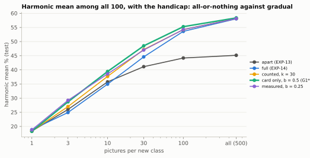
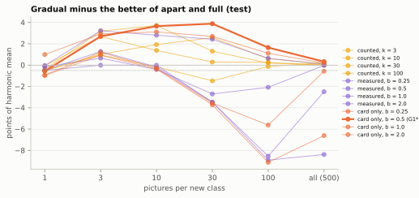
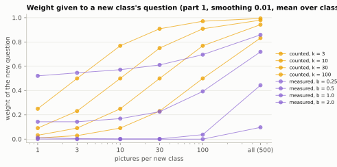
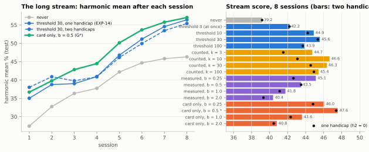
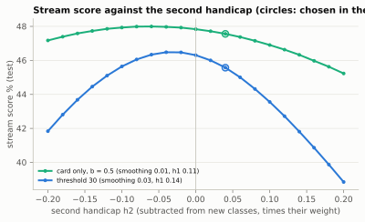

# EXP-15 · GRADUAL JOINING: LET A NEW CLASS'S QUESTION COUNT MORE AS IT EARNS IT

**Experiment ID:** EXP-15 · **Part A written:** 2026-11-19, before any code was run · **Hardware:** free Kaggle GPU (the method must still fit the RTX 3050 laptop, 4 GB) · **Status:** COMPLETE (run 2026-11-19 on Kaggle). Verdict: **works**. Part B added at the end

This journal has two parts. **Part A** (this part) explains the experiment before it starts.
**Part B** will be added to the end of this same PDF when the experiment finishes. Part A
will not be edited after results exist, except for the status line above.

## 1. Why this experiment

### What happened before

The project thinks of a learning system as two parts: the **eyes**, which turn a picture into
a list of numbers describing it, and the **memory**, which stores what was learned about each
class and gives the answer.

- **EXP-1** was a plan only. It was never run.
- **EXP-2 to EXP-6** used eyes trained by backpropagation (best without old pictures: 39.6%
  on 80 classes).
- **EXP-7 to EXP-9**: eyes with no training (fixed picture patches), a memory of class averages
  (**cards**) plus one **shared table**, and a **learned view** (the directions along which the
  known classes differ most): 55.2% on 80 classes, no forgetting; a new class from 3 pictures scores
  33.5% among 20 new classes.
- **EXP-10 to EXP-12**: among all 100 classes, new classes are drowned out. A **handicap** on old
  classes only trades old answers for new ones. An "old or new?" switch did not work.
- **EXP-11**: sharper eyes (mirrored pictures, two-sided answers): 59.3% on 80 classes.
- **EXP-13**: the score among all 100 grows with the pictures per new class (harmonic mean 26 at 3
  pictures, 45 with all 500), but new classes kept out of the view stay held back.
- **EXP-14** let new classes **join the view**: each joining class adds one new direction (a new
  "question" the memory asks of every picture), computed in one step from its card and the old
  shared table. Readings from `EXP-14-WHEN-TO-JOIN/results/summary.json`, test, 5 seeds:

| Pictures per new class | 1 | 3 | 10 | 30 | 100 | all (500) |
|---|---|---|---|---|---|---|
| Harmonic mean, held apart (with the handicap) | 18.4 | 26.0 | 35.8 | 41.1 | 44.2 | 45.1 |
| **Harmonic mean, joined (with the handicap)** | 18.8 | 24.9 | 35.0 | 44.6 | 53.6 | **58.0** |
| Gain from joining | +0.5 | **−1.1** | **−0.8** | +3.5 | +9.4 | **+12.9** |

  Rebuilding the shared table as well added only +0.5: the cheap step is enough. In a stream of 4
  sessions (5 new classes per session, each class getting 3, 10, 30 and 100 pictures over time),
  joining once a class had 30 pictures scored 38.8 against 36.5 for never joining (+2.2; 3.0 was
  needed), so the verdict was **"helps, but not enough"**.

### What stayed open

Three things, all in EXP-14's section 14:

1. **Joining is all or nothing.** Below 30 pictures, a new class's question is mostly about its few
   photos (a fox in snow, a fox at night) and joining hurts a little. Above 30 it helps a lot. A
   threshold throws away the help a class could give between 10 and 30 pictures, and lets it in at
   full strength the moment it crosses 30.
2. **One handicap does not suit two kinds of new class.** At the same handicap as "never", joining
   at 30 gave −0.3, and joining at once −9.4 (`EXP-14-WHEN-TO-JOIN/results/extra_matched.json`).
   The +2.2 needed a handicap re-chosen for joined classes. Held-apart and joined new classes
   compete differently, but the handicap treats them the same.
3. **The stream was short.** A class reached 100 pictures only in the last session, so
   consolidation had little time to pay off.

### What the papers say

One Sonnet subagent, 2026-11-19 (literature log, section 13). Seven papers were opened; all were
read through passages extracted from the full text. Conference names are unverified.

| Paper | What it reports | For EXP-15 |
|---|---|---|
| Tibshirani et al., "Diagnosis of multiple cancer types by shrunken centroids of gene expression", PNAS 2002 | Each class average is pulled toward the overall average: its difference is reduced by a noise-sized amount and set to zero if smaller (one amount for all classes, chosen by cross-validation) | The nearest precedent for a "measured" shrinkage of a new class's novelty |
| Wu et al., "Large Scale Incremental Learning" (BiC), arXiv:1905.13260 | New-class scores get their own scale and offset, fitted on a balanced set of stored old and new examples. CIFAR-100, 100 classes: 56.69% | Precedent for a separate handicap for new classes; we keep no old pictures, so ours is chosen in the rehearsal |
| Zhao et al., "Maintaining Discrimination and Fairness in Class Incremental Learning" (Weight Aligning), arXiv:1911.07053 | New classes are over-predicted because of how their weights are built; one scale from stored statistics fixes it (CIFAR-100, 5 steps: 55.3 → 61.5) | How a new class is built can bias its scores; the fix can come from what the memory stores |
| Yang et al., "Free Lunch for Few-shot Learning: Distribution Calibration", arXiv:2101.06395 | A new class's average is mixed with the 2 nearest known classes' averages, with fixed weights | This is our borrowing (EXP-9) |
| McDonnell et al. (RanPAC), arXiv:2307.02251; Goswami et al. (FeCAM), arXiv:2309.14062 | Closed-form memories on pretrained features; one global shrinkage amount chosen on held-out data | No per-class shrinkage by number of examples |
| Kumaran, Hassabis, McClelland, Trends in Cognitive Sciences 2016 | Fast integration of new knowledge into the slow "cortex" is safe when it fits what is known; when it does not fit, it must be slow | Supports joining by degrees, and by how much the new class adds |

No paper weights a new class's discriminant direction by how much evidence stands behind it.

### So EXP-15 asks

**Does letting a new class's question count for little at first and more as its pictures arrive
(gradual joining), with its own handicap, beat EXP-14's all-or-nothing joining at 30 pictures? And
does holding apart and joining pay off over a longer stream?**

# Part A: the plan (written before the run)

## 2. The idea in plain words

**Cats, dogs and a fox.** The memory knows 80 classes. Its view is a set of questions, such as
"pointy ears or round?", chosen to tell those 80 apart. A fox arrives with 3 photos. EXP-14 could
either not ask a fox question at all (apart), or ask the fox question at full volume (joined). With
3 photos, the fox question is really "is it snowy and dark?", and asking it at full volume makes
snowy pictures of wolves look like foxes.

**Gradual joining** asks the fox question **at a volume that grows with the evidence**. With 3
photos it is a whisper, with 30 it is clear, with 500 it is at full volume. In numbers, every
picture's answer to the fox question is multiplied by a weight w between 0 (apart) and 1 (fully
joined). Nothing is trained; the weight is one number per class.

**Two ways to set the volume**, each with one setting chosen in the rehearsal:

| Name | Weight w | Meaning |
|---|---|---|
| **Counted** | n / (n + k), n = pictures of the class; k = 3, 10, 30 or 100 | "Half volume at k pictures." The same for every class |
| **Measured** | max(0, 1 − β × noise / found) | "How much of what this class seems to add is real?" Per class (below); β = 0.25, 0.5, 1 or 2 |

**The measured weight.** A class's question is built from the part of its card that the old view
cannot express (its **novelty**). With few pictures, that part is mostly chance: the particular
photos. How much chance to expect can be computed from what the memory already stores. The shared
table says how much pictures of one class differ from each other, so the expected size of the
chance part of an average of n pictures is about (table spread) / n. The **found** size is measured
directly on the card. If found is no bigger than the expected chance, the class adds nothing yet
(w = 0); if found is much bigger, it is mostly real (w near 1). This is the same shape as the shrunken
centroids of Tibshirani and colleagues. β allows for the mirror images (a picture and its mirror are
averaged, which makes the chance part smaller than the table's spread suggests).

**A third variant, "measured, card only"**: the pictures answer the fox question at full volume, and
only the fox **card's** answer is turned down by w. This tests a different reading of the problem: the
question is fine, but the card exaggerates how fox-like a fox is along it.

**A second handicap.** As before, h1 is subtracted from the 80 old classes' scores. Now a second
amount, h2 × w, is subtracted from each new class's score (negative h2 is a boost). A held-apart class
(w = 0) is not affected. For EXP-14's all-or-nothing rules this is exactly "one handicap for old
classes, one for joined classes" (as in BiC, but chosen in the rehearsal, not from stored old pictures).

**A longer stream.** 8 sessions. 5 new classes arrive in each of sessions 1 to 4; in sessions 5 to 8
no class arrives, but every class keeps getting pictures: 3 in the session it arrives, then 10, 30,
60, 100, 200, 300 and 500. Sessions 1 to 3 are identical to EXP-14's stream.

## 3. What is run

**Eyes and memory: EXP-14's, unchanged.** A2 eyes (1,600 stencils, two-sided, 4 quarters, mirrored;
12,800 numbers per picture), compact tables, learned view of the old classes with all directions, new
cards by angle with borrowing from the 2 nearest known cards (weight 1 picture). The same 80 known
classes in 8 stages of 10, the same 20 surprise classes, the same 5 seeds and draws. Smoothing 0.01,
0.03, 0.1, 0.3, 1. Joining as in EXP-14: for each class the part of its card, through the old shared
table, that the old directions cannot express, made into one new direction (classes in order of
arrival); the shared table is never changed. The "table and view" way is dropped (EXP-14: +0.5).

**The ways.** Every way uses the same new directions; only the weights differ, so they cost little.

| Way | Weight of a new class's question |
|---|---|
| apart | 0 (EXP-13) |
| full | 1 (EXP-14's "view") |
| counted, k = 3, 10, 30, 100 | n / (n + k) |
| measured, β = 0.25, 0.5, 1, 2 | max(0, 1 − β s² / (n f²)) |
| measured, card only, β = 0.25, 0.5, 1, 2 | pictures 1; the card's new part × that weight |
| threshold at 3, 10, 30, 100 (stream only) | 0 below the threshold, 1 from it (EXP-14's rules) |

Here f² is the squared size of the card's novelty (measured on the class's average description,
through the old table), and s² the expected squared size of the novelty of a single description that
is pure chance. s² is computed from the shared table at each smoothing: (d − r) − γ m (tr(T⁻¹) −
‖P‖²), where d is 12,800, r the number of old directions, γ the smoothing, m the table's mean
diagonal, T the smoothed table and P the old view. The trace of T⁻¹ is estimated with 128 random
probes. As a check of this noise model, the actual chance part is also measured on the new classes'
own pictures (30 per class) and the ratio to s² is logged.

**Part 1, the crossover**: 1, 3, 10, 30, 100 and all pictures per new class, the same draws as
EXP-13 and EXP-14 (20, 20, 20, 20, 10, 1), all 14 part-1 ways, every handicap h1 from −0.2 to 0.5 in
steps of 0.01 (no second handicap: all new classes have the same number of pictures).

**Part 2, the stream**: 10 runs; 8 sessions; the 17 stream rules (never, 4 thresholds, 4 counted,
4 measured, 4 measured card only). Every h1 (71 values) and every h2 from −0.2 to 0.2 in steps of
0.02 (21 values) is logged, averaged over the 10 runs. After each session every test picture of the
80 old classes and of the arrived classes is named among all of them. **Stream score**: the harmonic
mean of old and new, averaged over the 8 sessions.

| Session | 1 | 2 | 3 | 4 | 5 | 6 | 7 | 8 |
|---|---|---|---|---|---|---|---|---|
| Classes that have arrived | 5 | 10 | 15 | 20 | 20 | 20 | 20 | 20 |
| Pictures per class, newest to oldest | 3 | 3, 10 | 3, 10, 30 | 3, 10, 30, 60 | 10, 30, 60, 100 | 30, 60, 100, 200 | 60, 100, 200, 300 | 100, 200, 300, 500 |

**Choosing settings: the rehearsal**, as in EXP-9 to EXP-14. The memory after stage 6 knows 60
classes; the 20 classes of stages 7 and 8 play the new ones, in the same ways and stream. For each
way or rule, among all smoothings and handicaps, keep those where the old classes stay within 5
points of no correction (h1 = h2 = 0, same smoothing, same way) in the rehearsal; of those, take the
highest harmonic mean (stream: the highest stream score, with old-class accuracy averaged over the 8
sessions). "No correction" is h1 = h2 = 0 at the smoothing with the best rehearsal score. "One
handicap" readings use h2 = 0. Among families: **G1\*** is the gradual way (counted, measured or
card only, any setting) with the highest rehearsal harmonic mean averaged over the 6 picture counts:
one setting for all counts, since the memory would not know in advance how many pictures will come.
**G\*** is the gradual stream rule with the highest rehearsal stream score. All choosing is done
afterwards, from the rehearsal rows only, in `src/figures.py`.

## 4. What is measured

| | Measurement | Why it matters |
|---|---|---|
| M1 | Part 1: harmonic mean against pictures per new class for apart, full and every gradual way | Does gradual joining remove the harm below 30 pictures and keep the gain above? |
| M2 | The weights the measured rule gives at each number of pictures, and the ratio of the measured chance part to s² | Is the noise model right? |
| M3 | The long stream: stream score and per-session score for every rule, with one and two handicaps | The main question |
| M4 | The chosen h2, and the gain from it | Does a separate handicap for joined classes matter? |
| M5 | The gradual rule at never's settings (same smoothing and h1, h2 = 0) | Does joining help on its own, without re-tuning the handicap? |
| M6 | Rehearsal against test | Can the choosing be trusted? |
| M7 | Time, GPU energy, peak GPU memory, ordinary memory | Cost, and whether it fits the laptop |

## 5. How the result will be judged (written before the run)

All scores are means of 5 seeds, on the test, at the settings chosen in the rehearsal.

**Step 0: are the earlier results rebuilt?**

- (a) Apart, smoothing 0.1, h1 = 0.08, 3 pictures: old within 0.5 of 52.47 and new within 0.5 of 17.28
  (EXP-11 to EXP-14).
- (b) Full, smoothing 0.1, h1 = 0.08, 3 pictures: old within 0.5 of 55.35 and new within 0.5 of 9.91
  (EXP-14's view, from `EXP-14-WHEN-TO-JOIN/results/runs.jsonl`).
- (c) Stream, threshold at 30, smoothing 0.03, h1 = 0.12, h2 = 0, sessions 1 / 2 / 3: harmonic mean
  within 0.5 of 34.82 / 38.65 / 39.20 (EXP-14).

**Step 1: the crossover with gradual joining.** For G1\*, at each number of pictures: G1\* minus
the better of apart and full. If it is −0.5 or more at **every** number of pictures: **gradual
joining removes the harm** (it is at least as good as the better all-or-nothing choice everywhere,
without knowing the number of pictures in advance). Also reported: G1\* minus apart and minus full.

**Step 2: is the noise model right?** The measured ratio (actual chance part / s²), and which β the
rehearsal picks. Description only, plus: counted against measured (best of each family in the
rehearsal, test stream score): a difference under 0.5 means **the two are the same**.

**Step 3: the main verdict, the long stream.** G\* (with its chosen h1 and h2) against EXP-14's
rule, threshold at 30 with one handicap (h2 = 0), and against never:

| | Condition |
|---|---|
| (a) | G\*'s stream score is 1.0 or more above threshold at 30 with one handicap |
| (b) | G\*'s stream score is 3.0 or more above never |
| (c) | G\*'s old-class accuracy (averaged over the 8 sessions) is no more than 6 points under its own no correction |
| (d) | peak GPU memory 3.5 GB or less |

| Reading | Verdict |
|---|---|
| (a) to (d) all hold | **works** |
| (c) and (d) hold, G\* is 0.5 or more above threshold at 30 with one handicap, but (a) or (b) fails | **helps, but not enough** |
| anything else | **does not work** |

**Step 4: does the second handicap matter?** For G\* and for threshold at 30: the stream score with
h2 chosen minus with h2 = 0 (each chosen by the same rule). 1.0 or more: **it matters**.

**Step 5: does consolidation pay off over a longer stream?** Threshold at 30 with one handicap minus
never. 3.0 or more: **yes** (EXP-14's 4 sessions: +2.2).

**Step 6: does joining help on its own?** G\* at never's chosen smoothing and h1, with h2 = 0, minus
never. 1.0 or more: **yes, without re-tuning the handicap** (EXP-14's threshold at 30: −0.3).

**Step 7: can the rehearsal be trusted?** If G\*'s test stream score is within 1.0 of the best gradual
rule's on the test: **yes**.

**What I expect, written down now.**

- Step 0 passes exactly, all three parts.
- Step 1: G1\* is counted with k = 30 or measured with β = 0.5. Harmonic mean with the handicap at
  1 / 3 / 10 / 30 / 100 / all pictures: about 18.6 / 26.0 / 36.0 / 45.0 / 53.5 / 58.0, so within 0.5
  of the better all-or-nothing choice everywhere: **gradual joining removes the harm**, but adds
  little on top of the better of the two.
- Step 2: the measured ratio is about 0.6 (the mirror averaging), the rehearsal picks β = 0.5, and
  counted and measured are **the same** (within 0.5).
- Step 3: never about 40, threshold at 30 with one handicap about 45, G\* about 45.7. So (b) holds
  but (a) fails: **"helps, but not enough"**. Most of the stream's gain comes from consolidation
  itself, not from making it gradual.
- Step 4: the second handicap adds about +1 for threshold at 30 (**matters**) and about +0.5 for G\*
  (**does not matter**: gradual joining makes the scores of joined classes more like held-apart ones).
- Step 5: **yes**, about +5.
- Step 6: **yes**, about +2 (the long stream has classes with hundreds of pictures).
- Step 7: yes. Peak GPU memory about 2.4 GB.

My main prediction was wrong in EXP-9, EXP-10, EXP-12 and EXP-13 and right in EXP-11 and EXP-14.
If it is wrong again, it stays in the journal.

## 6. What carries over beyond pictures

| Part | Depends on pictures? |
|---|---|
| Joining a new class's direction to the view with a weight that grows with evidence | **no** |
| The measured weight: novelty against the chance expected from the shared table | **no**. It needs only class averages, counts and the shared table, which a language memory would have too |
| A separate handicap for joined classes | **no** |
| The long stream with consolidation | **no** |
| β's allowance for mirror images | **yes**: mirroring is image-specific |
| The eyes (stencils, mirror images) | **yes**, unchanged from EXP-11 |

## 7. What could go wrong

- **The noise model may be wrong.** The shared table describes the old classes' spread; a new class
  may vary more or less. The logged ratio will show this, and β can absorb a constant error, but not
  one that differs from class to class.
- **More settings, more luck in the choosing.** 17 stream rules × 5 smoothings × 71 × 21 handicaps
  are searched in the rehearsal. The chosen rule may win by chance; step 7 checks it on the test.
- **Classes joining in order.** A class's direction is what is left after the directions of classes
  that arrived earlier; with weights below 1 the order matters slightly.
- **The stream is still one design:** 20 classes, at most 500 pictures, 10 runs. Sessions 5 to 8 have
  no arrivals, so they favour rules that join many-picture classes.
- **5 seeds, one dataset, images only. The surprise classes are fixed.**

## 8. Time and disk

| | Expected |
|---|---|
| Run time | about 30 minutes on a free Kaggle GPU (EXP-14 took 46, of which about 24 were the dropped "table and view" way; the stream is twice as long but joins once per session for all rules). About 26.1 of the roughly 30 free weekly hours are used |
| Disk in this folder | 0.15 GB for this experiment's own Python environment (copied from EXP-14's, so nothing is downloaded), about 0.05 GB of results and figures |
| Downloads | none. A short code check on the laptop borrows EXP-2's environment and CIFAR-100 without changing them |
| GPU memory | about 2.4 GB (EXP-14: 2.4 GB) |

## 9. Roadmap: where EXP-15 sits

The owner asked for a roadmap. The order below is a plan, not a promise; each step needs its own
Part A, and the next step depends on this one's verdict.

| Step | What | Why | Depends on |
|---|---|---|---|
| **EXP-15 (this)** | Gradual joining, a second handicap, a long stream | The view limit is solved for classes with many pictures (EXP-14); make the joining safe at every number of pictures and test it over time | — |
| EXP-16, if EXP-15 helps or works | **The whole memory as one stream**: start from 10 classes, and let every later class arrive with a few pictures and grow, with consolidation from the start; compare with rebuilding everything from scratch at each stage, in accuracy, time and energy | The project's main claim is a learner that grows without retraining; so far new classes always arrived on top of 80 well-known ones | EXP-15's best rule |
| EXP-16 instead, if EXP-15 does not work | Why joined classes score differently (score distributions of joined and held-apart classes; a data-free correction in the spirit of Weight Aligning) | Without a fair score, no joining rule can be judged | EXP-15's step 4 and 6 |
| Later: the few-picture limit | From 3 pictures, every memory-side step tried (handicap, certainty, switch, copies, joining) stays at a harmonic mean of about 26. The next lever is the eyes: a second layer of patch eyes, built without backpropagation from which first-layer stencils fire together | A handful of pictures is the project's goal; the memory alone cannot reach it | — |
| Later, only when the owner asks | A first non-image test of the memory (the parts marked "no" in section 6) | Images first, then language (owner, 2026-11-15) | the owner |

## 10. Words used in this journal

| Word | Meaning here |
|---|---|
| Class | One kind of thing to recognise |
| Eyes (features) | The part that turns a picture into a list of numbers (the description) |
| Memory | The part that stores what was learned about each class and gives the answer |
| Card | The average description of one class |
| Shared table (covariance) | A table of which numbers of a description rise and fall together inside a class, and how much pictures of one class spread |
| Smoothing | How strongly the shared table is evened out before use |
| Learned view | The directions along which the known classes differ most (EXP-9). Like a set of questions the memory asks about every picture |
| Joining the view | Adding a new class's own direction (question) to the view, computed in one step from its card (EXP-14) |
| Novelty | The part of a new class's card that the old questions cannot express |
| Gradual joining | Asking a new class's question with a weight between 0 and 1 that grows with its pictures |
| Counted weight | n / (n + k): a weight from the number of pictures alone |
| Measured weight | max(0, 1 − β × noise / found): a weight from how much of the novelty is more than chance |
| Shrinkage | Pulling an estimate toward a safe default by an amount that depends on how uncertain it is |
| Borrowing | Mixing the cards of the 2 nearest known classes into a new class's card (EXP-9) |
| Handicap | An amount subtracted from a group of classes' scores before the answer is picked (h1: old classes; h2: new classes, in proportion to their weight) |
| Harmonic mean | One score from two: 2 × a × b / (a + b). It is high only if both are high |
| Stream score | The harmonic mean of old and new, averaged over the sessions of the stream |
| Consolidation | Holding a new memory apart first and folding it into the general structure later |
| Rehearsal | Choosing settings by pretending the most recent known classes are new. Uses no test class |
| Trace | The sum of the diagonal of a table; here it measures how much chance spread to expect |
| Backpropagation | The usual way to train a network: push corrections back through all layers, many times |
| Seed | One repeat with a different random shuffle |

# Part B: the readings (added after the run, 2026-11-19)

Part A above was not changed after the run, except the one status line at the top of page 1.

## 11. What was actually run

The plan in section 3 was run once, on a free Kaggle GPU (Tesla T4), as a private job named
`exp15-gradual-join`. It took **25 minutes** for 5 seeds. The result files were downloaded into
`results/`: `runs.jsonl`, `meta.json`, `kaggle_run.log`, and for each seed and task the accuracy
tables `cross_<task>_s<seed>.npz` (part 1) and `stream_<task>_s<seed>.npz` (the stream). There were no
errors. `src/figures.py` turned them into `results/summary.json` and the figures, with the choosing
rules of section 3. **Every number below comes from `results/summary.json`** unless another file is
named: means of 5 seeds on the test.

**Things that differ from Part A, or that need saying:**

| Item | What was done |
|---|---|
| Code checks before the run | A small trial (1 seed, a tenth of the stencils and pictures) gave **exactly** the numbers of EXP-14's small trial for "apart", "full" and stream sessions 1 to 3. The trial numbers were thrown away |
| Laptop check | The full-size code ran on the laptop's RTX 3050 through the stage-6 rehearsal (1 seed): peak **2.22 GB** of GPU memory in use (2.7 GB including reserve), 4.1 minutes, lowest free ordinary memory 2.75 GB (a watcher would have stopped it below 1.2 GB). "Apart" at smoothing 0.3 gave old 53.47%, new 22.34%, the same as EXP-13 and EXP-14 |
| Run time | 25 minutes, not 30. About 0.4 Kaggle hours used |
| Handicap grid edge | For 5 rules (counted 3, counted 10, measured 0.25, card only 1 and 2) the rehearsal chose h2 = 0.2, the edge of the grid written in section 3. Their scores may be a little low. The selected rule's h2 (0.04) and threshold 30's (0.04) are well inside the grid. Recorded in section 16 |

Nothing in sections 1 to 10 was changed.

## 12. The readings

### 12.1 Step 0: are the earlier results rebuilt? Yes, exactly

- (a) Apart, smoothing 0.1, h1 = 0.08, 3 pictures: old **52.47%**, new **17.28%** (EXP-13 and EXP-14:
  the same).
- (b) Full, smoothing 0.1, h1 = 0.08, 3 pictures: old **55.35%**, new **9.91%** (EXP-14: the same).
- (c) Stream, threshold at 30, smoothing 0.03, h1 = 0.12, h2 = 0, sessions 1 / 2 / 3: **34.82 / 38.65 /
  39.20** (EXP-14: the same).

### 12.2 The crossover with gradual joining

*Figure 1. Harmonic mean of old and new among all 100 classes, with the handicap, against pictures per
new class. Grey: apart (EXP-13). Blue: full joining (EXP-14). Green: the gradual way chosen in the
rehearsal (G1\*: measured weight, card only, β = 0.5). Orange and violet: the best counted and the best
measured way.*

| Pictures per new class | 1 | 3 | 10 | 30 | 100 | all (500) |
|---|---|---|---|---|---|---|
| Apart | 18.4 | 26.0 | 35.8 | 41.1 | 44.2 | 45.1 |
| Full (EXP-14) | 18.8 | 24.9 | 35.0 | 44.6 | 53.6 | 58.0 |
| **Card only, β = 0.5 (G1\*)** | 18.3 | **28.7** | **39.4** | **48.5** | **55.3** | **58.4** |
| Old / new, G1\* | 50.1 / 11.2 | 50.7 / 20.0 | 53.6 / 31.2 | 53.8 / 44.1 | 53.0 / 57.8 | 54.0 / 63.6 |
| G1\* minus the better of apart and full | **−0.56** | +2.70 | +3.66 | +3.89 | +1.65 | +0.33 |
| Counted, k = 10 | 18.4 | 29.2 | 39.5 | 45.9 | 53.8 | 58.1 |
| Measured, β = 0.25 | 18.8 | 29.2 | 38.6 | 47.0 | 54.3 | 58.1 |

*Figure 2. Every gradual way minus the better of apart and full, at each number of pictures. Dotted
line: the −0.5 of step 1.*

In plain words:

- **Gradual joining does better than either all-or-nothing choice from 3 pictures on.** The fox
  question asked at low volume gains 2.7 points at 3 pictures, 3.7 at 10 and 3.9 at 30 over the better
  of "never ask" and "ask at full volume". Several gradual ways do this (figure 2): counting pictures
  works almost as well as measuring.
- **At 1 picture it is 0.56 points under full joining**, so step 1's "−0.5 or more everywhere" fails by
  0.06. With one picture, all three are within half a point of each other (18.3 to 18.8).
- With no handicap at all, G1\* reaches 17.9 at 3 pictures and 39.4 at 30 (apart: 14.3 and 29.2;
  full: 10.7 and 30.4).
- At 3 pictures, G1\*'s new classes named **among themselves** score 36.0%, the same as apart (36.2%).
  So at 3 pictures the gain comes from how the new cards **compete with the old ones**, not from telling
  the new classes apart better. From 30 pictures on, both improve (among themselves: 59.0% against
  53.8% apart and 55.5% full).

### 12.3 The weights, and the noise model

*Figure 3. Weight of a new class's question against pictures per new class, at smoothing 0.01 (the
smoothing G1\* chose most often), averaged over classes and seeds. Orange: counted; violet: measured.*

| Pictures per new class | 1 | 3 | 10 | 30 | 100 | all |
|---|---|---|---|---|---|---|
| Measured weight, β = 0.5 (smoothing 0.01) | 0.14 | 0.14 | 0.17 | 0.23 | 0.39 | 0.72 |
| Measured weight, β = 0.25 | 0.52 | 0.55 | 0.57 | 0.61 | 0.70 | 0.86 |
| Counted weight, k = 10 | 0.09 | 0.23 | 0.50 | 0.75 | 0.91 | 0.98 |

The **noise model holds up**. The chance part measured on the new classes' own pictures is **0.54 to
0.59** times the table's prediction s² in part 1 and 0.58 to 0.66 in the rehearsal, depending on the
smoothing (`noise` rows of `results/runs.jsonl`; spread over seeds under 0.03). That fits the
expectation in section 5 (about 0.6): a picture averaged with its mirror image has less chance in it
than one table description. The rehearsal picked β = 0.5 for the card-only rule, close to that ratio,
and β = 0.25 for the measured rule.

The measured weights grow **slowly**: even with 100 pictures, the measured weight with β = 0.5 is only
0.39. Most of a new class's novelty, as the memory sees it, is chance until it has hundreds of pictures.

### 12.4 The long stream

*Figure 4. Left: harmonic mean after each of the 8 sessions. Grey: never joining. Blue: threshold at 30
(solid: one handicap, EXP-14's rule; dashed: two handicaps). Green: the selected rule G\*. Right: stream
score of all 17 rules with two handicaps (bars) and one handicap (dots).*

| Rule (handicaps) | Stream score | Old / new (mean of sessions) | Sessions 1 to 8 | No correction |
|---|---|---|---|---|
| never (one) | 39.2 | 54.0 / 31.8 | 27.4 32.8 36.4 37.8 42.2 44.7 45.8 46.3 | 26.3 |
| threshold 30 (one; EXP-14's rule) | 45.4 | 55.2 / 40.2 | 35.0 38.8 39.0 41.0 46.8 51.2 54.6 56.5 | 31.9 |
| threshold 30 (two) | 45.6 | 53.9 / 40.6 | | |
| counted, k = 10 (two) | 46.6 | 55.0 / 41.7 | | 27.5 |
| counted, k = 30 (two) | 46.3 | 54.0 / 41.3 | | 28.1 |
| measured, β = 0.25 (two) | 45.1 | 53.4 / 41.9 | | 26.5 |
| **card only, β = 0.5 (two): G\*** | **47.6** | 53.7 / **44.7** | 36.7 39.8 42.9 44.5 50.2 53.7 55.8 57.1 | **38.1** |

The rehearsal picked **card only, β = 0.5** (smoothing 0.01, h1 = 0.11, h2 = 0.04), which is also the
best rule on the test. It beats EXP-14's rule by **+2.2** (paired over seeds: +2.21, spread 0.20) and
never joining by **+8.4**. It is ahead of threshold 30 with one handicap in all 8 sessions, most clearly in
sessions 3 to 5 (by 3.4 to 3.9 points), when many classes have 10 to 60 pictures. Its old classes average 53.7%, 5.1 points
under its own no-correction reading (58.8%); the limit was 6.

With **no handicap at all**, G\* scores 38.1 against 26.3 for never and 31.9 for threshold 30. It needs
the handicap much less than the other rules do.

### 12.5 The second handicap

*Figure 5. Stream score on the test against h2, for G\* and threshold 30, each at its chosen smoothing and
h1. Circles: the h2 chosen in the rehearsal.*

For G\*, the second handicap adds +0.17 (47.56 against 47.39 with h2 = 0); for threshold 30, +0.22. The
curves are flat near 0. **The second handicap does not matter** for the rules that win. For some
counted, measured and card-only rules it seemed to matter more (+1.2 to +3.5), but those choices have h1
and h2 both large (h2 from 0.14 to the grid's edge, 0.2): the two handicaps partly cancel each other there.

### 12.6 Does joining help without re-tuning?

At never's settings (smoothing 0.03, h1 = 0.08, h2 = 0), G\* scores **45.7** against 39.2 for never:
**+6.5**. In EXP-14, threshold 30 at never's settings gave −0.3. So the card-only rule's gain does not
depend on a re-chosen handicap.

### 12.7 Cost

| | Reading |
|---|---|
| Peak GPU memory in use | **2.29 GB** (3.0 GB including reserve) on the T4; 2.22 GB (2.7 GB) on the laptop through the rehearsal |
| Ordinary memory | 5.4 GB at its peak on Kaggle (with page-locked copies); the laptop never went under 2.75 GB free |
| Time per seed (T4) | 293 s: describing 59 s, tables 6 s, views 38 s, joining for every draw, session and smoothing 128 s, scoring all ways and rules 63 s |
| GPU energy per seed | 2.8 Wh |

Gradual joining costs nothing over EXP-14's joining: the directions are the same, and each way only
multiplies some numbers by a weight.

## 13. The verdict, by the rule written in section 5

| Step | Reading | Result |
|---|---|---|
| 0. Rebuild | (a) 52.47 / 17.28; (b) 55.35 / 9.91; (c) 34.82 / 38.65 / 39.20 | passed, exactly |
| 1. Gradual minus the better of apart and full | G1\* = card only, β = 0.5: −0.56, +2.70, +3.66, +3.89, +1.65, +0.33 at 1, 3, 10, 30, 100, all | **fails at 1 picture by 0.06**; ahead from 3 pictures on |
| 2. Noise model; counted against measured | ratio 0.54 to 0.66; β chosen 0.5 (card only) and 0.25 (measured); best counted 46.34, best measured 45.13: difference **1.21** | ratio as expected; **not the same** (counted ahead) |
| 3(a) G\* minus threshold 30 with one handicap | 47.56 − 45.35 = **+2.21** (1.0 needed) | holds |
| 3(b) G\* minus never | 47.56 − 39.17 = **+8.39** (3.0 needed) | holds |
| 3(c) G\*'s old classes | 53.67, its own no correction 58.75: 5.1 under (6 allowed) | holds |
| 3(d) peak GPU memory | 2.29 GB (3.5 GB allowed) | holds |
| **3. Main verdict** | (a) to (d) all hold | **works** |
| 4. Does the second handicap matter? | G\*: +0.17; threshold 30: +0.22 (1.0 needed) | **no** |
| 5. Does consolidation pay off over a longer stream? | threshold 30 with one handicap − never = **+6.18** (3.0 needed) | **yes** |
| 6. Does joining help without re-tuning? | G\* at never's settings − never = **+6.54** (1.0 needed) | **yes** |
| 7. Can the rehearsal be trusted? | G\* is also the best gradual rule on the test | **yes** |

## 14. Was the expectation in section 5 right?

| What I wrote before the run | What happened | |
|---|---|---|
| Step 0 passes exactly | exactly | right |
| G1\* is counted (k = 30) or measured (β = 0.5) | card only, β = 0.5 | **wrong** |
| G1\*: 18.6 / 26.0 / 36.0 / 45.0 / 53.5 / 58.0 | 18.3 / 28.7 / 39.4 / 48.5 / 55.3 / 58.4 | too low from 3 pictures on |
| Gradual removes the harm but adds little | adds 2.7 to 3.9 points from 3 to 30 pictures; misses the "no harm" rule at 1 picture by 0.06 | **wrong both ways** |
| Measured ratio about 0.6; β = 0.5 | 0.54 to 0.66; β = 0.5 (card only) | right |
| Counted and measured the same | counted 1.2 ahead | wrong |
| Never about 40, threshold 30 about 45, G\* about 45.7 | 39.2, 45.4, 47.6 | right for the first two; G\* better |
| Verdict "helps, but not enough" | "works" | **wrong** |
| The second handicap matters for threshold 30 (+1) but not for G\* | +0.22 and +0.17: matters for neither | half right |
| Consolidation pays off over the long stream, about +5 | +6.2 | right |
| Joining helps without re-tuning, about +2 | +6.5 | right, and larger |
| The rehearsal picks well; about 2.4 GB | yes; 2.29 GB | right |

What I did not expect: the variant I added as a side test (turning down only the card) is the one that
works best.

## 15. What it means for the project

**1. A new class can join the memory gradually, and that beats all-or-nothing joining.** From 3
pictures on, asking a new class's question of every picture, while letting its card claim only as much
as the evidence supports, gives 2.7 to 3.9 points more than either never asking or asking at full
volume. In the long stream it gives 47.6 against 45.4 for EXP-14's rule and 39.2 for never joining.

**2. The problem was the card, not the question.** "Measured, card only" (the pictures answer the fox
question in full; the fox card is turned down) beats the best "measured" rule (both turned down) by 2.4
points in the stream (47.6 against 45.1). My reading, not tested directly: with few pictures, the fox card
lies far out along its own question, because that question was built from those very pictures; real fox
pictures lie much closer in. Turning the card down puts it where real foxes are. Turning the question
down for everyone throws away what fox pictures really do have in common.

**3. The weight can come from what the memory already stores.** The measured weight needs only the
class's average, its number of pictures and the shared table. The noise the table predicts is right up
to a near-constant factor (0.54 to 0.66, explained by mirror averaging), and β = 0.5 matches it. Counting
pictures alone (k = 10) is nearly as good in the stream (46.6 against 47.6) and simpler.

**4. Consolidation pays off over time.** In a stream that lasts long enough for classes to collect
hundreds of pictures, joining beats never joining by 6 to 8 points. This is the brain-like idea of
EXP-14 (hold apart, then fold in) working as a running system, and the gradual version works from the
first sessions on.

**5. The second handicap is not needed.** One handicap on the old classes is enough once joining is
gradual. G\* even needs the one handicap less: without any, it scores 38.1, against 26.3 for never.

**6. The cost of new classes is old-class accuracy.** G\*'s old classes average 53.7% in the stream,
against 58.8% at its own no correction. That is within the rule, but the handicap still trades about 5
points of old accuracy for new accuracy. Without the handicap, G\* keeps the old classes at 58.8% and
still scores 38.1.

**7. Against the three goals.** No forgetting: achieved (old cards and directions are never changed;
the old-class loss comes only from the handicap, a choice made at answer time). Cheap: achieved (2.3 GB,
under 5 minutes per seed for all the tests, nothing trained). A new class from a handful of pictures
among old ones: **better, not solved**. At 3 pictures the harmonic mean is now 28.7 (EXP-13: 26.0); the
new class itself is named right 20% of the time among 100 classes.

## 16. What is still unverified

- **Why card only works** (section 15, point 2) is a reading, not a measurement. Where real test
  pictures of a new class lie along its question, compared with its card, was not measured.
- **The h2 grid edge.** Five rules chose h2 = 0.2, the edge. With a wider grid they might score higher.
  The selected rule (h2 = 0.04) is not affected, but whether one of those rules would beat it is not known.
- **1 picture**: gradual joining is 0.56 under full joining there, by the measure of step 1.
- **The stream** is one design (20 classes, 8 sessions, up to 500 pictures, 10 runs, arrivals only in
  the first 4 sessions). Whether the rule holds when classes keep arriving, or when the memory starts
  from 10 classes rather than 80, is not known.
- **The 80 old classes** are always well known (500 pictures each). In a memory that grows from the start,
  old classes would themselves have been joined gradually.
- **Many settings were searched** (17 rules, 5 smoothings, 71 × 21 handicaps). The rehearsal's pick was
  also the test's best, but the margin over counted k = 10 (0.9 points) is not large.
- 5 seeds, one dataset (CIFAR-100), images only. The surprise classes are fixed.

## 17. What carries over beyond pictures

| Part | Depends on pictures? |
|---|---|
| Gradual joining: ask a new class's question in full, turn its card's novelty down by a weight from the evidence | **no** |
| The measured weight from the class average, the count and the shared table | **no**. β's value (0.5) reflects mirror averaging and may differ elsewhere |
| Consolidation over a long stream (+6 to +8 over never joining) | **no** |
| One handicap is enough | **no** |
| The eyes (stencils, mirror images) | **yes**, unchanged from EXP-11 |

## 18. What the next experiment should be, and why

**Proposed EXP-16: the whole memory as one stream.** This follows the roadmap in section 9 ("if EXP-15
helps or works").

Why: every experiment from EXP-9 to EXP-15 added new classes **on top of 80 well-known classes**, each
learned from all 500 pictures. The project's claim is a learner that grows from little, without
retraining. EXP-15 now has a joining rule that works when classes arrive with few pictures and collect
more over time. The next question is whether the whole memory can be built that way from the start.

What it should contain, all closed-form, on A2's eyes:

1. **Start from 10 classes** (the first stage, with all their pictures, to make the eyes and the first
   view), then let the other 90 classes arrive a few per session, each starting with 3 pictures and
   collecting more over the sessions, joined by EXP-15's rule (card only, β chosen in a rehearsal).
2. **Compare with rebuilding the memory from scratch at each session** from all pictures seen so far
   (the "retraining" reference of this memory, no backpropagation), and with never joining. Accuracy on
   all classes seen so far, old-class forgetting, time and energy per session.
3. **Let the shared table grow too**: in a memory that starts small, the table from 10 classes may not
   be enough. Test adding the pictures of classes that have joined to the table at a few points, as in
   EXP-14's "table and view", and compare.
4. Fix the h2 grid problem by keeping one handicap (section 12.5).

Nothing in it is image-specific. This is a proposal. It needs its own Part A and the owner's go-ahead
before any code is run.
