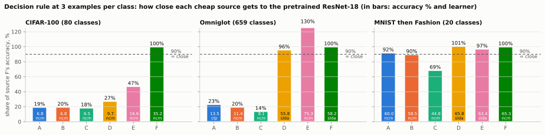
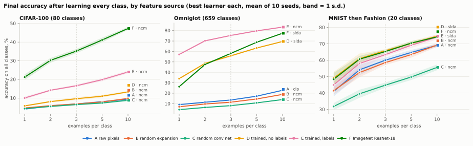
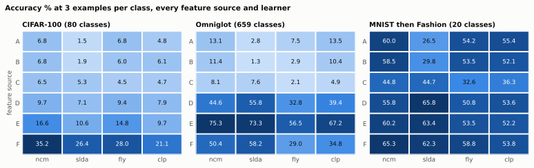
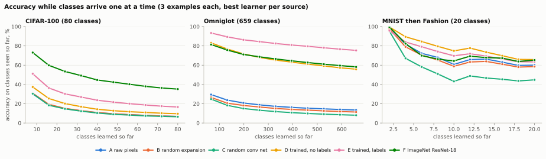
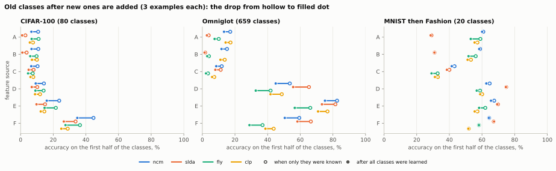
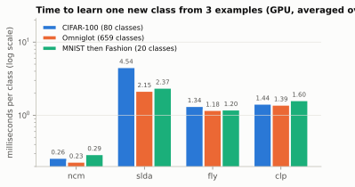

# EXP-2 · FEATURE LADDER

**Experiment ID:** EXP-2 · **Started:** 2026-11-12 · **Hardware:** RTX 3050 Laptop GPU, 4 GB · **Status:** complete (2026-11-12)

## 1. Question

A learner that keeps one small memory per class can add a new class from a few examples without
forgetting old ones, and it needs no backpropagation. Published results show this works when
the features come from a large pretrained network. How cheap can the features be before
learning from 2-3 examples stops working?

## 2. What is run

Classes arrive one at a time with 1, 2, 3, 5 or 10 examples each. The learner is never told
which task an image belongs to and stores no old examples. After learning, it is scored on
held-out images of every class seen so far. Each setting is repeated with 10 random seeds.

**Datasets.** The classes used to build features never overlap with the classes that are tested.

| Dataset | Features built on | Learned few-shot |
|---|---|---|
| CIFAR-100 | 20 classes | the other 80 classes |
| Omniglot | 964 background characters | 659 evaluation characters |
| MNIST then Fashion-MNIST | KMNIST (Japanese characters) | 10 digits first, then 10 clothing items |

**Feature sources, cheapest first.**

| | Source | Training cost |
|---|---|---|
| A | Raw pixels | none |
| B | Random sparse expansion of the pixels, 2048 units | none |
| C | Small 4-layer conv network with random weights, never trained | none |
| D | The same network trained without labels on the base data (contrastive) | minutes |
| E | The same network trained with labels on the base classes | minutes |
| F | ResNet-18 pretrained on ImageNet, frozen | paid by someone else |

**Learners (none uses backpropagation).**

| | Learner | Source |
|---|---|---|
| ncm | Nearest class mean | standard baseline |
| slda | Streaming LDA: class means plus one shared covariance | arXiv 1909.01520 |
| fly | Fruit-fly model: sparse random expansion, winner-take-all, local weight growth | arXiv 2107.07617 |
| clp | Prototype neurons created on novelty | after arXiv 2511.01553 |

Details the papers left open, and the choices made, are marked `OUR CHOICE` in `src/learners.py`.
The `clp` learner is CLP-style, not a reproduction of the paper.

## 3. Decision rule (written 2026-11-12, before any result existed)

Compared at **3 examples per class**, using each source's best learner and the average over 10 seeds:

- **A cheap source counts as "close"** if it reaches at least 90% of source F's accuracy on that dataset.
- If A, B or C is close: few-shot learning needs no feature training at all.
- If only D or E is close: a few minutes of training on unrelated data is enough, and a large
  pretrained model is not needed. This would be the first evidence for the project's thesis.
- If none is close: the gap between the best cheap source and F is the size of the problem the
  project has to solve, and it is reported per dataset.

**Omniglot is the fairest of the three tests.** Source F was trained on ImageNet, which contains
classes similar to CIFAR-100's, so F has an unfair advantage there.

Forgetting is reported separately: accuracy on the first half of the classes when only they are
known, against accuracy on the same classes after all classes are learned.

## 4. Sanity check against a published number

Before trusting new numbers, the same nearest-class-mean code was run on a setup with a published
result: frozen ViT-B/16 (ImageNet-21k) features, all 100 CIFAR-100 classes, full training set.

| | Accuracy |
|---|---|
| Published (Janson et al., arXiv 2210.04428) | 83.70% |
| This code, unit-length features | 79.36% |
| This code, plain features | 78.60% |

**Not reproduced exactly: 4.3 points lower.** The learner itself is a few lines (average the
features per class, pick the nearest average), so the likely cause is a different pretrained
checkpoint or image resizing than the paper used. That cause was not confirmed. The result is in
the right range, which is enough to say the pipeline is not broken, and not enough to say it
matches the paper.

## 5. Results

3,600 runs: 3 datasets x 6 feature sources x 4 learners x 5 shot counts x 10 seeds. Run time 56
minutes on the laptop GPU. All numbers below are means over 10 seeds, read from
`results/full.jsonl`; the full tables are in `results/summary_full.json`.

### 5.1 The decision rule, applied

Accuracy at 3 examples per class, each source with its best learner, and that accuracy as a share
of source F (pretrained ResNet-18). "Close" means 90% or more.

| Source | CIFAR-100 (80 classes) | Omniglot (659 classes) | MNIST then Fashion (20 classes) |
|---|---|---|---|
| A raw pixels | 6.8 (19%) | 13.5 (23%) | 60.0 (92%) **close** |
| B random expansion | 6.9 (20%) | 11.4 (20%) | 58.5 (90%, just under) |
| C random conv net | 6.5 (18%) | 8.1 (14%) | 44.8 (69%) |
| D trained without labels, minutes | 9.7 (27%) | 55.8 (96%) **close** | 65.8 (101%) **close** |
| E trained with labels, minutes | 16.6 (47%) | 75.3 (130%) **close** | 63.4 (97%) **close** |
| F ImageNet ResNet-18 | 35.2 | 58.2 | 65.3 |

Spread across seeds is small: the standard deviation at 3 shots is between 0.3 and 1.7 points
everywhere, so the gaps above are not noise.

**Verdict per dataset, using the rule written before the run:**

- **Omniglot (the fairest test): only D and E are close.** A small network trained for 1 to 3
  minutes on other handwritten characters matches (D) or clearly beats (E, 75.3 vs 58.2) the
  ImageNet network. Untrained sources reach 8 to 14%.
- **MNIST then Fashion: A, D and E are close.** Raw pixels reach 92% of F. This says more about
  the dataset than about raw pixels: centred 28x28 digits and clothes are easy, and the
  photo-trained network F is not well suited to them.
- **CIFAR-100: nothing is close.** The best cheap source (E) reaches 16.6% against 35.2%, a gap
  of 18.6 points. Untrained sources reach about 7%, where guessing gives 1.25%.

### 5.2 Every source and learner at 3 examples

- **Nearest class mean (`ncm`) is the best or near-best learner at 3 shots in most cells.**
- **`slda` needs good features and enough examples.** With 1 example it is often the worst; with
  10 examples on trained features it is the best (Omniglot D: 69.6 vs 54.0 for `ncm`). On raw
  pixels it fails (CIFAR-100 A: 1.5%).
- **The two brain-style learners did not beat the plain baseline.** At 3 shots `fly` is below
  `ncm` in all 18 source-dataset cells, by a wide margin on Omniglot (E: 56.5 vs 75.3), and
  `clp` is below `ncm` in 17 of 18. These are our implementations with our choices for details
  the papers left open, so this is a statement about these implementations, not about the papers.

### 5.3 What happens as classes are added

Accuracy falls as more classes arrive. That is expected for any classifier: choosing among 80
classes is harder than choosing among 8.

Accuracy on the first half of the classes does drop once the second half is learned (CIFAR-100,
source F, `ncm`: 44.7% to 34.7%). **This drop is not forgetting in the cats-then-digits sense.**
For `ncm`, `fly` and `clp`, learning a new class never changes anything stored for an old class,
and for `ncm` the final state is identical to learning all classes at once. The drop comes from
new classes that look like old ones competing for the same images. On MNIST then Fashion, where
the second half (clothes) looks nothing like the first half (digits), the drop for `ncm` is
at most 2.1 points on any source. Catastrophic forgetting, where old skills are overwritten,
did not occur in any run, by construction.

### 5.4 Cost of learning

Learning one class from 3 examples takes 0.2 to 4.5 milliseconds on the GPU, with no
backpropagation. Building the features cost: A, B, C nothing; D 188 to 244 seconds; E 53 to 69
seconds; F nothing on this laptop (trained elsewhere on 1.28 million images). Energy was not
measured.

`clp` created roughly one prototype per stored example when features were weak (Omniglot A:
5,591 prototypes for 6,590 examples) and fewer when features were good (Omniglot E: 2,025).

## 6. What this means for the project

1. **The learning mechanism is not the bottleneck; the features are.** Given good features, a
   class is learned from 3 examples in a millisecond without touching old classes. Given poor
   features, no learner tested here rescues it.
2. **A large pretrained model is not required when the features are trained on the same kind of
   data.** On Omniglot, about one minute of training on 964 other characters beat ImageNet
   pretraining by 17 points. This supports the project's thesis for narrow domains.
3. **For natural photos, a few minutes on 20 classes is far from enough.** The 18.6 point gap on
   CIFAR-100 is the size of the open problem. F itself only reaches 35% at 3 shots, so even big
   pretraining is far from solved here.
4. **Features that cost nothing (A, B, C) only work on easy data.** Random expansion and random
   conv nets, the most brain-like sources tested, gave no benefit over raw pixels.
5. **Growing the classifier added nothing here.** `clp` grows a neuron on novelty and `fly`
   grows weights locally; both lost to averaging. The open question for EXP-3 is therefore how
   to grow or improve the *features* cheaply and continually, not how to grow the classifier.

## 7. Limits and what is still unverified

- The sanity check came in 4.3 points under the published number and the cause is not confirmed.
- D and E were trained on data of the same kind as the test data (other characters, other
  CIFAR classes). "Cheap" here means few minutes and few images, not unrelated data.
- Source D is a weak version of contrastive training (3,000 steps, small network, final loss
  about 5.1 where chance is 6.9). A better label-free method could change D's row.
- Source F is ResNet-18 fed 28 or 32 pixel images enlarged to 224. A stronger or better-matched
  pretrained model would raise F, especially on CIFAR-100.
- ImageNet contains classes like CIFAR-100's, so F's lead on CIFAR-100 partly reflects overlap.
- `fly` and `clp` use our choices where the papers were silent (marked `OUR CHOICE` in
  `src/learners.py`); no hyperparameter was tuned for any learner.
- Features were trained once (one seed). The 10 seeds vary the examples and the class order only.
- Time is measured on a GPU; energy and Loihi-style hardware savings were not measured.
- Images only. Nothing here says anything about language models.

## 8. Files and how to rerun

| | |
|---|---|
| `src/data.py`, `src/features.py` | build the splits and the six feature sources |
| `src/learners.py`, `src/run.py` | the four learners and the protocol |
| `src/sanity.py` | the published-number check |
| `src/figures.py`, `src/render_pdf.py` | figures (SVG) and this PDF |
| `results/full.jsonl` | one line per run (3,600) |
| `results/summary_full.json` | the tables behind every figure |
| `figures/*.svg` | the six figures |

Rerun: `python src/data.py`, `python src/features.py`, `python src/run.py --tag full --seeds 10`,
`python src/figures.py --tag full`, `python src/render_pdf.py` (all with `.venv/Scripts/python.exe`).

Disk used by this folder: 7.5 GB (environment 4.6 GB, saved features 1.8 GB, datasets 0.6 GB,
weights 0.4 GB).

## 9. Log

- 2026-11-12: Environment installed inside the experiment folder (PyTorch 2.14.1 + cu126).
  All four learners pass a synthetic smoke test. On noisy synthetic data `clp` created a
  prototype for almost every example and did not improve with more examples.
- 2026-11-12: Decision rule written, then a 3-seed pilot on MNIST then Fashion (`results/pilot.jsonl`).
- 2026-11-12: A background feature build was stopped once by a low-memory condition on the
  laptop and restarted; no result was affected.
- 2026-11-12: Sanity check, full 10-seed run, figures and this journal completed.
