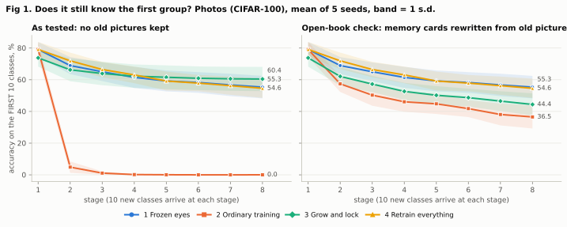
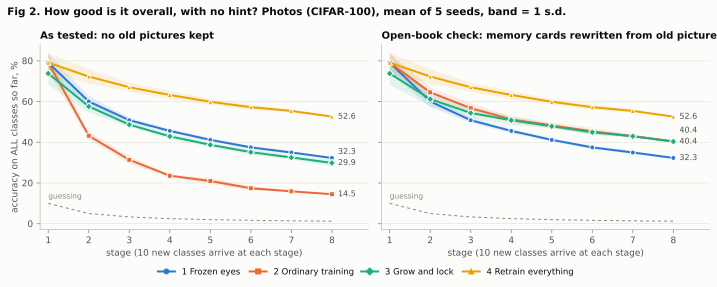
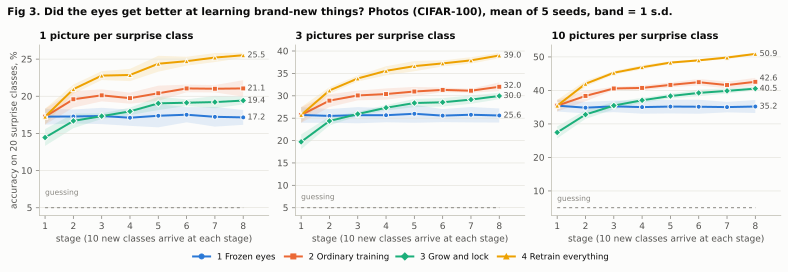
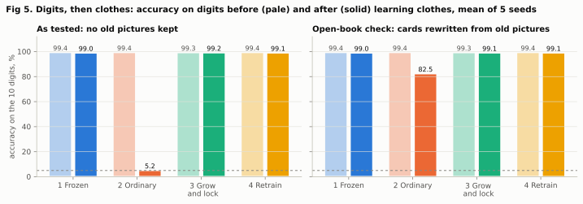
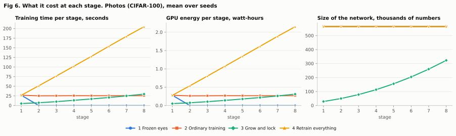
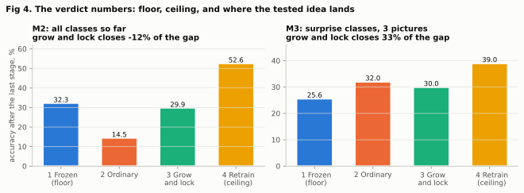

# EXP-3 · GROWING FEATURES

**Experiment ID:** EXP-3 · **Part A written:** 2026-11-13, before any code was run · **Hardware:** RTX 3050 laptop GPU, 4 GB · **Status:** COMPLETE. Run 2026-11-13, Part B added 2026-11-15. Verdict: does not work on photos (section 14)

This journal has two parts. **Part A** (this part) explains the experiment before it starts.
**Part B** will be added to the end of this same PDF when the experiment finishes, with the
readings and what they mean. Part A will not be edited after results exist.

## 1. Why this experiment

### What happened before

**EXP-1 was never run.** An earlier assistant wrote a long plan for it in September 2026
(train a network on digits, then on clothes, and study which internal numbers changed). The
plan stopped at "waiting for review". No code was written and there are no readings. A check
of its references on 2026-10-01 found five that were wrong. After that the project goal was
restated on 2026-11-12, because that assistant had steered toward a different goal than the
owner's. So EXP-1 produced nothing we can build on, except one simple idea that we reuse here:
*train on A, then on B, and watch A collapse*.

**EXP-2 was run and finished on 2026-11-12.** Think of a learning system as two parts:

- the **eyes**: the part that turns a picture into a description ("round shape, fur, two ears"),
- the **memory**: the part that remembers "this description means *dog*".

EXP-2 kept the eyes fixed and tested the memory. New classes arrived one at a time with only 3
example pictures each. The readings (from `EXP-2-FEATURE-LADDER/results/summary_full.json`):

| Kind of eyes | Photos (CIFAR-100) | Handwritten characters (Omniglot) |
|---|---|---|
| No training at all (raw pixels) | 6.8% | 13.5% |
| Small network trained for about a minute | 16.6% | 75.3% |
| Big network pretrained on 1.28 million photos | 35.2% | 58.2% |

What EXP-2 told us:

1. **The memory part is already good enough.** With good eyes, a new class is learned from 3
   pictures in about a millisecond, and nothing stored for old classes is touched.
2. **The eyes are the bottleneck.** With poor eyes, no memory method we tried could rescue the result.
3. **On photos, cheap eyes are far behind:** 16.6% against 35.2%. That gap is the open problem.

### What was missing in EXP-2

In EXP-2 the eyes were **frozen**: trained once, then never allowed to change. That is the
only reason nothing was forgotten. It is like a child whose eyesight stopped developing on
day one. Such a system cannot get better at seeing, no matter how much it experiences.

If we simply let the eyes keep training on new things, we expect the classic problem to come
back: learning digits rewrites the same internal numbers that were used for cats and dogs,
and cats and dogs are lost.

### So EXP-3 asks

**Can the eyes keep learning as new things arrive, without ruining what they could already
see?** The idea we test is the brain-like one from the project goal: for new knowledge, **add
new units and lock the old ones**, instead of rewriting the old ones.

# Part A: the plan (written before the run)

## 2. The question in plain words

A system learns animals first, then vehicles, then furniture, and so on, one group at a time.
After each group we ask three things:

1. **Does it still know the first group?** (forgetting)
2. **Did its eyes get better?** We show it 3 pictures each of things it has never seen and
   check how well it learns them. Better eyes means better learning from 3 pictures.
3. **What did it cost?** Time, size of the network, and energy if the laptop can report it.

## 3. The four ways we will compare

All four use the same memory part: one "memory card" per class, which holds the average
description of that class. This was the winner in EXP-2. Only the eyes differ.

| | Name | What happens to the eyes when a new group arrives | What we expect |
|---|---|---|---|
| 1 | **Frozen eyes** | Nothing. Trained on the first group only, never changed. This is EXP-2's way. | Forgets nothing, never improves |
| 2 | **Ordinary training** | The same network keeps training on each new group. This is how AI is normally trained, and it is the baseline EXP-1 wanted to measure. | Improves on new things, loses the old ones |
| 3 | **Grow and lock** (the idea under test) | New units are added. Only the new units are trained. Every old unit is locked and can never change again. | Hopefully: keeps the old *and* improves |
| 4 | **Retrain everything** | Throw the network away and train a fresh one on every picture seen so far, at every stage. | Best accuracy, highest cost |

Way 4 is the "burn more coal" approach the project wants to get away from. It has to keep
every old picture and repeat all the training each time. We include it only as the ceiling:
it shows the best score that is reachable, so we can see how close way 3 gets.

**How "grow and lock" works, with the cats example.** Say the network has 32 units after
learning cats and dogs. When digits arrive, we add 16 new units. The new units are allowed to
look at what the old 32 units report, plus the picture. Only the 16 new ones are trained on
digits. The old 32 are locked, so on a cat picture they report exactly what they reported
before. The memory card for "cat" was written using those 32 units, so it is still correct.

**No old pictures are kept** in ways 1, 2 and 3. Once a group has been learned, its pictures
are gone, and its memory cards are never rewritten. **No hint is given at test time** either:
the system is not told "this is an animal picture". It has to pick among every class it has
ever learned.

## 4. What is run, step by step

**Run 1: digits, then clothes.** This is the project's standing example. Stage 1 is the 10
handwritten digits (MNIST). Stage 2 is 10 kinds of clothing (Fashion-MNIST). It is small and
quick, and it gives the plain "before" number: how much does ordinary training forget?

**Run 2: photos (CIFAR-100).** This is where EXP-2 found the gap. CIFAR-100 has 100 kinds of
objects in small colour photos.

- **20 kinds are set aside as "surprise classes".** The eyes are never trained on them. They
  are only used for the 3-picture test.
- **The other 80 kinds arrive in 8 stages of 10 kinds each**, with all their training
  pictures (500 per kind).
- After every stage, all the measurements in section 5 are taken.

Everything is repeated 5 times with a different random order of the classes and a different
random start of the network (5 "seeds"), so that one lucky or unlucky run cannot mislead us.

**An honest note about "3 pictures".** In this experiment the eyes learn from many pictures
(500 per kind) during the stages. The 3-picture learning is tested only on the surprise
classes. The comparison to a person is: a child sees a great deal before it can learn "zebra"
from one picture book. EXP-3 does not try to train the eyes themselves from 3 pictures.

**Settings fixed now, before the run.**

| Setting | Value |
|---|---|
| Network | 4 layers of small image filters, the same design as EXP-2 |
| Grow and lock, photos | starts with 32 units per layer, adds 16 per stage, ends at 144 |
| Grow and lock, digits then clothes | starts with 32 units per layer, adds 32, ends at 64 |
| Ways 1, 2 and 4 | fixed size, equal to the final size of the growing network (144 or 64), so they are never smaller than it |
| Training per stage | every picture of the stage is shown 30 times |
| Way 4 | shown every picture seen so far, 30 times, from a fresh start each stage |
| Memory | nearest memory card (average description per class) |
| Repeats | 5 seeds |

## 5. What is measured

| | Measurement | Plain meaning | Why it matters |
|---|---|---|---|
| M1 | Accuracy on the **first group**, after every stage | Does it still know cats and dogs after 7 more groups? | This is forgetting, drawn as a curve over time |
| M2 | Accuracy on **all classes learned so far**, with no hint | How good is it overall at the end? | The main score of a continual learner |
| M3 | Accuracy on the **20 surprise classes from 3 pictures each** (also 1 and 10 pictures) | Did the eyes get better at learning brand-new things? | This is the 16.6% vs 35.2% gap from EXP-2 |
| M4 | Training time per stage, number of units, peak GPU memory, and GPU energy if the laptop reports its power draw | What it cost | Compute and energy are part of the project goal |
| M5 | **Open-book check** (not counted in the verdict): rewrite every memory card using the old pictures, then test again | Were the eyes really damaged, or did only the memory cards go out of date? | Tells us *where* the damage is |

M5 breaks the "no old pictures" rule on purpose, so it is never used to judge a method. It
is a diagnostic. Example: if ordinary training scores 10% normally and 60% in the open-book
check, the eyes still see cats fine and only the cards are stale. If both are near 10%, the
eyes themselves lost cats.

## 6. How the result will be judged (written before the run)

The verdict uses Run 2 (photos), after all 8 stages, averaged over the 5 seeds.

**Step 0: is the test valid?** Ordinary training (way 2) must lose at least half of its
accuracy on the first group. If it does not, the test is too easy to show forgetting, and it
must be fixed before anything is concluded.

**Step 1: how much of the gap does "grow and lock" close?** Frozen eyes (way 1) is the floor.
Retrain everything (way 4) is the ceiling. For M2 and for M3 at 3 pictures:

> share of the gap closed = (grow and lock − frozen) ÷ (retrain everything − frozen)

Example: frozen 15%, retrain 35%, grow and lock 27%. It closed 12 of 20 points, which is 60%.

**Step 2: did it keep the old knowledge?** On M1 at the end, grow and lock must be within 5
points of frozen eyes. Frozen eyes cannot forget, so it is the reference for "kept everything".

| Verdict | Condition |
|---|---|
| **Works** | closes at least 50% of the gap on both M2 and M3, and passes step 2 |
| **Partly works** | closes 25% to 50% on the weaker of the two, and passes step 2 |
| **Does not work** | closes under 25% on either, or fails step 2 |

If the floor and the ceiling are less than 3 points apart on a measurement, the share cannot
be computed reliably. In that case the plain numbers are reported and no verdict is given for
that measurement.

**What I expect, written down now so it can be checked later.**

- Ordinary training will collapse on the first group, to somewhere near guessing (10%).
- Grow and lock will keep the first group (it passes step 2).
- Grow and lock will land at **"partly works"**. The new units are trained on only 10 kinds
  at a time, so they see less variety than a network retrained on everything. My guess is
  that it closes about a third of the gap on M3.

If this guess turns out wrong in either direction, it stays in the journal as written.

## 7. What earlier research says about this idea

These points come from the project's literature review of 2026-11-12
(`RESEARCH_GROWING_STRUCTURE.md`). Reader agents opened the papers and extracted passages;
nobody read them page by page. "Read" means passages of the full text were read; "abstract"
means only the summary was read.

| Finding | Source | How it was checked |
|---|---|---|
| Networks that add a new part per task and lock the old parts do not forget, but they need to be told which task a picture belongs to | Progressive Networks (arXiv 1606.04671); PackNet (arXiv 1711.05769) | abstract; read |
| A growing method that works without the hint keeps 2,000 old pictures and re-shows them | DER (arXiv 2103.16788) | read |
| Growing units in a network trained from nothing was combined with stored pictures or extra constraints, and reached 25-33% on CIFAR-100 against 48.56% for training on everything at once | Width Expansion (arXiv 2609.37702) | read |
| Averaging per class on fixed features adds classes without forgetting and without the hint | Deep Streaming LDA (arXiv 1909.01520) | read |

We did not find a paper that does all of this together: grows the eyes from nothing, keeps no
old pictures, needs no hint, and is tested on learning new classes from 3 pictures. One search
pass not finding it does not prove nobody has done it.

EXP-3 joins two known pieces: locked-and-grown eyes (first row) with per-class memory cards
(last row). The memory cards are what should remove the need for the hint.

## 8. What could go wrong

- **Old and new classes are compared on different numbers of units.** The card for a class
  from stage 1 covers 32 units; a card from stage 8 covers 144. We compare each class using
  only the units its card has. This is our own choice, and it may favour newer or older
  classes unfairly. M5 will show how much this costs.
- **The new units may learn little that is general.** They only ever see 10 kinds at a time.
- **The network keeps getting bigger.** After 8 stages it is 4.5 times wider than at the
  start. That is a real cost and it is reported in M4. A system that grows forever is not a
  finished answer.
- **Ways 1, 2 and 4 start at full size**, so in early stages they have more units than the
  growing network. This favours them slightly, which makes the comparison harder on our idea,
  not easier.
- **The time estimate below is arithmetic, not a measurement.** A one-seed trial will be timed
  first.
- **Small pictures and a small network.** Nothing here says anything about language models.

## 9. Time and disk

| | Expected |
|---|---|
| Run time | about 2 to 4 hours on the laptop GPU for all 5 seeds (estimate) |
| Disk | about 5 GB inside this folder: Python environment 4.6 GB, datasets 0.3 GB, results and figures under 0.1 GB |
| GPU memory | well under the 4 GB limit |
| Free disk now | 63 GB |

Everything stays inside `EXP-3-GROWING-FEATURES/`. Nothing is installed elsewhere on the laptop.

## 10. Words used in this journal

| Word | Meaning here |
|---|---|
| Class | One kind of thing to recognise: "dog", "7", "sandal" |
| Network | The program that learns. It is made of many small adjustable numbers |
| Unit | One small detector inside the network, for example one that reacts to stripes |
| Eyes (features) | The part of the network that turns a picture into a list of numbers describing it |
| Memory card (prototype) | The average description of all pictures of one class. To recognise a picture, the system picks the nearest card |
| Training | Adjusting the network's numbers, a little at a time, so its answers improve |
| Lock (freeze) | Forbid a unit's numbers from ever changing again |
| Stage | One step in time when a new group of classes arrives |
| Catastrophic forgetting | Losing an old skill because learning a new one rewrote the same numbers |
| Hint (task label) | Being told at test time which group a picture belongs to. We never give it |
| Surprise classes | Classes the eyes were never trained on, used only for the 3-picture test |
| Seed | One repeat of the experiment with a different random shuffle |
| Guessing level | The score from picking at random: 10% for 10 classes, 5% for 20 |
| Floor and ceiling | The worst and best reference methods that the tested idea is compared against |

# Part B: the readings (added 2026-11-15, after the run)

Part A above is unchanged, except for the status word in the header line on page 1. All
numbers below come from three files in `EXP-3-GROWING-FEATURES/results/`: `runs.jsonl` (every
raw reading), `summary.json` (the averages and the verdict arithmetic, made by
`src/figures.py`) and `meta.json` (the machine and the settings). Every score is the average
of 5 seeds. "±" is how much the 5 seeds differed from each other.

## 11. The result in five lines

1. **Ordinary training forgot everything, as expected.** On photos its score on the first
   group fell from 79.1% to 0.0%.
2. **Grow and lock did not forget.** Its first group ended at 60.4%, above frozen eyes (55.3%).
3. **Its eyes did get better at learning new things from 3 pictures:** 30.0% against 25.6%
   for frozen eyes. That closes 33% of the gap to retraining everything (39.0%).
4. **But its overall score on photos was worse than frozen eyes:** 29.9% against 32.3%. By the
   rule written in section 6, the verdict on photos is **"does not work"**.
5. **The likely reason is the memory cards, not the eyes.** Old cards and new cards have
   different sizes, and the way we compared them seems to favour old classes. This risk was
   listed in section 8. On digits then clothes, where there are only two sizes, the same
   method did well (89.1%, between frozen 82.4% and retrain 94.0%).

## 12. What was actually run, and what differed from Part A

The experiment itself was run as section 4 describes: same four ways, same network, same
sizes, 30 passes per stage, 5 seeds, 8 stages on photos, 2 stages on digits then clothes.
`meta.json` records the settings. These things differed from the plan:

| Part A said | What happened | Why |
|---|---|---|
| Run on the laptop GPU (RTX 3050) | Run on a free Kaggle cloud GPU (Tesla T4), as a private job | The owner approved Kaggle on 2026-11-13. It kept the laptop free |
| 2 to 4 hours | 157 minutes in total (`meta.json`) | Inside the estimate |
| About 5 GB of disk in this folder | 147 MB measured | The heavy training software and the datasets lived on Kaggle's machine and were removed when the job ended. The local environment only draws figures and makes the PDF |
| Energy "if the laptop can report it" | Reported, but it is the Kaggle GPU's power draw, read once per second | It is GPU only (not the whole computer) and a different GPU from the laptop. Use it to compare the four ways with each other, not as a laptop figure |
| A one-seed trial would be timed first | A tiny trial (1 seed, 1 pass, a tenth of the data) was run on the laptop to check the code, using EXP-2's environment and datasets without changing them | It was a code check only. None of its numbers are used |

Choices that Part A left open and that were fixed in the code before the full run:

- The 20 surprise classes are the same in all 5 seeds. The order of the other 80 changes per seed.
- Ways 1, 2 and 4 share the same stage-1 network, because at stage 1 they are identical.
  Their stage-1 time and energy are therefore the same number, counted once for each way.
- A picture is compared with a card by the angle between them, using only the units that card has.
- The surprise test is repeated 20 times with different example pictures and averaged.
- A lock check was added: after every growth step the old units' output on 256 pictures was
  compared with before. The change was exactly 0.0 in every stage of every seed (`lock_drift`
  in `runs.jsonl`). The lock holds.

The Kaggle log is saved as `results/kaggle_run.log`. It contains no errors.

## 13. The readings

### 13.1 Does it still know the first group? (M1, photos)

The score is on the first 10 kinds, while the system must choose among every kind learned so far.

| After stage | 1 | 2 | 4 | 8 |
|---|---|---|---|---|
| Frozen eyes | 79.1 | 68.9 | 61.5 | 55.3 ± 7.1 |
| Ordinary training | 79.1 | 4.9 | 0.2 | 0.0 ± 0.0 |
| Grow and lock | 73.8 | 66.3 | 62.3 | 60.4 ± 7.7 |
| Retrain everything | 79.1 | 71.9 | 63.0 | 54.6 ± 6.1 |

Frozen eyes and retraining also go down, although neither forgets. That is not forgetting: with
80 kinds to choose from instead of 10, there are simply more ways to be wrong. Ordinary
training is the only one that collapses, and it does so after a single new group.

### 13.2 How good is it overall? (M2, photos)

| After stage | 1 | 2 | 4 | 8 |
|---|---|---|---|---|
| Frozen eyes | 79.1 | 60.1 | 45.6 | 32.3 ± 0.3 |
| Ordinary training | 79.1 | 43.2 | 23.6 | 14.5 ± 0.3 |
| Grow and lock | 73.8 | 57.6 | 42.9 | 29.9 ± 1.6 |
| Retrain everything | 79.1 | 72.3 | 63.2 | 52.6 ± 0.2 |

Grow and lock stays a little below frozen eyes at every stage. It never catches up.

### 13.3 Did the eyes get better? (M3, 20 surprise classes, photos)

Scores after the last stage:

| Pictures per new class | 1 | 3 | 10 |
|---|---|---|---|
| Frozen eyes | 17.2 | 25.6 ± 1.6 | 35.2 |
| Ordinary training | 21.1 | 32.0 ± 1.0 | 42.6 |
| Grow and lock | 19.4 | 30.0 ± 0.7 | 40.5 |
| Retrain everything | 25.5 | 39.0 ± 0.6 | 50.9 |

How the 3-picture score moved over time:

| After stage | 1 | 2 | 4 | 8 |
|---|---|---|---|---|
| Frozen eyes | 25.7 | 25.5 | 25.7 | 25.6 |
| Ordinary training | 25.7 | 28.9 | 30.4 | 32.0 |
| Grow and lock | 19.7 | 24.4 | 27.3 | 30.0 |
| Retrain everything | 25.7 | 31.2 | 35.6 | 39.0 |

Three things to see here. Grow and lock starts lower (19.7%) because it starts with a small
network, then climbs past frozen eyes by stage 4. Second, **ordinary training's eyes improved
slightly more than grow and lock's** (32.0% against 30.0%). Third, both are well short of
retraining everything.

These scores cannot be set beside EXP-2's 16.6% and 35.2%. EXP-2 tested 100 classes arriving
one by one; this test uses 20 classes, which is easier.

### 13.4 Where is the damage: eyes or memory cards? (M5, open-book check)

Here every card is rewritten using the old pictures. This is not allowed in the real test. It
only shows how good the eyes are when the cards are perfect. Photos, after stage 8:

| | Real test (M2) | Open-book | First group, real | First group, open-book |
|---|---|---|---|---|
| Frozen eyes | 32.3 | 32.3 | 55.3 | 55.3 |
| Ordinary training | 14.5 | 40.4 | 0.0 | 36.5 |
| Grow and lock | 29.9 | 40.4 | 60.4 | 44.4 |
| Retrain everything | 52.6 | 52.6 | 54.6 | 54.6 |

Score per group for grow and lock, oldest group first (computed from `runs.jsonl`):

| Group | 1 | 2 | 3 | 4 | 5 | 6 | 7 | 8 |
|---|---|---|---|---|---|---|---|---|
| Real test | 60.4 | 38.6 | 34.1 | 28.2 | 25.1 | 19.7 | 19.4 | 13.3 |
| Open-book | 44.4 | 38.8 | 41.9 | 42.7 | 43.1 | 37.4 | 41.8 | 32.8 |

In the real test the newest groups do worst, and the oldest group does better than it does
even with perfect cards. That is the pattern you would get if the old cards win too often: old
classes pick up extra right answers and newer classes lose theirs. With fair cards the groups
come out roughly level, and the overall score rises from 29.9% to 40.4%.

The same table says something about ordinary training. Its eyes are not ruined: with fresh
cards it scores 40.4% overall, the same as grow and lock. Its 0.0% on the first group in the
real test is mostly stale cards. The eyes did lose something real though: 36.5% on the first
group against 55.3% for frozen eyes.

### 13.5 Digits, then clothes (Run 1)

| After both stages | Digits (first group) | Clothes | All 20 classes | All 20, open-book |
|---|---|---|---|---|
| Frozen eyes | 99.0 | 65.7 | 82.4 ± 0.3 | 82.4 |
| Ordinary training | 5.2 | 89.7 | 47.5 ± 1.4 | 86.0 |
| Grow and lock | 99.2 | 79.1 | 89.1 ± 0.8 | 93.0 |
| Retrain everything | 99.1 | 88.9 | 94.0 ± 0.1 | 94.0 |

This is the project's standing example, and it came out the way the idea hopes. Ordinary
training learned clothes and dropped digits from 99.4% to 5.2%. Grow and lock kept digits at
99.2% and still learned clothes far better than frozen eyes. No surprise-class test was run
here, so there is no M3 for this run.

### 13.6 What it cost (M4)

Per seed, all stages added up. Photos:

| | Training time | GPU energy | Adjustable numbers at the end | Peak GPU memory |
|---|---|---|---|---|
| Frozen eyes | 27 s | 0.28 Wh | 565 thousand | 1.0 GB |
| Ordinary training | 205 s | 2.15 Wh | 565 thousand | 1.0 GB |
| Grow and lock | 129 s | 1.34 Wh | 323 thousand | 0.85 GB |
| Retrain everything | 924 s | 9.69 Wh | 565 thousand | 1.0 GB |

Digits then clothes: frozen 93 s and 0.98 Wh, ordinary 186 s and 1.95 Wh, grow and lock 143 s
and 1.50 Wh, retrain 279 s and 2.91 Wh.

On photos, grow and lock used about one seventh of the time and energy of retraining
everything, and less than ordinary training. It also ended up smaller than the others.
Everything fits easily in the laptop's 4 GB. Retraining gets more expensive with every stage
because it re-reads every old picture; the other three do not.

## 14. The verdict, using the rule in section 6

The rule uses photos, after 8 stages, averaged over 5 seeds (`summary.json`).

**Step 0, is the test valid? Yes.** Ordinary training lost 100% of its first-group accuracy
(79.1% to 0.0%). The rule needed at least half.

**Step 1, share of the gap closed.**

| | Frozen (floor) | Retrain (ceiling) | Grow and lock | Share of gap closed |
|---|---|---|---|---|
| M2, all classes | 32.3 | 52.6 | 29.9 | **−12%** (below the floor) |
| M3, 3 pictures | 25.6 | 39.0 | 30.0 | **33%** |

Both gaps are wider than 3 points (20.3 and 13.4), so both shares count.
Seed by seed, the M2 share was −23%, −12%, +2%, −10%, −18%, and the M3 share was 36%, 40%,
33%, 35%, 14% (computed from `runs.jsonl`). No seed tells a different story.

**Step 2, did it keep the old knowledge? Yes.** First group at the end: grow and lock 60.4%,
frozen eyes 55.3%. It had to be no more than 5 points below; it is 5 points above. Section
13.4 suggests part of that extra comes from old cards winning too often, so it should not be
read as "better memory".

**Verdict: does not work.** The rule says "closes under 25% on either". On M2 it closed less
than nothing. Passing step 2 and reaching 33% on M3 do not change that.

For information only, since the rule does not use it: on digits then clothes, grow and lock
closed 58% of the M2 gap and passed step 2.

## 15. Was the expectation in section 6 right?

| What I wrote before the run | What happened |
|---|---|
| Ordinary training collapses on the first group, near 10% | Right about the collapse. It went lower than I guessed: 0.0% on photos, 5.2% on digits |
| Grow and lock keeps the first group | Right |
| It closes about a third of the gap on M3 | Right: 33% |
| It lands at "partly works" | **Wrong.** I did not expect the overall score to fall below frozen eyes. The verdict is "does not work" |

I had listed the cause as a risk in section 8 but did not think it would decide the result.

## 16. What this means for the project

In the eyes-and-memory picture from EXP-2:

1. **Locking works as a way to not forget.** The old units did not change at all, and the old
   cards stayed valid with no old pictures kept. This is the first time in this project that
   the eyes were allowed to keep learning without the first group collapsing.
2. **Growing made the eyes somewhat better at new things, at low cost.** A third of the way to
   retraining everything, for about a seventh of the energy.
3. **Growing did not make better eyes than ordinary training did.** Ordinary training's eyes
   were as good or slightly better on every eye test (surprise classes 32.0% against 30.0%;
   open-book 40.4% for both). What grow and lock adds is only that the old cards stay
   readable. That is a narrower benefit than the idea promised.
4. **The system as built is not better than never learning again.** On photos, frozen eyes
   beat it overall. The eyes improved, but the improvement was lost when comparing cards of
   different sizes. EXP-2 said "the memory is good enough, the eyes are the problem". EXP-3
   adds: once the eyes change size over time, the memory is a problem again.
5. **Even with perfect cards it would only be part of the answer.** The open-book score of
   40.4% would be 40% of the gap. Eyes trained on 10 kinds at a time are still far from eyes
   trained on everything (52.6%).

## 17. What is still unverified

- **The cause of the low overall score is a reading of the pattern, not a proven fact.** We
  did not save which wrong class was chosen for each picture, so "old cards win too often" has
  not been checked directly.
- **Open-book numbers used old pictures.** They show what the eyes could do, not what the
  method does.
- **One network design, one growth schedule, one dataset of small photos.** Other sizes (for
  example adding 32 units instead of 16) were not tried. Nothing here applies to language models.
- **Ways 1, 2 and 4 were larger than the growing network** in every stage but the last. This
  was chosen to be hard on our idea; how much it mattered was not measured.
- **Energy is GPU-only, on a Kaggle Tesla T4,** sampled once per second. It was not measured
  on the laptop.
- **Run 1 has only two stages** and no surprise-class test.
- The literature table in section 7 is as it was: passages read by reader agents, not
  page-by-page reading.

## 18. The next experiment, and why

**EXP-4 should fix the comparison between cards of different sizes, without keeping any old
pictures.**

Why this one: EXP-3 showed the eyes improved (30.0% against 25.6% on surprise classes) and the
old knowledge survived, yet the overall score fell below frozen eyes (29.9% against 32.3%).
The open-book check says 40.4% is available from the very same eyes. Those 10 points are being
lost in the memory step, and that step is cheap to change. The eyes are built the same way as
in EXP-3; only the card-matching rule changes.

What EXP-4 would do, in plain words: try a few simple ways to make a small old card and a
large new card compete fairly, for example scaling each card's score so that no card is
favoured just for being short, using only the pictures of the current stage. It would also
save which wrong class was chosen each time, so the cause in section 17 is checked directly
instead of guessed.

How it would be judged: does grow and lock's overall score rise above frozen eyes (32.3%) and
toward its own open-book level (40.4%), while the first group is still kept?

What EXP-4 will not fix: point 5 in section 16. Closing the remaining distance to 52.6% needs
better eyes, which is a separate question for a later experiment (for example, whether the new
units can learn more general things than "these 10 kinds").
