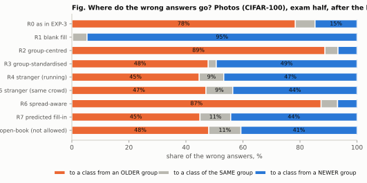
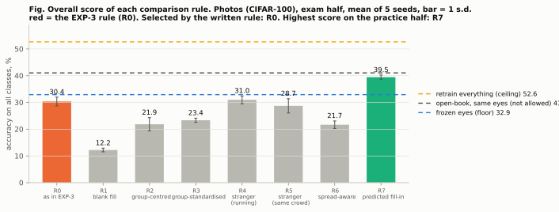
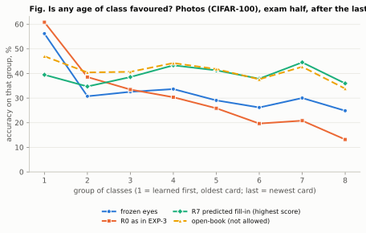
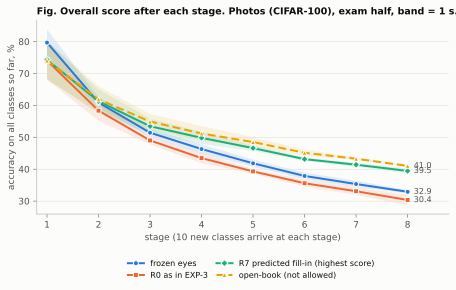
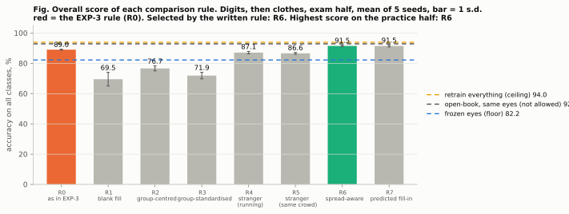

# EXP-4 · FAIR CARDS

**Experiment ID:** EXP-4 · **Part A written:** 2026-11-15, before any code was run · **Hardware:** free Kaggle GPU (the method must still fit the RTX 3050 laptop, 4 GB) · **Status:** COMPLETE. Run and Part B added 2026-11-15. Verdict: does not work on photos by the written rule (section 14); cause confirmed; one rule (R7) reaches 39.5% but fails the old-knowledge check

This journal has two parts. **Part A** (this part) explains the experiment before it starts.
**Part B** will be added to the end of this same PDF when the experiment finishes. Part A
will not be edited after results exist, except for the status word in the line above.

## 1. Why this experiment

### What happened before

The project thinks of a learning system as two parts: the **eyes**, which turn a picture into
a list of numbers describing it, and the **memory**, which keeps one **memory card** per class
(the average description of that class) and answers with the nearest card.

- **EXP-1** was a plan only. It was never run and has no readings.
- **EXP-2** showed that the memory part works when the eyes are good, and that the eyes are
  the bottleneck. Its eyes were frozen, so they could never improve.
- **EXP-3** let the eyes keep learning by **grow and lock**: for every new group of classes,
  add new units and lock the old ones. Its readings on photos, after 8 groups of 10 classes
  (from `EXP-3-GROWING-FEATURES/results/summary.json`):

| Way | Still knows first group | All 80 classes | New classes from 3 pictures | All 80, open-book |
|---|---|---|---|---|
| Frozen eyes (never learn again) | 55.3% | 32.3% | 25.6% | 32.3% |
| Ordinary training | 0.0% | 14.5% | 32.0% | 40.4% |
| Grow and lock | 60.4% | 29.9% | 30.0% | 40.4% |
| Retrain everything (ceiling) | 54.6% | 52.6% | 39.0% | 52.6% |

### What failed in EXP-3

Grow and lock did two things right: it did not forget (60.4% on the first group, against 0.0%
for ordinary training), and its eyes got somewhat better at new things (30.0% against 25.6%).

But its overall score, 29.9%, was **below frozen eyes at 32.3%**. A system that keeps learning
ended up worse than one that stopped on day one. By the rule written before that run, the
verdict was "does not work".

### The clue

In the **open-book check**, every card was rewritten using the old pictures. This is not
allowed in the real test; it only shows what the eyes could do with perfect cards. The same
eyes then scored **40.4%**. So about 10 points are being lost in the memory step, not in the eyes.

The suspected reason: the cards have different sizes. A card written in stage 1 describes the
32 units that existed then. A card written in stage 8 describes 144 units. EXP-3 compared a
picture with each card using only the units that card has. It looks as if short, old cards
win too often. Score per group in EXP-3, oldest group first:

| Group | 1 | 2 | 3 | 4 | 5 | 6 | 7 | 8 |
|---|---|---|---|---|---|---|---|---|
| Real test | 60.4 | 38.6 | 34.1 | 28.2 | 25.1 | 19.7 | 19.4 | 13.3 |
| Open-book | 44.4 | 38.8 | 41.9 | 42.7 | 43.1 | 37.4 | 41.8 | 32.8 |

This is a reading of a pattern. EXP-3 did not record which wrong class was chosen, so the
cause was never checked directly.

### So EXP-4 asks

**Can cards of different sizes be compared fairly, without keeping any old pictures, so that
the improvement in the eyes shows up in the overall score?** And first: **is the suspected
cause the real one?**

# Part A: the plan (written before the run)

## 2. The question in plain words

Imagine a quiz with 80 answer cards. The oldest cards were written when the system could only
notice 32 things about a picture. The newest were written when it could notice 144 things. A
picture comes in, and each card says how well it matches. If short cards tend to say "good
match" more easily than long cards, the old classes win arguments they should lose.

EXP-4 keeps the eyes exactly as in EXP-3 and changes only **the rule for comparing a picture
with the cards**. Eight rules are tried on the same eyes.

## 3. The eight rules

None of the rules keeps any old picture. Some keep a few extra numbers per card. Rules 2 to 8
were designed by us for this experiment; no literature search was done for them (see section 8).

| | Name | In plain words | Extra things stored |
|---|---|---|---|
| R0 | **As in EXP-3** | Compare the picture with each card using only the units that card has | nothing |
| R1 | **Blank fill** | Treat the units an old card does not have as zeros, and compare at full length | nothing |
| R2 | **Group-centred** | For each picture, look at the scores of the 10 cards of one group and subtract that group's average. A group whose cards all score high gets no advantage | nothing |
| R3 | **Group-standardised** | Like R2, and also divide by how spread out that group's scores are. Asks "does one card in this group stand out?" | nothing |
| R4 | **Stranger-calibrated (running)** | Each card remembers how high it usually scores on pictures that are *not* its class ("strangers"), measured on the training pictures of every stage as they pass. A match counts only by how far it rises above that usual level | 2 numbers per card |
| R5 | **Stranger-calibrated (same crowd)** | Like R4, but every card is measured against the same crowd: the newest stage's training pictures | 2 numbers per card |
| R6 | **Spread-aware card** | The card also stores how much each unit varies within the class. The score is the average closeness per unit, so the number of units does not matter | one more list per card |
| R7 | **Predicted fill-in** | When new units are added, learn from the current pictures how the new units' values follow from the old units' values. Use that to guess the missing part of every old card, so all cards have full length | nothing after the guess |

**Example for R4 with cats and digits.** The "cat" card is short. Suppose it gives a match
score of 0.80 to almost any picture, including digits. The "7" card is long and gives 0.50 to
most pictures. A picture of a 7 scores 0.82 on "cat" and 0.75 on "7". Under R0, "cat" wins.
Under R4, "cat" is only 0.02 above its usual level while "7" is 0.25 above its usual level,
so "7" wins.

## 4. What is run, step by step

1. **Rebuild the eyes of EXP-3**, with the same settings: grow and lock on photos (CIFAR-100,
   80 classes in 8 stages of 10, starting at 32 units per layer and adding 16 per stage) and
   on digits then clothes (2 stages). Old pictures are thrown away after each stage, as before.
2. **Rebuild the two reference points**: frozen eyes (trained on the first group only) and
   retrain everything (a fresh network trained on all classes at once). Retrain is only built
   for the final stage, because the verdict only uses the final stage. Ordinary training is
   not repeated; EXP-3 already showed it collapses.
3. **Apply all eight rules to the same grown eyes** and record the score of each.
4. **Record every answer.** For each test picture and each rule, the chosen class is saved, so
   we can count where the wrong answers go.
5. Repeat with 5 seeds (5 different class orders and random starts), as in EXP-3.

**Practice half and exam half.** Trying eight rules and then reporting the best one on the
same pictures would flatter the result. So the test pictures are split once, at random, into
two halves. The **practice half** is used to pick the best rule. The **exam half** is used
for the verdict. The split is the same for every rule. Picking a rule this way is something
the researcher does; the system itself still never sees an old picture.

**Settings fixed now.**

| Setting | Value |
|---|---|
| Network, sizes, training | exactly as EXP-3: 4 layers, 30 passes per stage, same learning settings |
| Seeds | 5 (the same seed numbers as EXP-3) |
| Test split | half practice, half exam, per class, fixed in advance |
| Rule selection | highest average score on all 80 classes on the practice half of the photos run, among rules that pass step 3 of section 6 on the practice half |
| Digits then clothes | reported for every rule, not used to select |

## 5. What is measured

| | Measurement | Plain meaning | Why it matters |
|---|---|---|---|
| N1 | Accuracy on **all classes**, for each rule | Overall score | This is the number that fell below frozen eyes in EXP-3 |
| N2 | Accuracy **per group**, oldest to newest, for each rule | Is any age of class favoured? | A fair rule should give a fairly level line |
| N3 | Accuracy on the **first group** | Is old knowledge still kept? | A rule could "fix" the bias by sacrificing old classes |
| N4 | **Where the wrong answers go**: to an older group, a newer group, or the same group | Do old cards steal answers? | This checks the suspected cause directly |
| N5 | **Open-book score** on the same eyes (not counted) | What perfect cards would give | The most any rule could hope to recover |
| N6 | Time and extra storage of each rule | What the rule costs | A rule that needs heavy computing is not a fix |

The 3-picture test on surprise classes is not repeated. It does not use the old cards, so no
rule here can change it. It stays at the EXP-3 value of 30.0%.

## 6. How the result will be judged (written before the run)

The verdict uses photos, after all 8 stages, on the **exam half**, averaged over 5 seeds, for
the one rule that was selected on the practice half.

**Step 0: did we rebuild EXP-3 correctly?** On the full test set, rule R0 must land within 3
points of EXP-3's 29.9%, frozen eyes within 3 points of 32.3%, and retrain within 3 points of
52.6%. If not, the cause is found before any verdict is given.

**Step 1: is the suspected cause real?** Under rule R0, take the wrong answers where the
chosen class belongs to a different group than the true class. Count the share that went to
an **older** group. With no bias this would be about 50%.

| Share going to an older group | Conclusion |
|---|---|
| 65% or more | Cause confirmed: old cards win too often |
| 55% to 65% | Unclear |
| under 55% | Cause not supported; the explanation in EXP-3 was wrong |

**Step 2: how much of the gap does the selected rule close?** Same formula as EXP-3:

> share of the gap closed = (grow and lock with the selected rule − frozen) ÷ (retrain − frozen)

**Step 3: is the old knowledge still kept?** On the first group, the selected rule must be no
more than 5 points below frozen eyes.

| Verdict | Condition |
|---|---|
| **Works** | closes at least 50% of the gap and passes step 3 |
| **Partly works** | closes 25% to 50% and passes step 3 |
| **Does not work** | closes under 25%, or fails step 3 |

The thresholds are the same as in EXP-3 on purpose. With EXP-3's numbers, "partly works"
needs about 37.4% and "works" needs about 42.5%. The open-book score was 40.4%, so "works" is
probably out of reach for any card rule. Two plainer numbers will also be reported: whether
the selected rule **beats frozen eyes at all** (the minimum for the idea to be worth keeping),
and how many of the roughly 10 lost points it wins back.

**What I expect, written down now.**

- Step 1: the cause will be confirmed, with 75% or more of those wrong answers going to older groups.
- The selected rule will be one of the two stranger-calibrated rules (R4 or R5).
- It will score about **36%** on all 80 classes: above frozen eyes (32.3%), but just under
  the 37.4% needed for "partly works". So my guess for the verdict is **"does not work", by
  a small margin, while beating the floor**. Reason: a fair comparison removes the bias, but
  an old card still describes its class with only the few units that existed when it was
  written. No rule can add information the card never had.
- R1 (blank fill) will swing the bias the other way and favour the newest classes.

If any of this is wrong, it stays in the journal as written.

## 7. What carries over beyond pictures

The owner's end goal is a general model that also handles language. So it matters which parts
of this work depend on pictures.

| Part | Depends on pictures? |
|---|---|
| The image filters inside the network | Yes. A language model would use different building blocks |
| Lock old units, add new units | No. Any network made of layers can be grown this way |
| Memory cards (average description per class) | No. A card is just a list of numbers |
| All eight comparison rules | No. They work on lists of numbers of different lengths, wherever those come from |

An open point for later, not solved here: a language model does not pick one class out of a
small set of cards. It predicts the next word. How "one card per thing learned" should look
for language is a design question for a later experiment.

## 8. What could go wrong

- **Eight rules, one dataset.** The best rule on these photos may not be the best elsewhere.
  The practice/exam split guards against lucky picks, not against this. Digits then clothes is
  a small second check.
- **No literature search was done for these rules.** Ideas like score calibration and
  estimating how old averages shift very likely exist in published work. We have not opened
  those papers, so none is cited. A rule that looks new here may be known.
- **R7 guesses from the wrong pictures.** It learns how new units relate to old units from
  the current classes, then applies that to old classes. The relation may not hold for them.
- **R4 and R5 measure "strangers" unevenly.** A new card's strangers are its 9 sister classes
  in the same stage; an old card's strangers are classes from later stages. That difference
  could itself tilt the result.
- **Training is not perfectly repeatable on a GPU.** The rebuilt eyes will not be identical to
  EXP-3's. Step 0 checks that they are close.
- **Half the test pictures means more noise.** The exam half has 50 pictures per class.
- **The ceiling for this experiment is low.** Even perfect cards gave 40.4%, far from 52.6%.
  Better eyes are a separate problem.

## 9. Time and disk

| | Expected |
|---|---|
| Run time | about 1 to 1.5 hours on a free Kaggle GPU for all 5 seeds (estimate from EXP-3's measured times) |
| Disk in this folder | about 0.2 GB: Python environment for figures and the PDF 0.15 GB (measured), results and figures under 0.05 GB |
| Downloads to the laptop | none. Datasets are downloaded on Kaggle's machine. A short code check on the laptop borrows EXP-2's environment and datasets without changing them |
| GPU memory | under 1.1 GB in EXP-3, well inside the laptop's 4 GB |
| Free disk now | 63 GB |

## 10. Words used in this journal

| Word | Meaning here |
|---|---|
| Class | One kind of thing to recognise: "dog", "7", "sandal" |
| Unit | One small detector inside the network |
| Eyes (features) | The part of the network that turns a picture into a list of numbers |
| Memory card (prototype) | The average description of all pictures of one class |
| Grow and lock | Add new units for new classes; forbid the old units from ever changing |
| Group, stage | 10 classes that arrive together; the moment they arrive |
| Match score | A number saying how well a picture fits a card. Highest score wins |
| Stranger | A picture that does not belong to the card's class |
| Calibrate | Adjust scores so that different cards can be compared on equal terms |
| Open-book | Rewriting all cards from old pictures. Forbidden in the real test, used only to see the best the eyes could do |
| Floor and ceiling | Frozen eyes and retrain everything, the two reference points |
| Practice half, exam half | The two halves of the test pictures: one to choose the rule, one to grade it |
| Seed | One repeat with a different random shuffle |

# Part B: the readings (added after the run, 2026-11-15)

Part A above was not changed after the run, except the one status line at the top of page 1.

## 11. What was actually run

The full plan in section 4 was run once, on a free Kaggle GPU (Tesla T4), as a private job
named `exp4-fair-cards`. It took **64 minutes**. The result files were downloaded into
`results/`: `runs.jsonl` (510 lines, one per dataset, seed, way, rule and stage), `meta.json`
(settings and timing), `preds_cifar100.npz` and `preds_digits_clothes.npz` (every final answer
of every rule), and `kaggle_run.log`. All 5 seeds finished on both datasets and the log holds
no errors. `src/figures.py` turned `runs.jsonl` into `results/summary.json` and the figures.
**Every number below comes from `results/summary.json` unless another file is named.**

**Things that differ from Part A, or that Part A left open and the code had to fix:**

| Item | What was done |
|---|---|
| Small code check before the run | A 1-epoch trial was run on the laptop to catch crashes. It borrowed the Python environment and the datasets of EXP-2 (read only). Its numbers were thrown away |
| R6, smallest allowed spread | 0.1 (`var_floor` in `meta.json`) |
| R7, strength of the fill-in fit | ridge 0.01 (`ridge` in `meta.json`). The fill-in is fitted on un-normalised card averages |
| Practice half and exam half | split per class with a fixed seed, 4321 |
| R4 and R5 "stranger" scores | measured on training pictures without the random crop and flip |
| Step 1 | computed on the exam half; the full-test figure is given next to it |
| Rule selection on digits, then clothes | Part A defined selection on the photos run only. For the easy pair the same procedure was applied to its own practice half |
| Frozen eyes | as in EXP-3, this is a full-size network trained on the first group only. That is why it scores a little higher than grow and lock at stage 1, where grow and lock is still small (figure 4) |
| Figures | after seeing the first drawings, the rule with the highest score (R7) was added to figures 2 and 4 next to the rule selected by the written procedure. No number changed |

Nothing in sections 1 to 10 was changed.

## 12. The readings on photos

### 12.1 Step 0: was EXP-3 rebuilt correctly? Yes

Full test set, all 80 classes, after stage 8, mean of 5 seeds:

| | EXP-3 | EXP-4 rebuild | Within 3 points? |
|---|---|---|---|
| Grow and lock, rule R0 | 29.9 | 29.7 | yes |
| Frozen eyes | 32.3 | 32.4 | yes |
| Retrain everything | 52.6 | 52.2 | yes |
| Open-book cards on the grown eyes | 40.4 | 40.5 | (not part of the rule) |

### 12.2 Step 1: is the suspected cause real? Yes

Under the EXP-3 rule (R0), of the wrong answers that landed in a different group than the
true class, **84.2% went to an older group** (exam half; 84.2% on the full test too). The
rule in section 6 says 65% or more means "cause confirmed". For comparison, frozen eyes send
55.7% to older groups and open-book cards 54.1%, so the natural level here is about 55%, not
exactly 50%.

In plain words: in EXP-3 the short old cards really did win too often. A photo of a new
class was usually mistaken for an old class, not the other way round.

*Figure 1. Each bar is one rule. Orange = wrong answers that went to an older class, blue =
to a newer class. R0, R2 and R6 lean heavily to old classes. R1 leans the other way. R3, R4,
R5 and R7 are balanced, like open-book.*

### 12.3 All eight rules

Exam half, after stage 8, mean of 5 seeds (± is the spread between seeds):

| Rule | All 80 classes | First group | Wrong answers going to older groups | Passed step 3 on the practice half? |
|---|---|---|---|---|
| R0 as in EXP-3 | 30.4 ± 1.7 | 60.8 | 84% | yes |
| R1 blank fill | 12.2 ± 0.7 | 0.0 | 0.3% | no |
| R2 group-centred | 21.9 ± 2.5 | 68.3 | 93% | yes |
| R3 group-standardised | 23.4 ± 0.8 | 23.4 | 49% | no |
| R4 stranger (running) | 31.0 ± 1.5 | 33.0 | 49% | no |
| R5 stranger (same crowd) | 28.7 ± 2.7 | 31.8 | 52% | no |
| R6 spread-aware | 21.7 ± 1.4 | 65.6 | 93% | yes |
| **R7 predicted fill-in** | **39.5 ± 0.8** | 39.5 | 50% | **no** |
| *Frozen eyes (floor)* | 32.9 ± 0.5 | 56.2 | 56% | |
| *Open-book, same eyes (not allowed)* | 41.0 ± 0.3 | 47.0 | 54% | |
| *Retrain everything (ceiling)* | 52.7 ± 0.4 | 54.3 | 50% | |

*Figure 2. Height = accuracy on all 80 classes. R7 is far above every other rule and close
to the open-book line, which is the most any card rule could reach with these eyes.*

Three things stand out.

1. **R7 (predicted fill-in) reaches 39.5%.** That is 9.1 points above the EXP-3 rule, 6.5
   points above frozen eyes, and only 1.6 points under open-book (41.0%). It does this
   without keeping one old picture. Of the 10.7 points that EXP-3 lost to the unfair
   comparison (41.0 − 30.4), R7 wins back 9.1, which is **85%**.
2. **R7 pays for it on the first group.** The first group falls to 39.5%, against 56.2% for
   frozen eyes. That is 16.7 points lower, and step 3 allows only 5.
3. **The two "stranger" rules (R4, R5), which I expected to win, changed almost nothing
   overall** (31.0 and 28.7 against 30.4). They removed the bias but did not raise the score.

*Figure 3. Under R0 (orange) the oldest group scores 61% and the newest 13%. Under R7 (green)
all groups sit between 35% and 45%, almost on top of the open-book line (dashed).*

*Figure 4. R7 (green) stays above frozen eyes (blue) from stage 3 onwards and follows the
open-book line closely.*

### 12.4 Which rule did the written procedure select?

Section 4 said: on the practice half, drop every rule that fails step 3, then take the
highest score among those left. On the practice half only R0, R2 and R6 kept the first
group within 5 points of frozen eyes (54.9%). Their practice scores were 29.1, 20.9 and
20.7. **So the procedure selected R0, the unchanged EXP-3 rule.** R7 had the highest
practice score (38.1) but was dropped because its first group was 37.6%.

### 12.5 Cost

| | Photos | Digits, then clothes |
|---|---|---|
| Training, grow and lock, all stages, per seed | 122 s | 137 s |
| Training, frozen eyes, per seed | 23 s | 88 s |
| Training, retrain on everything once, per seed | 181 s | 176 s |
| Writing all cards and extras for all eight rules | 1.8 s | 0.8 s |
| Scoring the whole test set with R0 | 10.4 ms | 4.3 ms |
| Scoring the whole test set with R7 | 7.4 ms | 3.2 ms |
| Scoring the whole test set with R6 (slowest) | 41.8 ms | 7.6 ms |

All on the Kaggle T4. R7 adds no cost when answering: once the old cards are filled in, it
is a plain comparison. Energy was not measured in this experiment.

## 13. The readings on digits, then clothes

Exam half, after both stages, mean of 5 seeds:

| | All 20 classes | Digits (first group) |
|---|---|---|
| Frozen eyes (floor) | 82.3 | 98.9 |
| R0 as in EXP-3 | 89.1 | 99.1 |
| **R6 spread-aware (selected)** | **91.5** | 97.6 |
| R7 predicted fill-in | 91.5 | 97.3 |
| Open-book, same eyes | 92.9 | 98.9 |
| Retrain everything (ceiling) | 94.0 | 99.1 |

Here six of the eight rules passed step 3 on the practice half, and R6 was selected (91.64
against 91.63 for R7, a tie in practice). On the exam half it closes **79% of the gap**
between frozen and retrain and keeps the digits within 1.3 points. By the same rule the
verdict on this easier pair is **"works"**. Under R0, 98.4% of cross-group wrong answers
went to the older group, so the same bias was present here too.

*Figure 5. On the easy pair, R6 and R7 both sit just under the open-book line.*

Figures for the per-group scores and wrong answers of this pair are in `figures/`
(`fig2_per_group_digits_clothes.svg`, `fig3_wrong_answers_digits_clothes.svg`).

## 14. The verdict, by the rule written in section 6

Photos, exam half, selected rule R0:

| Step | Reading | Result |
|---|---|---|
| 0. Rebuild check | 29.7, 32.4, 52.2 against 29.9, 32.3, 52.6 | passed |
| 1. Cause | 84.2% of cross-group wrong answers go to older groups | **cause confirmed** |
| 2. Share of the gap closed | (30.4 − 32.9) ÷ (52.7 − 32.9) = **−13%** | under 25% |
| 3. First group kept | 60.8 against 56.2 for frozen | passed |
| Beats frozen eyes at all? | 30.4 against 32.9 | no |

**Verdict: does not work on photos.** The cause was confirmed, but no rule both fixed the
unfair comparison and kept the first group within 5 points of frozen eyes.

For the record, and not as the verdict: if R7 had been allowed, it would have closed
(39.5 − 32.9) ÷ (52.7 − 32.9) = **33%** of the gap, which is the "partly works" band. It
failed step 3, so by the written rule it does not count.

## 15. Was the expectation in section 6 right?

| What I wrote before the run | What happened | |
|---|---|---|
| Cause confirmed, 75% or more to older groups | 84.2% | right |
| Selected rule will be R4 or R5 | R0 was selected; R4 and R5 failed step 3 and barely moved the score | wrong |
| About 36% on all 80 classes | selected rule 30.4%; best rule (R7) 39.5% | wrong both ways |
| Verdict "does not work", by a small margin, while beating frozen | "does not work", and the selected rule does not beat frozen | verdict right, reason wrong |
| R1 will favour the newest classes | 95% of its wrong answers go to newer classes; first group 0.0% | right |

I also wrote "no rule can add information the card never had". R7 shows that a good part of
the missing information can be guessed from the old units, so that sentence was too
pessimistic.

## 16. What it means for the project

**1. The comparison problem is mostly solved, and cheaply.** A short old card can be
completed by guessing its missing part from the part it has. No old pictures are needed,
the fitting takes under 2 seconds for all stages, and answering costs nothing extra. With
this, cards on grown eyes score 39.5%, close to the 41.0% that cards could reach if old
pictures were allowed.

**2. Part of EXP-3's "old knowledge kept" was an illusion.** EXP-3 reported 60.4% on the
first group and called it kept. The locked units really did not change. But the 60% was
helped by the same unfair comparison: old cards won too often, which props up old classes
and hurts new ones. Once the comparison is fair, the first group scores 39 to 47% on these
eyes (R7 and open-book). This is my reading of the numbers; the experiment did not test it
separately.

**3. Step 3 turned out stricter than I understood when I wrote it.** Even the open-book
cards, which use every old picture, land 9 points under frozen eyes on the first group
(47.0 against 56.2). So on these eyes no fair rule could have passed. Frozen eyes get 56%
on the first group partly because their other 70 classes are weak rivals. The rule stays as
written and the verdict stands. The next experiment needs a test of "old knowledge kept"
that separates real forgetting from simply having stronger rivals.

**4. The remaining gap is in the eyes, not the cards.** Retrain reaches 52.7%; the best any
card rule can do on grown eyes is 41.0%. Those 11.7 points cannot be won by a better
comparison. The likely reason, not tested here: units added at a stage are trained only to
tell that stage's 10 classes apart. Nothing ever teaches them to tell a new class from an
old one, because old pictures are gone.

**5. What carries beyond pictures.** R7 works on lists of numbers only. It does not know
they came from pictures: it learns how new units follow from old units and uses that to
bring old knowledge up to date. The same step would apply to any model whose stored
knowledge is a vector written at an earlier, smaller size. Whether it holds for language is
untested.

## 17. What is still unverified

- **No literature search was done for the eight rules.** Ideas like R7 (bringing old
  class averages up to date after the features change) may well exist in published work
  under other names. Nothing is cited here because nothing was opened.
- R7's settings (ridge 0.01, fitted on the current stage's pictures only) were fixed once
  and not tuned. Other settings may be better or worse.
- The reading in point 2 of section 16 (the first-group score in EXP-3 was inflated) is an
  interpretation of the per-group numbers, not a separate test.
- The reason given in point 4 (new units never learn old-against-new) is a guess.
- One network size, one growth size (16 units per stage), one photo dataset, 5 seeds.
- Rule selection on digits-then-clothes was a tie between R6 and R7 (91.64 against 91.63
  on the practice half).
- Energy was not measured. Timings are from a Kaggle T4, not the laptop.
- Images only.

## 18. What the next experiment should be, and why

**Proposed EXP-5: better eyes at each stage, with R7 as the fixed card rule.**

Why: EXP-4 shows the card comparison is now within 1.6 points of its ceiling (39.5 against
41.0), while the ceiling itself is 11.7 points under retraining (41.0 against 52.7). The
next gain has to come from what the newly added units learn.

Question: can the units added at each stage be trained so that they are useful beyond that
stage's 10 classes, still without old pictures and without touching locked units?

What it should contain:

1. Keep grow and lock, and keep R7 as the one card rule (no more rule search).
2. Change only how the new units are trained. First candidate: besides the usual "tell
   these 10 classes apart" signal, add a signal that needs no labels (two altered copies of
   the same picture should get similar features), so the new units learn general shapes
   and not only this stage's classes. EXP-2 found that a label-free signal alone gave weak
   features on photos (9.7% against 16.6% with labels), so this is tested as an addition,
   not a replacement.
3. Measure the open-book score (the ceiling for cards on those eyes) and the R7 score. The
   aim is to move the 41.0 upward toward 52.7.
4. Replace step 3 with a test that separates forgetting from rivalry: score the first
   group with only the first group's 10 cards allowed as answers. With locked units that
   number should stay the same at every stage; report the all-classes first-group score
   next to it and compare it with retrain (54.3), not with frozen.
5. Before designing it, have a subagent read what is published on updating stored class
   averages after features change, and on label-free signals in class-by-class learning,
   so EXP-5 does not repeat known work.

This is a proposal. It needs its own Part A before any code is run.
