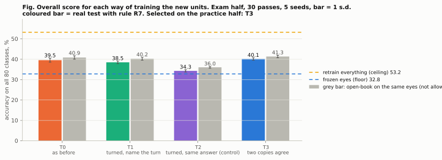
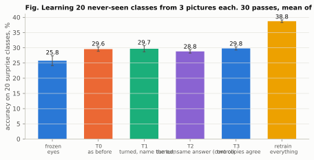
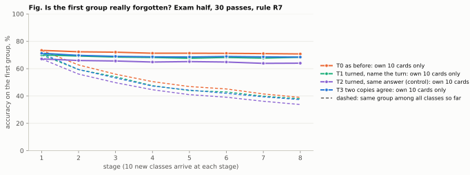
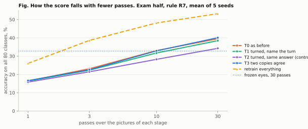
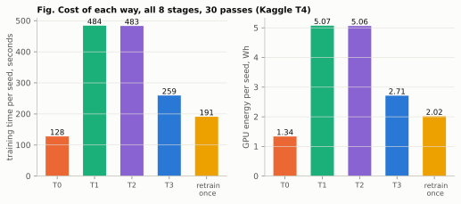

# EXP-5 · BETTER EYES

**Experiment ID:** EXP-5 · **Part A written:** 2026-11-15, before any code was run · **Hardware:** free Kaggle GPU (the method must still fit the RTX 3050 laptop, 4 GB) · **Status:** COMPLETE. Run and Part B added 2026-11-15. Verdict: does not work (section 13); none of the three extra training jobs improved the eyes

This journal has two parts. **Part A** (this part) explains the experiment before it starts.
**Part B** will be added to the end of this same PDF when the experiment finishes. Part A
will not be edited after results exist, except for the status word in the line above.

## 1. Why this experiment

### What happened before

The project thinks of a learning system as two parts: the **eyes**, which turn a picture into
a list of numbers describing it, and the **memory**, which keeps one **memory card** per class
(the average description of that class) and answers with the nearest card.

- **EXP-1** was a plan only. It was never run.
- **EXP-2** showed the memory part works when the eyes are good: a new class is learned from
  3 pictures in about a millisecond. The eyes are the bottleneck.
- **EXP-3** let the eyes keep learning by **grow and lock**: for every new group of 10
  classes, add new units and lock the old ones. Old units changed by exactly zero, but the
  overall score (29.9%) fell below eyes that never learn again (32.3%).
- **EXP-4** found out why and fixed most of it. Old cards are short, new cards are long, and
  short cards were winning too often: 84.2% of mix-ups between groups went to an older class.
  Rule **R7** guesses the missing part of each old card from the part it has, without any old
  picture. Readings on photos after 8 groups of 10 classes, exam half, 5 seeds (from
  `EXP-4-FAIR-CARDS/results/summary.json`):

| | All 80 classes | First group |
|---|---|---|
| Frozen eyes (never learn again) | 32.9% | 56.2% |
| Grow and lock, EXP-3 rule (R0) | 30.4% | 60.8% |
| **Grow and lock, rule R7** | **39.5%** | 39.5% |
| Open-book: best possible cards on the same eyes (not allowed) | 41.0% | 47.0% |
| Retrain everything (ceiling) | 52.7% | 54.3% |

### What stayed open in EXP-4

1. **The cards are no longer the problem; the eyes are.** R7 is 1.6 points under the
   open-book line (39.5 against 41.0). No card rule can go above that line. But the line
   itself is 11.7 points under retraining (41.0 against 52.7). Those points have to come
   from better eyes.
2. **The verdict was "does not work"** because R7 dropped the first group by 16.7 points and
   the written rule allowed 5. But even open-book cards, which use every old picture, would
   have failed that rule. The rule mixed two different things: real forgetting, and old
   classes simply facing stronger rivals. EXP-5 needs a test that separates them.
3. **No published work had been read** for the card rules.

### What the owner asked (2026-11-15)

Why must the model look at 5,000 pictures 30 times each? A person who is shown a plant once
remembers it. The answer so far: writing a memory card already takes one look (EXP-2). The
30 passes are spent on building the eyes. How much the score falls with fewer passes has
never been measured here. EXP-5 measures it as a side reading.

### So EXP-5 asks

**Can the units added at each stage be trained so that they are useful beyond that stage's
10 classes, still without old pictures and without touching locked units?** Side question:
**how fast does the score fall when each picture is looked at fewer times?**

# Part A: the plan (written before the run)

## 2. The question in plain words

Today, the new units added in round 5 are trained on one job only: tell round 5's ten kinds
apart. Suppose round 5 is ten kinds of vehicles. The new units learn "wheels or wings?",
which is all that job needs. They never learn anything that would help tell a vehicle from
a tree, because no tree is in the room.

**Cats and digits example.** Round 1 is cats against dogs. Round 2 is the digits. The units
added in round 2 learn strokes and loops, enough to tell 3 from 8. Nothing pushes them to
learn fur or eyes. If we give them one more job that does not depend on which classes are
in the room, they may learn richer detectors that also help with classes from other rounds.

EXP-5 tries three such extra jobs and checks whether the eyes really get better.

## 3. What published work says (read by two reading assistants on 2026-11-15)

The assistants opened these papers through a tool that returns the relevant passages
(method text and result tables), not the whole PDF. So every paper below is tagged
**passages read**, not "read in full". Numbers are the ones they saw in the text.

**About R7 (filling in old cards).** The idea is known. It was not invented here.

| Paper | Tag | What matters for us |
|---|---|---|
| Gomez-Villa et al., "Exemplar-free Continual Representation Learning via Learnable Drift Compensation", arXiv:2407.08536 | passages read | Learns a simple map from old features to new features using only current pictures, and moves old class averages through it. CIFAR-100, 10 equal steps, ResNet-18 from scratch, last-step accuracy 40.5 without and 45.4 with it. A plain linear map beat more complex ones |
| Gu et al., "Gated subspace alignment with drift compensation", PLoS ONE 2026, DOI 10.1371/journal.pone.0348270 | passages read | Closest to R7: features grow, old part frozen, missing part of old class averages filled by a closed-form ridge fit. Done on a large pretrained model |
| Zhou et al., "Expandable Subspace Ensemble" (EASE), arXiv:2403.12030 | passages read | Also growing features with missing parts filled in, by a different formula, on a large pretrained model |
| He et al., "Semantic Shift Estimation via Dual-Projection and Classifier Reconstruction", arXiv:2503.05423 | passages read | Closed-form map from old to new features from current data |
| Yu et al., "Semantic Drift Compensation for Class-Incremental Learning", arXiv:2004.00440 | passages read | The earlier, simpler form of the same family |

No paper was found doing this on a small network trained from scratch with grown units.
That is absence of evidence, not proof. R7 is used in EXP-5 unchanged from EXP-4.

**About an extra training job that needs no labels.**

| Paper | Tag | What matters for us |
|---|---|---|
| Zhu et al., "PASS++", arXiv:2407.14029 | passages read | Turn each picture by 0, 90, 180, 270 degrees and treat each (class, turn) pair as its own class. ResNet-18 trained on 40 CIFAR-100 classes, then nearest-average on 60 unseen classes: 40.6 without, 52.1 with. Not separated from the effect of simply seeing 4 times more pictures |
| Kalla and Biswas, "AggSS", arXiv:2408.04347 | passages read | Same trick added to four methods: +2.5 to +9 points, always with a large first group (50 classes) |
| Magistri et al., "Elastic Feature Consolidation", arXiv:2402.03917 | passages read | Warning: when the first group is small (10 classes, like ours), methods that use this trick scored 30 to 35 on CIFAR-100, no better than older methods |
| Gallardo et al., "Self-Supervised Training Enhances Online Continual Learning", arXiv:2103.14010 | passages read | Label-free training on 10 classes gave more general features than labelled training (31.1 against 10.4 on a later test), but most of that gain came from stronger picture alterations and longer training, not from the label-free job itself |

No paper was found that compares different label-free jobs on a small network in our
setting. So the choice below is ours, guided by these, and not settled by them.

**About looking fewer times.**

| Paper | Tag | What matters for us |
|---|---|---|
| Mai et al., "Online Continual Learning in Image Classification: An Empirical Survey", arXiv:2101.10423 | passages read | CIFAR-100: 49.7 with 70 passes, about 29 at best with one pass (and that with stored old pictures) |
| Zhang et al., "Repeated Augmented Rehearsal", arXiv:2209.13917 | passages read | Looking again helps only if the picture is altered each time; without alteration it hurts after about 2 looks |
| Soutif-Cormerais et al., "A Comprehensive Empirical Evaluation on Online Continual Learning", arXiv:2308.10328 | passages read | With few looks, methods are under-trained; the features suffer less than the final answer step |

## 4. The four ways of training the new units

Everything else is identical in all four: the same network, grow and lock, the same
pictures, R7 for the cards, no old pictures.

| | Name | The job given to the new units | Depends on pictures? |
|---|---|---|---|
| T0 | **As before** | Tell this stage's 10 classes apart | no |
| T1 | **Turned pictures, turn must be named** | Each picture is also shown turned by 90, 180 and 270 degrees. The units must tell the class *and* how far it was turned: 40 answers, not 10. To name the turn, a unit must notice shape and "which way is up", which is useful for any class | **yes** (text cannot be turned) |
| T2 | **Turned pictures, same answer** (a control) | The same four copies, but only the class is asked: 10 answers. Same amount of data as T1, no new job. If T2 does as well as T1, the gain came from more data, not from the job | yes |
| T3 | **Two altered copies must agree** | Each picture is altered twice at random (crop, shift, brightness). Besides telling the 10 classes apart, the units must give the two copies of one picture similar descriptions, and different pictures different descriptions. No labels are needed for this part | **no** (any data that can be altered slightly) |

When cards are written and when test pictures are scored, only upright, unaltered pictures
are used, in all four ways.

**Settings fixed now.**

| Setting | Value |
|---|---|
| Dataset | photos only (CIFAR-100): 80 classes in 8 stages of 10, plus 20 "surprise" classes never trained on |
| Network and growth | exactly as EXP-3 and EXP-4: 4 layers, 32 units to start, 16 added per stage |
| Card rule | R7 exactly as in EXP-4 (ridge 0.01). R0 and open-book are also recorded |
| T3 details | the agreement job has the same weight as the class job (1.0), temperature 0.5, a small extra layer of 64 outputs used only during training. Chosen once, not tuned |
| Passes over the pictures per stage | 30 (the main run), and also 10, 3 and 1 for the side reading |
| Seeds | 5, the same seed numbers as before |
| Test split | half practice, half exam, per class, same split as EXP-4 |
| Selecting one of T1, T2, T3 | highest R7 score on all 80 classes on the practice half, at 30 passes, among those that pass step 3 on the practice half |
| Reference points | frozen eyes; retrain everything (plain training, at 30, 10, 3 and 1 passes) |

**Digits then clothes is left out.** EXP-4 already gave "works" there (91.5% against a
ceiling of 94.0%), and turning a digit changes what it is (a 6 becomes a 9).

## 5. What is measured

| | Measurement | Plain meaning | Why it matters |
|---|---|---|---|
| M1 | Accuracy on **all 80 classes** with R7 | The overall score | The number to move from 39.5 toward 52.7 |
| M2 | **Open-book score** on the same eyes (not counted) | The best any cards could do with these eyes | Tells directly whether the eyes got better |
| M3 | **3-picture test on the 20 surprise classes** | How good the eyes are at things they were never trained on | Measures the eyes alone; no old cards are involved. EXP-3: grow and lock 30.0%, retrain 39.0% |
| M4 | **First group, with only its own 10 cards allowed** as answers, after every stage | Has the system really forgotten how to tell the first 10 classes apart? | Separates forgetting from rivalry. Rivals from later stages cannot affect it |
| M5 | First group among all 80 classes, and score per group | How old classes do against rivals | Reported next to retrain (54.3%), not used for pass or fail |
| M6 | Training time, and GPU energy if Kaggle reports power | The cost of each way | A way that costs four times more must earn it |
| M7 | M1 and M2 at 30, 10, 3 and 1 passes | How much the 30 passes are really worth | The owner's question |

## 6. How the result will be judged (written before the run)

The verdict uses the exam half, after stage 8, 30 passes, mean of 5 seeds, for the one way
(T1, T2 or T3) selected on the practice half.

**Step 0: is EXP-4 rebuilt correctly?** T0 at 30 passes must give R7 within 3 points of
39.5%, open-book within 3 of 41.0%, frozen within 3 of 32.9%, retrain within 3 of 52.7%.

**Step 1: did the eyes get better?** Open-book score of the selected way minus open-book
score of T0. **2 points or more** counts as "eyes improved". The 3-picture surprise test is
reported next to it.

**Step 2: how much of the remaining gap is closed?**

> share = (selected way with R7 − T0 with R7) ÷ (retrain − T0 with R7)

With EXP-4's numbers the gap is 52.7 − 39.5 = 13.2 points.

**Step 3: is old knowledge really kept?** M4 for the first group after stage 8 must be no
more than **3 points** below its value right after stage 1.

| Verdict | Condition |
|---|---|
| **Works** | closes at least 50% of the gap (about 46.1% or more) and passes step 3 |
| **Partly works** | closes 25% to 50% (about 42.8% or more) and passes step 3 |
| **Does not work** | closes under 25%, or fails step 3 |

**Control.** If the selected way is T1 and T2 scores within 1 point of it, the gain is
credited to "more altered data", not to the extra job, and the journal will say so.

**Side reading (no verdict).** The table of scores at 30, 10, 3 and 1 passes for all four
ways and for retrain.

**What I expect, written down now.**

- T1 will be selected. Its open-book score will rise from 41.0% to about **45%**, and its
  R7 score from 39.5% to about **43%**. That is a share of about 25 to 30%: **"partly
  works", close to the border.** The first group is small (10 classes), and one paper warns
  that this trick is weaker then.
- T2 will be within 2 points of T0 either way. T3 will gain about 1 point.
- Step 3 will pass: the first group with only its own cards will drop by less than 3 points.
- The 3-picture surprise test will rise from about 30% to about 33% for T1.
- Fewer passes, T0 with R7: about **35%** at 10 passes, **27%** at 3, **18%** at 1. The
  extra jobs will not rescue the 1-pass case.

If any of this is wrong, it stays in the journal as written.

## 7. What carries over beyond pictures

| Part | Depends on pictures? |
|---|---|
| Image filters inside the network | yes |
| Grow and lock; memory cards; R7 | no |
| T1 and T2 (turning the picture) | **yes.** If T1 wins, it shows that a class-independent job helps, but the job itself would have to be replaced for language |
| T3 (two altered copies must agree) | no. It needs only a way to alter the input slightly |
| The idea of a job that needs no labels | no. Language models are already trained on one: guess the next word |
| The passes question | no. It is about how many times any piece of data must be seen |

## 8. What could go wrong

- **T1's evidence comes from larger networks with a large first group.** Ours is small with
  10 classes first. One paper suggests the trick is weak there.
- **T1 and T2 see four times more pictures per pass**, so they cost about four times the
  computing per pass. At 1 pass they still see each picture four times (turned). The side
  reading will state this next to the numbers.
- **T3's settings are untuned.** A poor result may be a poor setting, not a poor idea.
- **The ceiling is not retrained with the extra jobs.** If T1 also helps retraining, the
  true ceiling is higher than 52.7% and the share in step 2 is flattering. This is not
  measured here.
- **Step 3 is new.** It may turn out too easy to pass. M5 is reported so that the reader can
  see what happens to old classes against rivals.
- **Three ways, one dataset, 5 seeds.** The practice and exam halves guard against a lucky
  pick, not against a result that only holds for these photos.
- **Papers were read as passages, not cover to cover.** A detail may have been missed.
- **Training is not perfectly repeatable on a GPU.** Step 0 checks the rebuild is close.

## 9. Time and disk

| | Expected |
|---|---|
| Run time | about 3 to 4 hours on a free Kaggle GPU for all 5 seeds. Estimate from EXP-4's measured times (grow 122 s, retrain 181 s per seed at 30 passes), with T1 and T2 taken as 4 times T0, T3 as 2.5 times, and the three shorter runs adding about half again |
| Disk in this folder | 0.15 GB measured for the Python environment (figures and PDF), plus under 0.05 GB of results and figures |
| Downloads to the laptop | none. The dataset is downloaded on Kaggle's machine. A short code check on the laptop borrows EXP-2's environment and dataset without changing them |
| GPU memory | under 1.1 GB before; T1 and T2 use batches four times larger, expected under 3 GB, inside the laptop's 4 GB |

## 10. Words used in this journal

| Word | Meaning here |
|---|---|
| Class | One kind of thing to recognise: "dog", "bus", "7" |
| Unit | One small detector inside the network |
| Eyes (features) | The part of the network that turns a picture into a list of numbers |
| Memory card (prototype) | The average description of all pictures of one class |
| Grow and lock | Add new units for new classes; forbid the old units from ever changing |
| Stage, group | The moment 10 new classes arrive; those 10 classes |
| Pass | One time through all the pictures of a stage |
| R7 (predicted fill-in) | Guess the missing part of an old, short card from the part it has |
| Open-book | Rewriting all cards from old pictures. Forbidden in the real test; shows the best these eyes could do |
| Label | The name of the class, given by a person |
| Label-free job | A training task that needs no names, for example "are these two copies the same picture?" |
| Control | A run that differs in one thing only, to check what really caused a gain |
| Surprise classes | 20 classes the eyes are never trained on, learned from 3 pictures each |
| Floor and ceiling | Frozen eyes and retrain everything, the two reference points |
| Practice half, exam half | The two halves of the test pictures: one to choose, one to grade |
| Seed | One repeat with a different random shuffle |

# Part B: the readings (added after the run, 2026-11-15)

Part A above was not changed after the run, except the one status line at the top of page 1.

## 11. What was actually run

The full plan in section 4 was run once, on a free Kaggle GPU (Tesla T4), as a private job
named `exp5-better-eyes`. It took **216 minutes** (the plan said 3 to 4 hours). The result
files were downloaded into `results/`: `runs.jsonl` (1,945 lines), `meta.json` (settings and
timing), `preds.npz` (every final answer at 30 passes) and `kaggle_run.log`. All 5 seeds
finished for all four ways at 30, 10, 3 and 1 passes, and the log holds no errors.
`src/figures.py` turned `runs.jsonl` into `results/summary.json` and the figures.
**Every number below comes from `results/summary.json` unless another file is named.**
Numbers are for the exam half, after stage 8, mean of 5 seeds, unless stated.

**Things that differ from Part A, or that Part A left open and the code had to fix:**

| Item | What was done |
|---|---|
| Small code check before the run | A 1-pass trial on a tenth of the data was run on the laptop to catch crashes. It borrowed the Python environment and dataset of EXP-2 (read only). Its numbers were thrown away |
| T1 and T2 | each batch of 128 pictures is altered once, then shown in all four turns (512 pictures per step) |
| T3 | both altered copies are also used for the class job |
| Random starts | each way and each number of passes got its own random start; the class order is the same for all of them within a seed |
| 3-picture surprise test | run after the last stage only, with the same random draws for every way |
| Energy | Kaggle reported GPU power, so energy was recorded (GPU only) |
| Frozen eyes and retrain | as before, both are full-size networks (144 units per layer). Grow and lock starts with 32 units |

Nothing in sections 1 to 10 was changed.

## 12. The readings

### 12.1 Step 0: was EXP-4 rebuilt correctly? Yes

| | EXP-4 | EXP-5 rebuild (T0, 30 passes) | Within 3 points? |
|---|---|---|---|
| Grow and lock with R7 | 39.5 | 39.6 | yes |
| Open-book on the same eyes | 41.0 | 40.9 | yes |
| Frozen eyes | 32.9 | 32.8 | yes |
| Retrain everything | 52.7 | 53.2 | yes |

### 12.2 The four ways at 30 passes

| Way | All 80 classes (R7) | Open-book, same eyes | 3-picture surprise test | Training time per seed | GPU energy per seed |
|---|---|---|---|---|---|
| T0 as before | 39.6 ± 1.0 | 40.9 | 29.6 | 128 s | 1.34 Wh |
| T1 turned, name the turn | 38.5 ± 0.6 | 40.2 | 29.7 | 484 s | 5.07 Wh |
| T2 turned, same answer (control) | 34.3 ± 0.6 | 36.1 | 28.8 | 483 s | 5.06 Wh |
| **T3 two copies agree (selected)** | **40.1 ± 0.6** | 41.3 | 29.8 | 259 s | 2.71 Wh |
| *Frozen eyes (floor)* | 32.8 | | 25.8 | 24 s | 0.25 Wh |
| *Retrain everything, once (ceiling)* | 53.2 ± 0.4 | | 38.8 | 191 s | 2.02 Wh |

*Figure 1. Coloured bars: the real test with rule R7. Grey bars: open-book on the same eyes.
All four ways sit near 40%, far under the retrain line. T2 is clearly lower.*

In plain words: **none of the extra jobs made the eyes better.**

- T3 gained 0.6 points over T0, which is inside the spread between seeds, at twice the cost.
- T1, the one with the best published support, came out 1.1 points *lower* than T0, at
  almost four times the cost.
- T2, the control, lost 5.3 points. Showing turned copies and demanding the same answer
  hurts these small eyes. T1's extra job only repairs that damage.
- The 3-picture test on never-seen classes, which measures the eyes alone, did not move:
  29.6, 29.7, 28.8, 29.8. Retrain reaches 38.8.

*Figure 2. Learning 20 never-seen classes from 3 pictures each. The four ways are level.*

### 12.3 Selection

On the practice half, all three new ways passed step 3. Their R7 scores were T1 37.5,
T2 33.0, T3 38.4 (T0 had 38.2). **T3 was selected.**

### 12.4 Is old knowledge really kept? (the new test)

First group, with only its own 10 cards allowed as answers:

| Way | Right after stage 1 | After stage 8 | Drop |
|---|---|---|---|
| T0 | 73.4 | 70.8 | 2.6 |
| T1 | 70.0 | 68.4 | 1.7 |
| T2 | 67.1 | 64.0 | 3.1 |
| T3 | 71.2 | 68.4 | 2.8 |

*Figure 3. Solid lines: the first group with only its own cards allowed. They stay almost
flat. Dashed lines: the same group among all classes so far. They fall from about 72% to
about 38%.*

So the system has **not** forgotten how to tell the first 10 classes apart: it loses under
3 points in seven more stages. (The locked units do not change at all; the small loss comes
from R7's guessed additions to the old cards.) The large fall of the first group among all
classes, from 73.4% to 39.0% for T0, is caused by 70 new rivals, not by forgetting. For
comparison, retrain scores 80.4% on this own-cards test and 55.6% among all classes, so
its eyes are better even for the first group.

### 12.5 Fewer passes (side reading, no verdict)

All 80 classes, R7 for grow and lock:

| Passes per stage | T0 | T1 | T2 | T3 | Retrain everything | T0 as a share of retrain | T0 training time | T0 energy |
|---|---|---|---|---|---|---|---|---|
| 30 | 39.6 | 38.5 | 34.3 | 40.1 | 53.2 | 74% | 128 s | 1.34 Wh |
| 10 | 33.1 | 31.8 | 28.3 | 32.9 | 48.2 | 69% | 43 s | 0.45 Wh |
| 3 | 23.1 | 22.3 | 21.5 | 22.6 | 38.6 | 60% | 13 s | 0.13 Wh |
| 1 | 16.5 | 16.4 | 15.8 | 16.6 | 26.1 | 63% | 4 s | 0.03 Wh |

*Figure 4. Every method falls steeply with fewer passes. The extra jobs do not help at any
number of passes.*

- Going from 30 passes to 1 pass costs grow and lock 23 points (39.6 to 16.5) and retrain
  27 points (53.2 to 26.1). Looking once is far from enough for these eyes.
- 10 passes keeps 33.1% for a third of the time and energy. That is about level with
  frozen eyes (32.8%), which trained for 24 s.
- T1 and T2 see every picture four times per pass (turned), and still do not beat T0 at 1 pass.

### 12.6 Cost

*Figure 5. Training time and GPU energy per seed for all 8 stages at 30 passes, and for one
retraining on all 80 classes.*

Peak GPU memory was 0.9 GB for T0 and 2.0 GB for T1, inside the laptop's 4 GB.
"Retrain once" is one training at the very end. Retraining after every stage was not
repeated here; in EXP-3 it took 924 s and 9.69 Wh per seed.

The score per group is in `figures/fig6_per_group.svg`.

## 13. The verdict, by the rule written in section 6

Selected way T3, exam half, 30 passes:

| Step | Reading | Result |
|---|---|---|
| 0. Rebuild check | 39.6, 40.9, 32.8, 53.2 against 39.5, 41.0, 32.9, 52.7 | passed |
| 1. Did the eyes get better? | open-book 41.3 against 40.9: **+0.5 points** (2 needed) | **no** |
| 2. Share of the gap closed | (40.1 − 39.6) ÷ (53.2 − 39.6) = **4%** | under 25% |
| 3. Old knowledge kept | first group, own cards: 71.2 to 68.4, a drop of 2.8 (3 allowed) | passed |

**Verdict: does not work.** Giving the new units an extra job did not improve the eyes.
The control clause in section 6 does not apply, because T1 was not selected.

## 14. Was the expectation in section 6 right?

| What I wrote before the run | What happened | |
|---|---|---|
| T1 will be selected | T3 was selected; T1 was below T0 | wrong |
| Open-book rises to about 45% | 41.3% | wrong |
| R7 score rises to about 43%, "partly works" | 40.1%, "does not work" | wrong |
| T2 within 2 points of T0 | 5.3 points lower | wrong |
| T3 gains about 1 point | +0.6 | right |
| Step 3 passes | drop of 2.8, limit 3 | right, narrowly |
| Surprise test rises to about 33% for T1 | 29.7% | wrong |
| T0 with fewer passes: 35% / 27% / 18% | 33.1% / 23.1% / 16.5% | roughly right, a little optimistic |
| Extra jobs will not rescue the 1-pass case | they did not | right |

The warning from the one paper that tested a small first group turned out to be the right
guide; my main prediction leaned on the papers with a large first group.

## 15. What it means for the project

**1. "Give the new units a richer job" is not the fix.** Two different extra jobs, one
image-specific and one that would carry to language, left the eyes where they were. The
idea that the new units fail because their job is too narrow is not supported, at least
for jobs of this kind on a network this small.

**2. The new old-knowledge test does its work.** It shows clearly what EXP-3 and EXP-4
could not separate: real forgetting under grow and lock with R7 is under 3 points in seven
stages. Everything else that old classes lose is rivalry from new classes.

**3. The gap to retraining is the same size at every amount of training.** Grow and lock
reaches 60 to 74% of retrain's score at 1, 3, 10 and 30 passes. So the gap is not about
training longer either.

**4. A clue about size.** Trained on the same first 10 classes for 30 passes, a 144-unit
network tells them apart 79.8% of the time (frozen eyes, own cards), and grow and lock's
32-unit start 73.4%. Bigger eyes are better eyes here. Grow and lock adds only 16 units per
stage. This is a reading of two existing numbers, not a test.

**5. On looking once.** These eyes need many looks: one pass gives 16.5%. The cheap part of
the system (writing a card from a few pictures) is still cheap, but building eyes from
scratch is not, with this kind of training.

**6. Cost so far.** Grow and lock (T0) costs 128 s and 1.34 Wh for all 8 stages. That is
less than one single retraining at the end (191 s, 2.02 Wh) and far less than retraining
after every stage (924 s, 9.69 Wh in EXP-3). The price is 13.6 points of accuracy.

## 16. What is still unverified

- T3's settings (weight 1.0, temperature 0.5) were fixed once and not tuned. A tuned
  version might do better; this run cannot say.
- Only two kinds of extra job were tried. Other kinds exist.
- The ceiling was not retrained with the extra jobs.
- The size clue in point 4 of section 15 compares two networks that differ in size only at
  stage 1; it was not tested as a cause.
- Why the eyes of grow and lock stay 12 points under retrain (40.9 open-book against 53.2)
  is still not known. Three candidates, none tested: each stage's units see only 10
  classes; only 16 units are added per stage; locked units cannot improve.
- The published papers were read as passages by reading assistants, not cover to cover.
- One network size, one photo dataset, 5 seeds, images only.
- Energy is GPU-only, measured on a Kaggle T4, not on the laptop.

## 17. What carries over beyond pictures

Nothing new that works. The image-free extra job (T3) gave no gain, so there is nothing to
carry. The own-cards test for forgetting and the passes measurement are not tied to
pictures and can be reused as they are.

## 18. What the next experiment should be, and why

**Proposed EXP-6: find out what holds the eyes back, before trying another fix.**

Why: EXP-5 tried a fix for a cause that was only guessed, and the guess was wrong. Three
candidate causes remain (section 16). Each can be switched off on its own, using old
pictures where needed. That is forbidden in the real test, but allowed as a diagnosis, like
the open-book check.

What it should contain, all with grow and lock and R7, 30 passes:

1. **As now** (T0): 16 new units per stage, trained on the 10 new classes.
2. **More units**: 48 new units per stage instead of 16. Tests whether size is the limit.
3. **All data, diagnosis only**: the new units of each stage are trained on all classes so
   far, with old units still locked. Tests whether seeing only 10 classes is the limit.
4. **Both** 2 and 3 together.
5. Retrain at the matching network size, as the ceiling for each.

Reading: whichever switch moves the open-book score and the 3-picture surprise test toward
retrain names the bottleneck. If "more units" does it, the fix is cheap and allowed. If
only "all data" does it, the project needs a way to give new units a view of old knowledge
without old pictures, and that becomes EXP-7. If neither does it, locking itself is the
limit and grow and lock needs rethinking.

This is a proposal. It needs its own Part A before any code is run.
