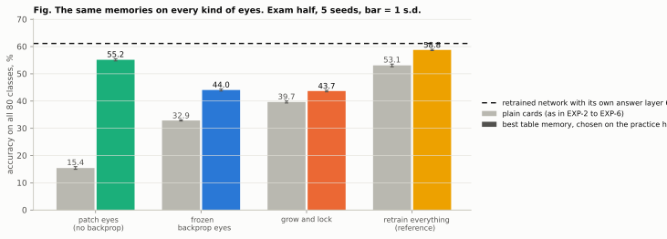
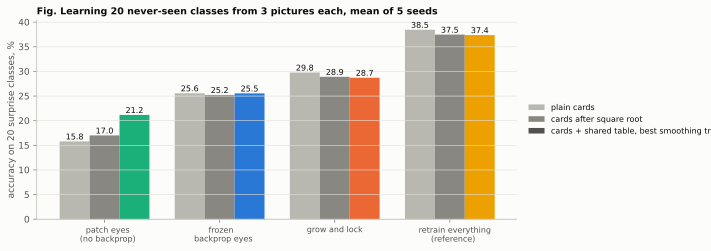
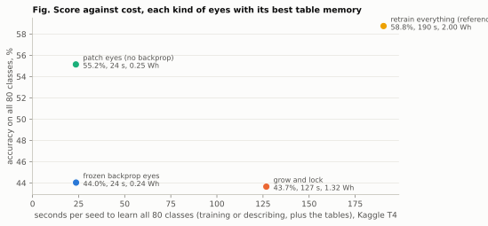

# EXP-8 · SAME MEMORY FOR EVERY EYES

**Experiment ID:** EXP-8 · **Part A written:** 2026-11-16, before any code was run · **Hardware:** free Kaggle GPU (the method must still fit the RTX 3050 laptop, 4 GB) · **Status:** COMPLETE. Run and Part B added 2026-11-16. Result: ceiling 61.1%; patch eyes with the shared table 55.2%, "close, at a fraction of the cost"; under the same memory frozen eyes equal grow and lock (section 12)

This journal has two parts. **Part A** (this part) explains the experiment before it starts.
**Part B** will be added to the end of this same PDF when the experiment finishes. Part A
will not be edited after results exist, except for the status word in the line above.

## 1. Why this experiment

### What happened before

The project thinks of a learning system as two parts: the **eyes**, which turn a picture into
a list of numbers describing it, and the **memory**, which stores what was learned about
each class and gives the answer.

- **EXP-1** was a plan only. It was never run.
- **EXP-2 to EXP-6** all used the same simple memory: one **card** per class (the average
  description), compared by angle. With it, eyes trained by backpropagation reached 33.2%
  (frozen after the first group), 39.6% (grow and lock) and 53.2% (retrain everything) on the
  80-class photo test. EXP-6 found that locking units trained on few classes is what holds
  grow and lock back.
- **EXP-7** tried eyes that need no training at all (1,600 fixed picture patches) and, for
  the first time, a richer memory: cards plus **one shared table** of how the numbers of a
  description vary together. Its readings, exam half, 5 seeds (from
  `EXP-7-PATCH-EYES/results/summary.json`; backprop rows quoted from EXP-6):

| | All 80 classes | 20 never-seen classes from 3 pictures | Time to learn |
|---|---|---|---|
| Patch eyes + plain cards | 15.4% | 15.8% | 9 s |
| **Patch eyes + cards and shared table** | **55.2%** | 8.2% (17.0% with plain cards after a square root) | 24 s |
| Frozen backprop eyes + plain cards | 33.2% | 25.6% | 26 s |
| Grow and lock + plain cards (R7) | 39.6% | 29.7% | 131 s |
| Retrain everything + plain cards | 53.2% | 38.5% | 202 s |

### What stayed open in EXP-7

By its written rule the verdict was "works": no backpropagation, one look at each picture,
nothing forgotten, and a higher score than the retraining reference. But the journal
attached three warnings, and the first one makes the headline unreliable:

1. **The comparison was not fair.** The same eyes went from 15.4% to 55.2% just by
   changing the memory. The backprop eyes were only ever measured with the weak memory.
   Nobody knows what they score with the strong one. The retrained network was also never
   allowed to answer with its own trained answer layer, which is how such a network is
   normally used.
2. **From 3 pictures per class the new system is poor** (17.0% against 29.7%).
3. It used 5.5 GB of GPU memory as written.

EXP-2 concluded "the memory works, the eyes are the bottleneck". After EXP-7 that
conclusion is in doubt.

### So EXP-8 asks

**With the same memory on every kind of eyes, which eyes are best, and how far is the
cheap no-backprop system from the best a trained network can do?** And: **does any memory
make learning from 3 pictures work?**

# Part A: the plan (written before the run)

## 2. The idea in plain words

So far we compared a runner in good shoes with runners in sandals and said the first one
was faster. EXP-8 gives everyone the same shoes.

**Cats and digits example.** Four students have learned cats, dogs and the digits, each
with different eyes. Until now three of them had to answer by "which average picture is
this closest to?", and the fourth was also told which features tend to go together (fur
with whiskers; a loop on top with a stem below). The fourth scored best. Was it the better
eyes, or the extra knowledge? EXP-8 gives all four the same extra knowledge and asks again.

## 3. What is run

### Four kinds of eyes, all on the same test

| | Eyes | Built how | Allowed in the real method? |
|---|---|---|---|
| P | **Patch eyes** | 1,600 fixed patches from the first group, threshold 0.1 (EXP-7's selected) | yes; no backprop |
| F | **Frozen backprop eyes** | network trained on the first 10 classes, then never again | yes |
| G | **Grow and lock** | units added and locked at each stage (EXP-6 run A) | yes |
| R | **Retrain everything** | a fresh network trained on all 80 classes at once | no (keeps all pictures); it is the reference |

### The same memories on each

| Memory | What it is |
|---|---|
| M-cos | plain cards, compared by angle (as in EXP-2 to EXP-6) |
| M-sqrt | the same after taking the square root of every number |
| M-lda | cards plus one shared table, with five smoothing values: 0.0001, 0.001, 0.01, 0.1, 1 |
| M-ridge | one-step straight-line classifier from running tables, same five values |
| Own answer layer (R only) | the answer layer the retrained network was trained with. **This is the honest ceiling** |

For grow and lock, old classes never had the newer units, so their part of the shared
table is missing. Two versions are run:

- **G with filled-in tables** (a real method): the missing parts of old cards are guessed
  as in R7, and the missing parts of the shared table are filled by the same kind of
  guess: learn from the current pictures how the new units follow from the old ones, and
  assume old classes behave the same way (an exact formula for this pattern of missing
  data is in arXiv:2009.11360, read as passages).
- **G open-book** (diagnosis only): tables written from all old pictures.

### The 3-picture surprise test

For every kind of eyes: plain cards, cards after square root, and cards judged with the
shared table built from the 80 learned classes, with smoothing from 0.01 up to 100 (strong
smoothing is what one paper used for few examples; FeCAM, arXiv:2309.14062, passages read).

### The test

Unchanged: photos (CIFAR-100), 80 classes in 8 stages of 10, old pictures thrown away
after each stage, 20 surprise classes, 5 seeds with the same class orders and the same
practice and exam halves as EXP-4 to EXP-7. Backprop networks as in EXP-6 (30 passes).

**Settings fixed now.**

| Setting | Value |
|---|---|
| Choosing the memory for each kind of eyes | the memory and smoothing with the highest score on all 80 classes on the practice half, among those that keep the first group (drop of 3 points or less with only its own cards, on the practice half). Scores are then read on the exam half |
| Tables are solved after stages | 1, 4 and 8 |
| Seeds | 5 |

## 4. What is measured

| | Measurement | Why it matters |
|---|---|---|
| S1 | Accuracy on all 80 classes after stage 8, for every eyes with every memory | The fair comparison |
| S2 | The retrained network with its own answer layer | The real ceiling for this size of network |
| S3 | First group with only its own cards, stage 1 against stage 8 | Forgetting, for every eyes and memory |
| S4 | 3-picture surprise test, every eyes and memory | The project's few-example goal |
| S5 | Time and GPU energy: training (backprop eyes), describing pictures, filling and solving tables | Cost of each full system, this time including the tables |
| S6 | Peak GPU memory | Laptop fit |

## 5. How the result will be judged (written before the run)

Each kind of eyes gets its best memory, chosen on the practice half. All scores below are
exam half, after stage 8, mean of 5 seeds.

**Step 0: are the earlier numbers rebuilt?** Within 3 points each: patch eyes with M-lda at
0.01: 55.2%; frozen with M-cos: 33.2%; grow and lock with R7 cards: 39.6%; retrain with
M-cos: 53.2%.

**Step 1: the ceiling.** Ceiling = the higher of "retrain with its own answer layer" and
"retrain with its best table memory".

**Step 2: where does the no-backprop system stand?** Patch eyes with their best memory,
against the ceiling:

| Distance below the ceiling | Verdict |
|---|---|
| 3 points or less (or above) | **matches the trained network** |
| 3 to 10 points | **close, at a fraction of the cost** |
| more than 10 points | **clearly behind** |

**Step 3: was grow and lock held back by its memory?** Grow and lock with filled-in tables
against 39.6%: a gain of 5 points or more counts as **yes**.

**Step 4: was EXP-2 right that the eyes are the bottleneck?** For frozen backprop eyes:
if the best table memory lifts them by 5 points or more over plain cards, the memory was
also a bottleneck.

**Step 5: few examples.** The best 3-picture score of each eyes with any memory. The
target to beat is 29.7% (grow and lock with plain cards); the retrain reference is 38.5%.

**What I expect, written down now.**

- Ceiling: retrain with its own answer layer about **60%**; with the table memory about 60% too.
- Patch eyes with a smaller smoothing value: about **56%**. So the verdict would be
  **"close, at a fraction of the cost"**, about 4 points under the ceiling.
- Frozen backprop eyes with tables: about 42% (a gain of about 9, so the memory was also a
  bottleneck in EXP-2).
- Grow and lock with filled-in tables: about 46% (a gain of about 6); open-book about 49%.
- Under the same memory the order will be: retrain, then patch eyes, then grow and lock,
  then frozen.
- Few examples: no memory will rescue patch eyes (best about 18%). The table memory with
  strong smoothing will help the backprop eyes a little (retrain about 40%, grow and lock
  about 31%).

My main predictions were wrong in EXP-4, EXP-5 and EXP-6, and my score prediction was 11
points too low in EXP-7. If any of this is wrong, it stays in the journal as written.

## 6. What carries over beyond pictures

| Part | Depends on pictures? |
|---|---|
| The four kinds of eyes | yes, all four are built for pictures |
| The memories (cards, shared table, straight-line classifier, filled-in tables) | no. They work on lists of numbers |
| The question "is it the eyes or the memory?" | no. Any system with these two parts should ask it before changing the eyes |

## 7. What could go wrong

- **Filled-in tables rest on a guess**: that old classes relate new units to old units the
  way current classes do. R7 made the same guess for cards and it worked (39.6% against
  41.0% open-book). For the table it is untested; the open-book version shows what is lost.
- **The ceiling is for this small network and 30 passes.** A bigger or longer-trained
  network would be higher. "Matches the trained network" would mean this network, nothing more.
- **Choosing among ten memory settings per eyes** on the practice half guards against a
  lucky pick only partly; differences under 1 point between settings should not be read into.
- **The smallest smoothing may again be the best**, in which case the best value still
  lies outside the tried range. Part B will say so.
- **Backprop features are short** (576 numbers) and patch features long (6,400). The table
  memory may suit long descriptions better. That is part of what is being measured, not an error.
- **5 seeds, one dataset, images only.**
- **Training is not perfectly repeatable on a GPU.** Step 0 checks the rebuild.

## 8. Time and disk

| | Expected |
|---|---|
| Run time | about 1 hour on a free Kaggle GPU for all 5 seeds. From measured times per seed: frozen 26 s, grow and lock 131 s, retrain 202 s (EXP-6), patch eyes about 1.5 minutes with five smoothing values (EXP-7), plus scoring |
| Disk in this folder | 0.15 GB measured for the Python environment (figures and PDF), plus under 0.05 GB of results and figures |
| Downloads to the laptop | none. A short code check on the laptop borrows EXP-2's environment and CIFAR-100 without changing them |
| GPU memory | about 5.5 GB for the patch eyes as in EXP-7 (not laptop-sized as written); under 1.2 GB for the backprop parts. Peak use will be reported per kind of eyes |

## 9. Words used in this journal

| Word | Meaning here |
|---|---|
| Class | One kind of thing to recognise |
| Eyes (features) | The part that turns a picture into a list of numbers |
| Memory | The part that stores what was learned about each class and gives the answer |
| Card | The average description of one class |
| Shared table (covariance) | A table recording which numbers of a description tend to rise and fall together, kept as a running sum |
| Smoothing | How strongly the shared table is evened out before use. More smoothing trusts the table less |
| Answer layer | The last layer of an ordinary trained network, which turns the description into one score per class. It is trained by backpropagation together with the eyes |
| Backpropagation | The usual way to train a network: measure the error and push corrections back through all layers, many times |
| Grow and lock | Add units for each new group of classes; never change old units |
| R7 | Guess the missing part of an old, short card from the part it has |
| Open-book | Using old pictures to rewrite what the memory holds. Forbidden in the real test; used as a diagnosis |
| Ceiling | The best score a trained network of this size reaches when it may keep all pictures |
| Practice half, exam half | The two halves of the test pictures: one to choose, one to grade |
| Surprise classes | 20 classes never used to build anything, learned from 3 pictures each |
| Seed | One repeat with a different random shuffle |

# Part B: the readings (added after the run, 2026-11-16)

Part A above was not changed after the run, except the one status line at the top of page 1.

## 10. What was actually run

The plan in section 3 was run once, on a free Kaggle GPU (Tesla T4), as a private job named
`exp8-same-memory`. It took **47 minutes**. The result files were downloaded into
`results/`: `runs.jsonl` (975 lines), `meta.json` and `kaggle_run.log`. All 5 seeds finished
for all four kinds of eyes, with no errors in the log. `src/figures.py` turned `runs.jsonl`
into `results/summary.json` and the figures. **Every number below comes from
`results/summary.json`**: exam half, after stage 8, mean of 5 seeds.

**Things that differ from Part A, or that the code had to fix:**

| Item | What was done |
|---|---|
| Small code checks before the run | A tiny trial (1 pass, 3 stages, a tenth of the data) was run on the laptop, borrowing EXP-2's Python environment and CIFAR-100 (read only). A second short check confirmed that the retrained network's own answer layer was being scored correctly (34.7% against 33.1% for cards on a 30-class toy run). Neither is a result |
| Filled-in tables for grow and lock | The missing part of each old card is guessed as in R7. The missing part of the shared table is filled through the relation between new and old units measured inside the current classes. Settings as R7 (0.01) |
| Surprise test for grow and lock | uses the final eyes; with the table memory it uses the filled-in table |
| M-ridge on grow and lock | only as open-book (diagnosis); no filled-in version was built |
| Energy | recorded for every step this time, including filling and solving the tables |

Nothing in sections 1 to 9 was changed.

## 11. The readings

### 11.1 Step 0: are the earlier numbers rebuilt? Yes

| | Earlier | EXP-8 |
|---|---|---|
| Patch eyes, shared table at 0.01 | 55.2 | 55.2 |
| Frozen backprop eyes, plain cards | 33.2 | 32.9 |
| Grow and lock, R7 cards | 39.6 | 39.7 |
| Retrain, plain cards | 53.2 | 53.1 |

### 11.2 The same memories on every kind of eyes

| Eyes | Plain cards | Best table memory (chosen on the practice half) | Gain | First group, own cards: drop over 7 stages |
|---|---|---|---|---|
| P: patch eyes, no backprop | 15.4 | **55.2** (shared table, smoothing 0.01) | +39.7 | none (rose 0.6) |
| F: frozen backprop eyes | 32.9 | 44.1 (shared table, 0.1) | +11.2 | 1.8 |
| G: grow and lock | 39.7 (R7) | 43.7 (filled-in table, 1.0) | +4.0 | 0.9 |
| R: retrain everything (keeps all pictures) | 53.1 | 58.8 (shared table, 0.1) | +5.7 | 2.1 |
| **R with its own trained answer layer (the ceiling)** | | **61.1 ± 0.7** | | |

*Figure 1. Grey: plain cards, as used in every experiment before EXP-7. Colour: the best
table memory. Dashed line: the retrained network answering with its own answer layer.*

The shared table beat the straight-line classifier (M-ridge) on every kind of eyes. For
patch eyes the best smoothing, 0.01, now lies inside the tried range (0.001 gives 54.0%,
0.1 gives 53.6%). For backprop eyes the smoothing hardly matters.

### 11.3 Grow and lock in detail

| Memory on grow-and-lock eyes | All 80 classes |
|---|---|
| Cards on their own units (R0, EXP-3) | 30.8 |
| Cards filled in (R7, EXP-4) | 39.7 |
| **Filled-in shared table (a real method)** | **43.7** |
| Open-book cards (not allowed) | 41.1 |
| Open-book shared table (not allowed) | 46.5 |

The filled-in table gains 4.0 points over R7 cards and sits 2.8 under its open-book
version. Frozen backprop eyes with the shared table reach 44.1%, which is as good as grow
and lock with its best real memory (43.7%), at a fifth of the training time.

### 11.4 Learning from 3 pictures

*Figure 2. 20 never-seen classes from 3 pictures each. The coloured bar is the shared
table at its best smoothing, which was always the strongest tried (10 or 100).*

| Eyes | Plain cards | Cards after square root | Cards + shared table, best smoothing |
|---|---|---|---|
| Patch eyes | 15.8 | 17.0 | 21.2 |
| Frozen backprop eyes | 25.6 | 25.2 | 25.5 |
| Grow and lock | 29.8 | 28.9 | 28.7 |
| Retrain everything | 38.5 | 37.5 | 37.4 |

No memory helps the backprop eyes here; plain cards remain the best. For patch eyes the
table with very strong smoothing adds about 4 points (17.0 to 21.2), still far below the
others. With the smoothing that is best for the 80 learned classes (0.01) the table is
very bad for new classes from 3 pictures (8.2% on patch eyes, 20.4% on retrained eyes).
The order from 3 pictures follows how much the eyes were trained with labels.

### 11.5 Cost of each full system

*Figure 3. Each kind of eyes with its best table memory: score against the time to learn
all 80 classes on the Kaggle GPU.*

| System | All 80 classes | Time per seed | GPU energy per seed | Peak GPU memory | Keeps old pictures? |
|---|---|---|---|---|---|
| Patch eyes + shared table | 55.2% | 24 s | 0.25 Wh | 5.6 GB | no |
| Frozen backprop eyes + shared table | 44.1% | 24 s | 0.25 Wh | 1.7 GB | no |
| Grow and lock + filled-in table | 43.7% | 127 s | 1.32 Wh | 1.6 GB | no |
| Retrain + shared table | 58.8% | 190 s | 2.00 Wh | 1.7 GB | **yes, all** |
| Retrain + own answer layer | 61.1% | 190 s | 2.00 Wh | 1.7 GB | **yes, all** |

"Retrain" here is one training at the very end. Kept up to date after every stage it cost
924 s and 9.69 Wh in EXP-3. Other figures in `figures/`: score against smoothing
(`fig2_smoothing.svg`) and grow and lock with each memory (`fig5_grow_and_lock.svg`).

## 12. The verdict, by the rule written in section 5

| Step | Reading | Result |
|---|---|---|
| 0. Rebuild | 55.2, 32.9, 39.7, 53.1 against 55.2, 33.2, 39.6, 53.2 | passed |
| 1. Ceiling | own answer layer 61.1; retrain with tables 58.8 | **61.1%** |
| 2. Patch eyes against the ceiling | 55.2%, which is 6.0 points below | **close, at a fraction of the cost** |
| 3. Was grow and lock held back by its memory? | 39.7 → 43.7, a gain of 4.0 (5 needed) | **no**, by the rule (just under) |
| 4. Was the memory a bottleneck in EXP-2? | frozen eyes 32.9 → 44.1, a gain of 11.2 | **yes** |
| 5. Few examples | best 3-picture scores: patch 21.2, frozen 25.6, grow and lock 29.8, retrain 38.5 | no memory rescues patch eyes; target 29.7 not reached by them |

Under the same memory the order is: retrain 58.8, patch eyes 55.2, frozen 44.1, grow and
lock 43.7.

## 13. Was the expectation in section 5 right?

| What I wrote before the run | What happened | |
|---|---|---|
| Ceiling about 60% with its own answer layer | 61.1% | right |
| Retrain with tables about 60% | 58.8% | close |
| Patch eyes about 56% with a smaller smoothing; "close" | 55.2%, smaller smoothing did not help; "close" | right |
| Frozen with tables about 42% | 44.1% | close |
| Grow and lock with filled-in tables about 46%, open-book 49% | 43.7%, 46.5% | too optimistic |
| Order: retrain, patch, grow and lock, frozen | retrain, patch, frozen, grow and lock | last two wrong (they are level) |
| No memory rescues patch eyes from 3 pictures (about 18%) | 21.2% | right in substance |
| Tables with strong smoothing help backprop eyes a little from 3 pictures | they did not | wrong |

## 14. What it means for the project

**1. EXP-7's headline stands, with its proper size.** The no-backpropagation system is not
better than a trained network. It is **6 points under the best this network can do**
(55.2% against 61.1%), while using about an eighth of the time and energy (24 s and
0.25 Wh against 190 s and 2.0 Wh) and without keeping a single old picture, which the
trained network cannot do without forgetting.

**2. Among systems that keep no old pictures, patch eyes with the shared table are the
best we have by a wide margin**: 55.2% against 44.1% (frozen) and 43.7% (grow and lock).

**3. Grow and lock, as built in EXP-3 to EXP-6, is no longer worth its cost.** With the
same memory, eyes that simply stop after the first group do as well (44.1% against 43.7%)
in a fifth of the time. Three experiments were spent improving grow and lock; under a
fair memory it has no advantage on this test, except from 3 pictures (29.8% against 25.6%).

**4. EXP-2's conclusion was half right.** The memory was a bottleneck too: the shared
table adds 11 points on frozen eyes, 6 on retrained eyes and 40 on patch eyes. Every
earlier experiment was measured with a memory that left points on the table.

**5. Few examples are a separate problem, and it sits in the eyes.** No memory changed
the 3-picture scores of trained eyes, and the order from 3 pictures follows how much the
eyes learned from labels: retrain 38.5, grow and lock 29.8, frozen 25.6, patch 21.2. The
reading done during this run (literature log, section 8) says the same.

**6. Where the project stands against its three goals.** No forgetting: achieved by
construction and measured (no drop). Low cost: achieved (24 s, one pass, no
backpropagation). A new class from a handful of examples: **not achieved** by the
no-backprop system (21% against 38.5% for a trained network).

## 15. What is still unverified

- The ceiling is for this small network with 30 passes. A larger or longer-trained network
  would score higher; the 6-point distance is to this network only.
- The cheap improvements to patch eyes from the literature log (mirrored copies, positive
  and negative parts, finer regions, more detectors, a second layer) are untested. They
  could shrink or close the 6 points.
- Grow and lock's step-3 result (gain 4.0) is just under the 5-point line; with other
  settings of the fill-in it might cross it.
- Few-example fixes from the literature (subtracting the base average, projecting onto the
  directions that separate known classes, borrowing from similar known classes) are untested.
- Patch eyes still need 5.6 GB of GPU memory as written. Not laptop-sized yet.
- 5 seeds, one dataset, images only.

## 16. What carries over beyond pictures

The lesson of this experiment is about method and applies anywhere: **fix the memory
before judging the eyes.** Three experiments compared eyes under a weak memory and reached
conclusions that changed once the memory was made the same for all. The shared-table
memory itself works on any descriptions, pictures or not.

## 17. What the next experiment should be, and why

**Proposed EXP-9: a new class from a handful of pictures, on patch eyes, without
backpropagation.**

Why: the no-backprop system now has two of the project's three goals. The missing one is
few examples (21.2% against 29.8% for grow and lock and 38.5% for a trained network). The
reading says this ability comes from what the eyes learned from labelled classes. Patch
eyes learn nothing from labels, but the memory does hold labelled knowledge about 80
classes: their averages and the shared table. The question is whether that knowledge can
be turned, by single calculations, into a better way of describing new classes.

What it should contain, all closed-form, on EXP-7's patch eyes:

1. Published feature fixes: square root, subtract the average of the known classes, scale
   to length 1.
2. **A learned view without backpropagation**: from the 80 known classes, compute the
   directions that best separate them (a single calculation from the tables already
   kept), describe new pictures by those directions only, then use plain cards.
3. Borrowing: blend a new class's average with its nearest known classes.
4. The same fixes on frozen backprop eyes, as a comparison.
5. Test with 1, 3 and 10 pictures per class, and vary how many classes are already known
   (10, 40, 80), to see whether knowing more classes helps learn new ones faster.

After that, a separate experiment should try the cheap improvements to the patch eyes
themselves, to close the 6 points to the ceiling.

This is a proposal. It needs its own Part A before any code is run.
