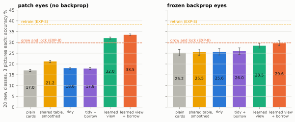
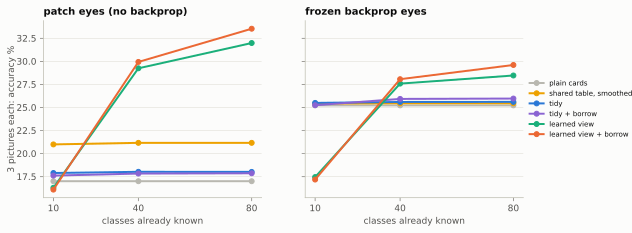
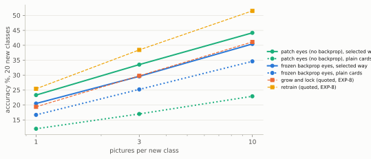
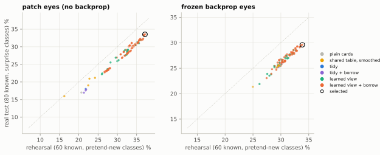
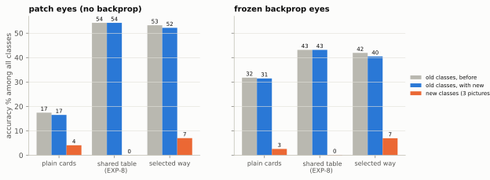

# EXP-9 · A NEW CLASS FROM A FEW PICTURES

**Experiment ID:** EXP-9 · **Part A written:** 2026-11-17, before any code was run · **Hardware:** free Kaggle GPU (the method must still fit the RTX 3050 laptop, 4 GB) · **Status:** COMPLETE. Run and Part B added 2026-11-17. Result: "works": patch eyes learn a new class from 3 pictures at 33.5%, against 29.8% for grow and lock (section 12)

This journal has two parts. **Part A** (this part) explains the experiment before it starts.
**Part B** will be added to the end of this same PDF when the experiment finishes. Part A
will not be edited after results exist, except for the status word in the line above.

## 1. Why this experiment

### What happened before

The project thinks of a learning system as two parts: the **eyes**, which turn a picture into
a list of numbers describing it, and the **memory**, which stores what was learned about
each class and gives the answer.

- **EXP-1** was a plan only. It was never run.
- **EXP-2 to EXP-6** used eyes trained by backpropagation and a simple memory: one **card**
  per class (the average description). The best system that keeps no old pictures (grow
  and lock) reached 39.6% on the 80-class photo test.
- **EXP-7** built eyes that need no training (1,600 fixed picture patches) and a richer
  memory: cards plus **one shared table** of how the numbers of a description vary together.
- **EXP-8** gave every kind of eyes the same memories. Its readings, 5 seeds (from
  `EXP-8-SAME-MEMORY/results/summary.json`):

| Eyes | All 80 classes, best memory | 20 never-seen classes from 3 pictures, best memory | Time to learn |
|---|---|---|---|
| **Patch eyes (no backprop)** | **55.2%** | **21.2%** | 24 s |
| Frozen backprop eyes | 44.1% | 25.6% | 24 s |
| Grow and lock | 43.7% | 29.8% | 127 s |
| Retrain everything (keeps all pictures) | 58.8% | 38.5% | 190 s |
| Retrain with its own answer layer (the ceiling) | 61.1% | | 190 s |

### What stayed open in EXP-8

The no-backprop system now meets two of the project's three goals: it forgets nothing, and
it is cheap (one look at each picture, 24 seconds). The third goal, **a new class from a
handful of pictures**, is not met. The same test at 1, 3 and 10 pictures per class:

| Eyes, best memory at each count | 1 picture | 3 pictures | 10 pictures |
|---|---|---|---|
| Patch eyes | 12.5% | 21.2% | 35.7% |
| Frozen backprop eyes | 17.2% | 25.6% | 37.8% |
| Grow and lock | 19.4% | 29.8% | 41.1% |
| Retrain everything | 25.4% | 38.5% | 51.5% |

No memory tried in EXP-8 changed this order. The papers read during EXP-8 (literature log,
section 8, read as passages) all say the same: learning from a few pictures depends on what
the eyes learned from labelled classes. Patch eyes learn nothing from labels.

But the **memory** of the patch system does hold labelled knowledge: the cards of 80
classes and the shared table. EXP-8 used that knowledge only to answer questions about
those 80 classes. It was never used to change how a **new** class is described.

### So EXP-9 asks

**Can what the memory already knows about 80 classes be turned, by single calculations
with no backpropagation, into a better way of learning a new class from 1 to 10 pictures?
And does knowing more classes make the next class easier to learn?**

# Part A: the plan (written before the run)

## 2. The idea in plain words

**Cats and digits example.** A child has learned cats, dogs and the ten digits from many
pictures. Now the child sees three pictures of a fox. A child with no experience would
compare every detail of the fox pictures: the grass behind it, the light, the exact pose.
Most of those details are accidents of those three pictures. A child with experience
knows, from cats and dogs, **which details usually tell animals apart** (ear shape, snout,
tail) and which do not (the background). It looks at the fox through that knowledge and
needs far fewer pictures.

The patch eyes are the child with no experience: 6,400 numbers per picture, all treated as
equally important. The memory, though, already contains the experience: from 80 learned
classes it can work out which combinations of numbers separate classes from one another.
EXP-9 tests three ways of using that, each a single calculation:

1. **Tidy the descriptions.** Take the square root of every number, subtract the average
   description of everything known so far, and scale each description to the same length.
   This removes what all pictures have in common, so that what is left is what differs.
2. **A learned view.** From the cards and the shared table, compute the handful of
   directions (at most 79 for 80 classes) along which the known classes differ most
   compared with how much pictures of one class vary. Describe every new picture by those
   directions only, instead of all 6,400 numbers. This is the "which details matter"
   knowledge. Nothing is trained; it is one calculation from tables the memory already keeps.
3. **Borrowing.** A card made from 3 pictures is shaky. Steady it by mixing in the cards
   of the two known classes it looks most like (a fox card leans a little on dog and cat).

## 3. What is run

### The eyes

| | Eyes | Built how |
|---|---|---|
| P | **Patch eyes** (the system under test) | exactly EXP-8's: 1,600 fixed patches from the first group, threshold 0.1, 6,400 numbers per picture, no backprop |
| F | **Frozen backprop eyes** (comparison) | exactly EXP-8's: a network trained on the first 10 classes, then never again, 576 numbers per picture |

Grow and lock (29.8%) and retraining (38.5%) are not rebuilt. Their EXP-8 scores are the
targets quoted in section 5.

### The ways of learning a new class

In every case a new class is stored as one card made from its few pictures, and a test
picture is given to the class whose card is nearest. What differs is how descriptions and
cards are prepared. Square roots are taken first in all of them, as in EXP-8.

| | Way | What it uses from the known classes | Settings tried |
|---|---|---|---|
| W0 | Plain cards, compared by angle (EXP-8's "cards after square root") | nothing | none |
| W1 | Shared table with heavy smoothing (EXP-8's best for patch eyes) | the shared table | smoothing 1, 10, 100, 1000 |
| W2 | Tidy: subtract the known average, scale to length 1 | the average description | none |
| W3 | **Learned view**, then tidy | cards and shared table | smoothing of the table 0.01, 0.1, 1, 10, 100; keep all directions or the stronger half; compare by angle or by straight distance |
| W2+B, W3+B | The same with **borrowing** from the 2 nearest known cards | also the known cards | weight of the borrowed part: 0.5, 1 or 2 pictures' worth |

### How settings are chosen without touching the test: a rehearsal

Several ways have settings, and choosing them on the surprise classes would be cheating.
So settings are chosen in a **rehearsal that uses no surprise class**:

- After stage 6 the memory knows 60 classes. The 20 classes of stages 7 and 8 have not
  been seen yet. They play the part of new classes: each is learned from 3 pictures and
  tested, with the memory as it stood after stage 6.
- For each way, the setting with the highest rehearsal score (mean of 5 seeds) is fixed.
  The **selected way** for each kind of eyes is the one with the highest rehearsal score.
- Those fixed settings are then used, unchanged, on the real surprise classes, for every
  number of pictures and every number of known classes.

A real system could do the same: it needs only the pictures of the classes arriving now.

### The test

Unchanged from EXP-3 to EXP-8: photos (CIFAR-100), 80 classes learned in 8 stages of 10,
old pictures thrown away after each stage, the same 20 surprise classes, 5 seeds with the
same class orders. Each surprise class is learned from 1, 3 or 10 pictures, drawn 20 times
at random; all 2,000 test pictures of the surprise classes are then sorted among the 20
surprise classes.

**New in EXP-9:**

- The surprise test is repeated with the memory as it stood after **stage 1 (10 known
  classes), stage 4 (40) and stage 8 (80)**.
- **One extra check, all 100 classes together.** After stage 8, the 20 surprise classes
  (3 pictures each) are added to the 80 learned classes and every test picture must be
  sorted among all 100. This shows whether a class learned from 3 pictures can hold its
  place next to classes learned from 500, and whether adding it harms them. It is run for
  the selected way and for EXP-8's shared-table memory (smoothing 0.01). It is reported,
  not judged.

**Settings fixed now.**

| Setting | Value |
|---|---|
| Rehearsal | memory after stage 6; stages 7 and 8 as pretend-new classes; 3 pictures each; 20 draws; mean of 5 seeds |
| Borrowing | 2 nearest known cards (nearest by the same comparison the way uses) |
| Smoothing | as in EXP-8: the value times the average of the table's diagonal |
| Pictures per new class | 1, 3, 10; 20 random draws each |
| Seeds | 5 |

## 4. What is measured

| | Measurement | Why it matters |
|---|---|---|
| S1 | 3-picture score on the 20 surprise classes, 80 known, for every way, on both eyes | The project's few-example goal, and which piece does the work |
| S2 | The same at 1 and 10 pictures | Whether a fix that helps at 3 pictures also helps at 1, and stops mattering at 10 |
| S3 | The same with 10, 40 and 80 known classes | Whether knowing more makes the next class easier. This is the property a growing system needs |
| S4 | Rehearsal score against real surprise score | Whether a rehearsal is a trustworthy way to pick settings |
| S5 | All 100 classes together: score on new-class pictures, on old-class pictures, and old classes with and without the new ones present | Whether few-picture classes live alongside well-learned ones |
| S6 | Time, GPU energy and peak GPU memory | Cost; the extra calculations should add seconds, not minutes |

## 5. How the result will be judged (written before the run)

All scores are means of 5 seeds on the 20 surprise classes. The fixed targets come from
EXP-8: patch eyes so far **21.2%**, frozen backprop eyes **25.6%**, grow and lock
**29.8%**, retrain **38.5%**, all from 3 pictures with 80 known classes.

**Step 0: are the earlier numbers rebuilt?** Within 2 points each, from 3 pictures: patch
eyes W0: 17.0%; patch eyes W1 at smoothing 100: 21.2%; frozen eyes W0: 25.2%.

**Step 1: the main verdict.** Patch eyes, selected way, 3 pictures, 80 known classes:

| Score | Verdict |
|---|---|
| 29.8% or more | **works**: no-backprop eyes learn a new class as well as the grown, trained eyes |
| 24.2% to 29.8% (a gain of 3 points or more) | **helps, but not enough** |
| under 24.2% | **does not work** |

**Step 2: does knowing more help?** Patch eyes, selected way, 3 pictures: the score with
80 known classes minus the score with 10 known classes. A rise of 3 points or more counts
as **yes**. (W0 uses nothing from the known classes, so it cannot rise.)

**Step 3: which piece does the work?** The ladder W0 → W2 → W3 → W3+B on patch eyes, each
at its rehearsal setting. A step counts if it adds 1.5 points or more.

**Step 4: do the same fixes help trained eyes?** Frozen backprop eyes, selected way,
against 25.6%: a gain of 3 points or more counts as **yes**.

**Step 5: can the rehearsal be trusted?** If the way selected in the rehearsal is also
the best, or within 1 point of the best, on the real surprise classes: **yes**.

**What I expect, written down now.**

- Tidy cards (W2) on patch eyes: about **19%**, a little better than plain cards (17.0%)
  and below the heavily smoothed table (21.2%).
- Learned view (W3): about **25%**. With borrowing about **26%**. So the verdict would be
  **"helps, but not enough"**: level with frozen backprop eyes, under grow and lock.
- 1 picture about 15%, 10 pictures about 38%.
- Knowing more helps: about 19% with 10 known classes, 25% with 80. **Yes.**
- Frozen backprop eyes: about 27% at best, a gain under 3. **No.**
- All 100 together: new classes from 3 pictures score low, about 12%; old classes lose
  about 2 points.
- The rehearsal will pick the right way.

My score predictions were right in EXP-8 for the main lines and wrong for grow and lock
and for the 3-picture memories. If any of this is wrong, it stays in the journal as written.

## 6. What carries over beyond pictures

| Part | Depends on pictures? |
|---|---|
| The two kinds of eyes | yes |
| Tidying, the learned view, borrowing | no. They work on any lists of numbers with class labels, whatever produced them |
| The rehearsal (pretend the newest classes are unknown, to choose settings) | no |
| The question "does knowing more classes make the next one easier?" | no. It is the question any system that keeps learning must answer, for words as much as for pictures |

## 7. What could go wrong

- **The papers suggest a limit.** No paper read shows eyes that learned nothing from labels
  matching trained eyes from a few pictures. The honest expectation is "less bad", and the
  rule in section 5 is written so that this counts as "helps, but not enough", not as success.
- **The learned view may fit the known classes too closely.** The directions that separate
  80 known classes need not separate a new one (ears and tails do not help with a
  bicycle). Stronger smoothing and keeping fewer directions are the guards; the rehearsal
  chooses among them.
- **With 10 known classes the learned view has only 9 directions.** It may then be worse
  than plain cards. That would be a finding about how much must be known before this pays.
- **Rehearsal and test may disagree.** The rehearsal has 60 known classes and other new
  classes. Step 5 checks this.
- **The test is 20 classes among themselves**, as in every earlier experiment. The
  100-class check (S5) is harder and is the more realistic one; it is reported but the
  verdict does not rest on it.
- **Many settings are tried** (20 for the learned view). They are chosen on classes that
  are not the test classes, which is the protection; small differences between settings
  should still not be read into.
- **The comparison targets are quoted, not rebuilt** (grow and lock 29.8%, retrain 38.5%).
  Step 0 checks that the parts that are rebuilt match EXP-8.
- **5 seeds, one dataset, images only.**

## 8. Time and disk

| | Expected |
|---|---|
| Run time | about 30 minutes on a free Kaggle GPU for all 5 seeds. From measured times per seed in EXP-8: patch eyes with tables 24 s, frozen eyes 24 s; the new calculations reuse the same tables. The weekly free allowance is about 30 hours, of which about 22 are used |
| Disk in this folder | about 0.15 GB for the Python environment (figures and PDF), plus under 0.05 GB of results and figures |
| Downloads to the laptop | the small Python environment only (about 0.15 GB, asked for before it is made). A short code check on the laptop borrows EXP-2's environment and CIFAR-100 without changing them |
| GPU memory | EXP-8 used 5.6 GB for patch eyes because all descriptions were held on the GPU. This code will hold them in ordinary memory and send them to the GPU in pieces, aiming to stay under 4 GB. The peak will be reported; if it is over 4 GB, Part B will say so |

## 9. Words used in this journal

| Word | Meaning here |
|---|---|
| Class | One kind of thing to recognise |
| Eyes (features) | The part that turns a picture into a list of numbers |
| Description | The list of numbers the eyes give for one picture |
| Memory | The part that stores what was learned about each class and gives the answer |
| Card | The average description of one class |
| Shared table (covariance) | A table recording which numbers of a description tend to rise and fall together inside a class, kept as a running sum |
| Smoothing | How strongly the shared table is evened out before use. More smoothing trusts the table less |
| Known classes | The classes the memory has already learned from many pictures (10, 40 or 80 of them) |
| Surprise classes | 20 classes never used to build anything, learned from 1, 3 or 10 pictures each |
| Tidy | Square root, subtract the average description of the known classes, scale to length 1 |
| Direction | A fixed recipe for combining the numbers of a description into one new number |
| Learned view (discriminant directions) | The few directions along which known classes differ most, relative to how much pictures of one class vary. Computed in one step from the cards and the shared table |
| Borrowing | Mixing the cards of the nearest known classes into a new class's card |
| Rehearsal | Choosing settings by pretending the most recent known classes are new. Uses no surprise class |
| Backpropagation | The usual way to train a network: measure the error and push corrections back through all layers, many times |
| Grow and lock | Add units for each new group of classes; never change old units (EXP-3 to EXP-6) |
| Seed | One repeat with a different random shuffle |

# Part B: the readings (added after the run, 2026-11-17)

Part A above was not changed after the run, except the one status line at the top of page 1.

## 10. What was actually run

The plan in section 3 was run once, on a free Kaggle GPU (Tesla T4), as a private job named
`exp9-few-pictures`. It took **28.5 minutes**, of which about 20 were Kaggle downloading the
photo dataset slowly (visible in `results/kaggle_run.log`); the experiment itself took about
8 minutes for all 5 seeds. The result files were downloaded into `results/`: `runs.jsonl`
(4,510 lines, one per way, setting, seed and test), `meta.json` and `kaggle_run.log`. There
were no errors. `src/figures.py` turned `runs.jsonl` into `results/summary.json` and the
figures. **Every number below comes from `results/summary.json`**: mean of 5 seeds, with the
spread between seeds where useful.

**Things that differ from Part A, or that the code had to fix:**

| Item | What was done |
|---|---|
| Small code checks before the run | A tiny trial (1 pass, a tenth of the data, 1 seed) was run on the laptop twice, borrowing EXP-2's Python environment and CIFAR-100 (read only): once with small patch eyes, once with the full 1,600 patches to measure GPU memory. Neither is a result |
| Choosing settings | Every setting of every way was run and logged; the choosing was done afterwards from the rehearsal rows only, exactly by the rule in section 3. This gives the same choice as choosing during the run, and lets every setting be shown (figure 4) |
| Known cards in the 100-class check | For the learned view and tidy ways, the card of a known class is its average description passed through the view (from the tables), not the average of each picture's view. No pictures are kept, so the second is not available |
| 100-class check | uses 5 of the 20 draws, and all 10,000 test pictures of the 100 classes (not only the exam half), because nothing is chosen on it |
| Rehearsal draws | a separate random stream from the surprise draws, so the two never share a draw |
| GPU memory | descriptions were made 50 pictures at a time (100 in EXP-8), and the smoothed tables one at a time |
| Python environment | this folder's own `.venv` (146 MB) was made after the owner approved it, for the figures and the PDF. Part A's PDF was rendered with EXP-8's environment before that |

Nothing in sections 1 to 9 was changed.

## 11. The readings

### 11.1 Step 0: are the earlier numbers rebuilt? Yes, exactly

| From 3 pictures, 80 known | EXP-8 | EXP-9 |
|---|---|---|
| Patch eyes, plain cards (W0) | 17.0 | 17.0 |
| Patch eyes, shared table at smoothing 100 (W1) | 21.2 | 21.2 |
| Frozen eyes, plain cards (W0) | 25.2 | 25.2 |

The same pictures were drawn as in EXP-8, so these match to the decimal.

### 11.2 Every way, 3 pictures, 80 known classes

*Figure 1. 20 never-seen classes, each learned from 3 pictures, after 80 classes are known.
Each bar is the way at the setting chosen in the rehearsal. Dashed lines: the EXP-8 scores of
grow and lock (29.8%) and of the retrained network (38.5%), quoted, not rebuilt.*

| Way | Setting chosen in the rehearsal | Patch eyes | Frozen backprop eyes |
|---|---|---|---|
| W0 plain cards | – | 17.0 | 25.2 |
| W1 shared table, smoothed | smoothing 100 | 21.2 | 25.5 |
| W2 tidy | – | 18.0 | 25.6 |
| W2+B tidy + borrowing | weight 0.5 | 17.9 | 26.0 |
| W3 learned view | P: smoothing 0.1; F: 1. All directions, by angle | 32.0 | 28.5 |
| **W3+B learned view + borrowing** (selected for both eyes) | as W3, weight 1 picture | **33.5 ± 0.5** | **29.6 ± 1.1** |
| *EXP-8's shared table at smoothing 0.01 (reference)* | | *8.2* | *14.2* |

Among the learned-view settings, comparing by angle beat comparing by straight distance in
every case (by 2 to 3 points), and moderate smoothing (0.1 or 1) was best; smoothing 100 lost
about 8 points on patch eyes.

### 11.3 Does knowing more classes help?

*Figure 2. The same 3-picture test with the memory as it stood after 10, 40 and 80 known
classes.*

| Patch eyes, 3 pictures | 10 known | 40 known | 80 known |
|---|---|---|---|
| W0 plain cards | 17.0 | 17.0 | 17.0 |
| W1 shared table | 21.0 | 21.2 | 21.2 |
| W3 learned view | 16.3 | 29.3 | 32.0 |
| W3+B learned view + borrowing | 16.1 | 29.9 | 33.5 |

With 10 known classes the learned view has only 9 directions and is slightly **worse** than
plain cards. With 40 it is already 12 points better. From 40 to 80 it gains another 3.6.
Frozen backprop eyes show the same shape, smaller: 17.2, 28.1, 29.6.

### 11.4 Number of pictures

*Figure 3. 80 known classes. Grow and lock and retrain are quoted from EXP-8 (best memory).*

| 80 known | 1 picture | 3 pictures | 10 pictures |
|---|---|---|---|
| Patch eyes, plain cards | 12.1 | 17.0 | 22.9 |
| **Patch eyes, learned view + borrowing** | **23.3** | **33.5** | **44.2** |
| Frozen eyes, plain cards | 16.7 | 25.2 | 34.6 |
| Frozen eyes, learned view + borrowing | 20.5 | 29.6 | 40.5 |
| Grow and lock (EXP-8, quoted) | 19.4 | 29.8 | 41.1 |
| Retrain (EXP-8, quoted; keeps all pictures) | 25.4 | 38.5 | 51.5 |

The gain holds at every number of pictures. Patch eyes are now second only to the retrained
network: about 2 points under it from 1 picture, and 5 to 7 points under it from 3 or 10.

### 11.5 Can the rehearsal be trusted?

*Figure 4. Each dot is one setting of one way: its rehearsal score (60 known, the classes of
stages 7 and 8 as pretend-new) against its real score (80 known, the 20 surprise classes).
The circled dot is the selected one.*

The rehearsal scores are 3 to 4 points higher than the real ones (the pretend-new classes
are apparently easier), but the order is almost the same. The setting picked in the
rehearsal is also the best of all settings on the real test, for both kinds of eyes.

### 11.6 All 100 classes together

*Figure 5. After stage 8 the 20 surprise classes, 3 pictures each, join the 80 known
classes. Grey: known classes' pictures sorted among the 80 known classes only. Blue: the
same pictures sorted among all 100. Red: the new classes' pictures sorted among all 100.*

| Patch eyes | Known classes, among 80 | Known classes, among 100 | New classes, among 100 |
|---|---|---|---|
| Plain cards | 17.5 | 16.6 | 4.1 |
| EXP-8's shared table (smoothing 0.01) | 54.2 | 54.2 | **0.05** |
| Learned view + borrowing (selected) | 53.3 | 52.2 | 7.1 |

Two things show here. First, **one memory now does both jobs**: the learned view scores the
80 known classes at 53.3%, close to EXP-8's shared table (54.2% on the same pictures), while
also being the best way for new classes. Second, **classes learned from 3 pictures cannot yet
hold their place among classes learned from 500**: only 7.1% of their pictures are named
correctly among 100 (chance is 1%). The shared table of EXP-8 ignores them almost entirely
(0.05%). Adding them costs the known classes about 1 point.

### 11.7 Cost

| Per seed, Kaggle T4 | Patch eyes | Frozen backprop eyes |
|---|---|---|
| Building or training the eyes | 0.3 s | 23 s |
| Describing every picture once | 15 s | 4 s |
| Filling the tables | 13 s | 0.3 s |
| Testing every setting of every way at 4 points in time | 36 s | 1.7 s |
| GPU energy, everything above | 0.69 Wh | 0.27 Wh |
| **Peak GPU memory** | **2.9 GB** | 1.0 GB |

The testing time covers every setting of every way; one chosen way is a small part of it.
Patch eyes now fit the laptop's 4 GB (5.6 GB in EXP-8).

## 12. The verdict, by the rule written in section 5

| Step | Reading | Result |
|---|---|---|
| 0. Rebuild | 17.0, 21.2, 25.2 against 17.0, 21.2, 25.2 | passed |
| **1. Main verdict** | patch eyes, learned view + borrowing, 3 pictures, 80 known: **33.5%** (29.8% needed) | **works** |
| 2. Does knowing more help? | 16.1% with 10 known, 33.5% with 80: a rise of 17.4 (3 needed) | **yes** |
| 3. Which piece does the work? | W0 → W2: +1.0 (does not count); W2 → W3: **+14.0**; W3 → W3+B: +1.6 (counts, just) | the learned view |
| 4. Do the fixes help trained eyes? | frozen eyes 29.6% against 25.6%: +4.0 (3 needed) | **yes** |
| 5. Can the rehearsal be trusted? | selected way is also the best on the real test, for both eyes | **yes** |

## 13. Was the expectation in section 5 right?

| What I wrote before the run | What happened | |
|---|---|---|
| Tidy cards about 19% | 18.0% | close |
| Learned view about 25%, with borrowing about 26% | 32.0%, 33.5% | **too low by 7 points** |
| Verdict "helps, but not enough" | "works" | **wrong** |
| 1 picture about 15%, 10 pictures about 38% | 23.3%, 44.2% | too low |
| Knowing more helps: about 19% with 10 known, 25% with 80 | 16.1%, 33.5% | right in direction; the rise is larger |
| Frozen eyes: about 27% at best, gain under 3, "no" | 29.6%, gain 4.0, "yes" | wrong |
| All 100 together: new classes about 12%, known classes lose about 2 | 7.1%, known lose 1.1 | new classes worse than expected |
| The rehearsal picks the right way | it did | right |

The papers read before (literature log, section 8) led me to expect a modest gain, because
the one paper with hand-made features found them nearly useless from 1 picture. The gain
here is much larger. A possible reason, not tested: the patch descriptions are very long
(6,400 numbers) and the view cuts them to 79, removing most of the noise that makes a
3-picture card shaky.

## 14. What it means for the project

**1. For the first time, one system meets all three goals on this test.** Patch eyes with
the shared-table memory and the learned view:

- **No forgetting**, by construction (EXP-7, EXP-8): nothing learned is ever overwritten.
- **Cheap**: no backpropagation, one look at each picture, about a minute per seed on the
  Kaggle GPU including all the tests, under 3 GB of GPU memory.
- **A new class from a handful of pictures**: 33.5% from 3 pictures among 20 new classes,
  better than any system in this project that keeps no old pictures (grow and lock 29.8%,
  frozen backprop eyes 25.6%), and 5 points under a network retrained on everything (38.5%).

**2. The few-picture ability came from the memory, not the eyes.** The eyes are the same as
in EXP-8 and have learned nothing from labels. What changed is that the memory's knowledge
of 80 classes (their averages and the shared table) was turned, in one calculation, into a
view of which combinations of numbers matter. EXP-8 concluded that few-picture ability
"sits in the eyes". That was true for the memories tried then; it is not true in general.

**3. Knowing more makes the next class easier.** With 10 known classes the view does not
help; with 40 it adds 12 points; with 80 it adds 16. This is the property a system that keeps
learning needs: each class learned makes the next one cheaper to learn. Nothing in the
earlier experiments had it (plain cards stay at 17.0% however much is known).

**4. Tidying and borrowing are small.** Subtracting the average and scaling added 1 point;
borrowing from the 2 nearest known classes added 1.6. The large step is the learned view.

**5. The open problem has moved.** A new class from 3 pictures is recognised well **among
other new classes**, but among 100 classes it is named correctly for only 7% of its pictures,
because classes learned from 500 pictures take most of the answers. Real use is the mixed
case. This is the next thing to fix.

## 15. What is still unverified

- **The mixed case.** The headline 33.5% is among the 20 new classes only, as in every
  earlier experiment. Among all 100 classes the new ones score 7.1%. Whether a simple
  correction (for example a starting score for each class that depends on how many
  pictures it was learned from) can lift this without harming old classes is untested.
- **Whether the view keeps improving after 80 classes.** Only 10, 40 and 80 known classes
  were tried; the rise slows between 40 and 80.
- **Whether new classes should be added to the view.** Here the view is recomputed from the
  tables at each test point (one calculation, no pictures). A class learned from 3 pictures
  is never added to it; whether it should be is untested.
- **Why the gain is much larger than the literature suggested** (section 13). Not tested.
- **The comparison targets are quoted** (grow and lock, retrain), from the same test in
  EXP-8 with the same draws of pictures. They were not rebuilt.
- **The test classes are fixed** (the same 20 surprise classes for every seed). Other new
  classes might be easier or harder; the rehearsal on other classes gave a similar order.
- **Energy** is GPU-only, as before. 5 seeds, one dataset, images only.

## 16. What carries over beyond pictures

| Part | Depends on pictures? |
|---|---|
| Patch eyes | yes |
| The learned view (directions that separate known classes, from the class averages and the shared table) | **no**. It needs only lists of numbers with class labels |
| Borrowing from the nearest known classes | no |
| The rehearsal (pretend the newest classes are unknown, to choose settings) | no |
| "Each class learned makes the next one easier" | no. It is a property of the memory, not the eyes |

This is the first result in the project where the part doing the work is the part meant to
carry over to language.

## 17. What the next experiment should be, and why

**Proposed EXP-10: new classes among old ones.**

Why: EXP-9 makes a new class learnable from 3 pictures, but only when it competes with
other new classes. Among all 100 classes the new ones are named correctly for 7% of their
pictures, while classes learned from 500 pictures keep about 52%. A real system meets every
new class in the company of everything it already knows. Until this works, the few-picture
result cannot be used.

What it should contain, all closed-form, on EXP-9's system (patch eyes, learned view,
borrowing):

1. **Fair scores for classes of different experience.** A card from 3 pictures is less
   certain than one from 500. Give each class an allowance that depends on how many
   pictures it was learned from, with its strength chosen in a rehearsal as in EXP-9. A
   literature pass by a subagent should first check how published work handles this.
2. **Add new classes to the view.** After a new class is learned, recompute the view with
   its pictures included, and see whether this helps it or harms the others.
3. **The full stream.** Instead of 80 classes from 500 pictures and then 20 from 3, let the
   later classes arrive with few pictures, so the test matches the project's goal from
   start to end.
4. Report the new-class score, the old-class score and their balance, each among all
   classes, and keep the 20-new-class score as a link back to EXP-9.

Separately, later: the cheap improvements to the patch eyes (mirrored copies, positive and
negative parts, finer regions), which could raise every number here.

This is a proposal. It needs its own Part A before any code is run.
